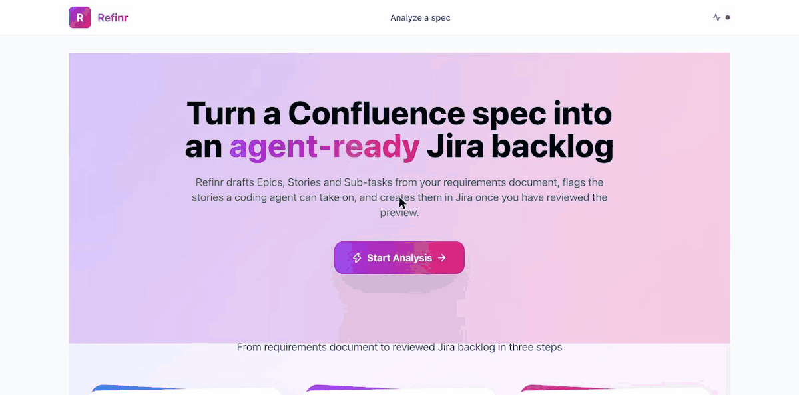
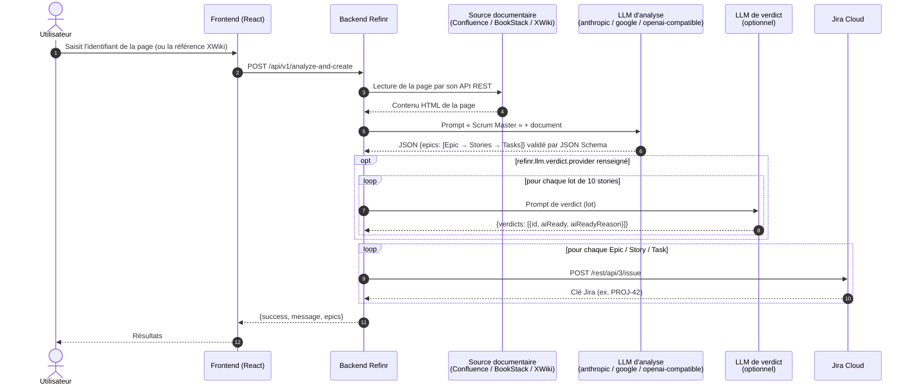
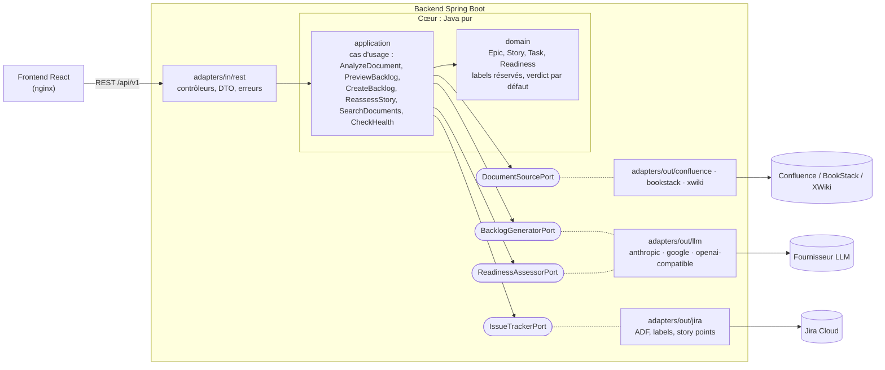

<div align="center">

# 📄 ➜ 🎯 Refinr

**Refinr transforme une spec Confluence, BookStack ou XWiki en backlog Jira ou OpenProject (Epic → Story → Sous-tâche) et indique, story par story, si un agent de code peut l'implémenter sans décision humaine.**

[English](README.md) · **Français**

Epics · User Stories · Sous-tâches · Critères d'acceptation · Story points · Verdict « prêt pour un agent de code »


[](LICENSE)

</div>

<p align="center">
  
</p>

---

## 🤔 Pourquoi

Les agents de code savent implémenter une story… quand elle est claire. Le vrai goulot d'étranglement est en amont :
savoir **quelles** stories peuvent leur être confiées sans aller-retour avec un humain.

Refinr ne se contente pas de découper une spec en tickets : il juge chaque story et pose un label **`ai-ready`**
(périmètre clair, critères testables, aucune dépendance externe non précisée) ou **`validation-necessaire`**
(il manque une décision, avec la raison). Le verdict est **recalculé sur le contenu final** au moment de la création,
et un doute vaut toujours `validation-necessaire`. Résultat : une file prête pour vos agents, en une requête JQL
`labels = "ai-ready"`, et une liste précise de questions pour le Product Owner sur le reste.

## ⚡ Démarrage rapide (Docker)

```bash
git clone https://github.com/chams-bensalem/refinr.git && cd refinr
cp .env.example .env    # renseignez la source documentaire, le gestionnaire de tickets et le fournisseur IA
docker compose up -d --build   # UI http://localhost:3000 · API http://localhost:8080
```

Ollama tourne sur votre machine ? Dans `.env`, mettez `LLM_ANALYSIS_BASE_URL=http://host.docker.internal:11434/v1`
(dans un conteneur, `localhost` désigne le conteneur lui-même). Puis `curl localhost:8080/api/v1/health`.
Ollama inclus en option : `docker compose --profile ollama up -d --build`
(avec `LLM_ANALYSIS_BASE_URL=http://ollama:11434/v1`). Détails : [Avec Docker Compose](#avec-docker-compose).

## 🔌 Fournisseurs IA

| Fournisseur | `provider` | Statut |
|---|---|---|
| Ollama (local, défaut : `qwen3:8b`) | `openai-compatible` | ✅ testé en réel |
| Google Gemini (`gemini-3.6-flash`) | `google` | ✅ testé en réel |
| Anthropic Claude | `anthropic` | ⚠️ non testé en réel (serveur HTTP simulé uniquement) |
| OpenAI | `openai-compatible` | ⚠️ non testé en réel (serveur HTTP simulé uniquement) |
| DeepSeek, Mistral, Groq, OpenRouter, LiteLLM, vLLM | `openai-compatible` | ⚠️ non testé en réel (même client que OpenAI / Ollama) |

« Testé en réel » = analyse et verdict exécutés contre la véritable API. Chaque client est par ailleurs couvert par
des tests sur serveur HTTP simulé (succès, `401`, `429` + nouvel essai, JSON invalide + relance, délai dépassé).
Un retour sur un fournisseur non testé est bienvenu : voir [CONTRIBUTING.md](CONTRIBUTING.md).

---

## 📚 Sommaire

- [Pourquoi](#-pourquoi)
- [Démarrage rapide (Docker)](#-démarrage-rapide-docker)
- [Fournisseurs IA](#-fournisseurs-ia)
- [Présentation](#-présentation)
- [Fonctionnalités](#-fonctionnalités)
- [Mode de fonctionnement](#️-mode-de-fonctionnement)
- [Architecture du projet](#-architecture-du-projet)
- [Prérequis](#-prérequis)
- [Installation](#️-installation)
- [Configuration & connexion aux services](#-configuration--connexion-aux-services)
- [Lancer l'application](#️-lancer-lapplication)
- [Utilisation](#-utilisation)
- [Intégrations](#-intégrations)
- [Référence de l'API](#-référence-de-lapi)
- [Modèle de données](#️-modèle-de-données)
- [Tests](#-tests)
- [Dépannage](#-dépannage)
- [Limites connues & feuille de route](#️-limites-connues--feuille-de-route)
- [Contribuer](#-contribuer)
- [Licence](#-licence)

---

## ✨ Présentation

**Refinr** lit une page Confluence (cahier des charges, spécification, besoin rapide…), la fait analyser par un LLM jouant le rôle de **Scrum Master / Product Owner**, puis crée automatiquement toute la hiérarchie correspondante dans un projet Jira :

```
Epic  ──►  User Story  ──►  Sous-tâche
```

Chaque story reçoit en plus un **verdict de maturité** : `ai-ready` (un agent de code peut l'implémenter sans décision humaine) ou `validation-necessaire` (il manque une information). Ce verdict est conçu pour alimenter un agent de code via JQL `labels = "ai-ready"` (dans OpenProject : filtre des lots de travaux sur *Agent readiness* = `ai-ready`, à enregistrer pour l'agent).

Le projet est un monorepo :

| Dossier | Rôle | Stack |
|---|---|---|
| [`backend/`](backend) | API backend | Java 25 · Spring Boot 4.1 · WebClient · Spring Resilience (`@Retryable`) |
| [`frontend/`](frontend) | Interface web | React 18 · TypeScript · Vite · Tailwind · TanStack Query |

---

## 🚀 Fonctionnalités

### Analyse IA du cahier des charges
- 🔌 **Fournisseurs au choix**, configurés séparément pour l'analyse et le verdict : `anthropic` (Claude — ⚠️ *non testé en conditions réelles* : seuls des tests sur serveur HTTP simulé existent, aucun appel à l'API Anthropic n'a encore été fait), `google` (Gemini) ou `openai-compatible` (OpenAI — ⚠️ *non testé en conditions réelles*, comme `anthropic` —, DeepSeek, Mistral, Groq, OpenRouter, Ollama, LiteLLM, vLLM…).
- 📐 **Sortie validée par JSON Schema** (mode JSON natif du fournisseur quand il existe) ; sortie invalide ⇒ jusqu'à 2 relances avec la liste des erreurs, puis erreur `502` propre. Sortie tronquée par la limite de tokens ⇒ erreur explicite, sans relance. Fournisseur indisponible (après les nouveaux essais) ⇒ `502`.
- 🚫 **Document vide refusé** : une page sans texte utile (vide, balises vides, images seules) donne un `400` explicite, sans appel à l'IA.
- 📖 **Sources documentaires** (une par instance, `source.provider`) : **Confluence Cloud** (défaut), **BookStack** et
  **XWiki** (v1.2). La page est lue en HTML (inclusions BookStack et macros XWiki comme `{{include}}` / `{{code}}`
  développées) avec un compte dédié en lecture seule ; recherche par titre dans toute la source ou dans un espace /
  livre (`GET /api/v1/documents/search`) ; lien vers le document analysé dans l'aperçu (cf. [Sources documentaires](#sources-documentaires)).
- 🧠 **Découpage Scrum proportionné** : 1 Epic pour un besoin court, un Epic par module pour un cahier des charges complet — sans jamais inventer de fonctionnalités absentes du document.
- 📝 **User stories normalisées** : format *As a / I want / So that*, titre, description.
- ✅ **Critères d'acceptation testables** au format *Given / When / Then* (2 à 5 par story).
- 🔢 **Estimation en story points** (suite de Fibonacci : 1, 2, 3, 5, 8, 13) et heures estimées par tâche.
- 🏷️ **Priorités et labels techniques** (`backend`, `frontend`, `api`, `security`, `devops`…), nettoyés et normalisés automatiquement.

### Verdict « prêt pour un agent de code »
- 🤖 Chaque story est évaluée : `aiReady = true` **uniquement** si le périmètre est clair, les critères testables et sans dépendance externe non précisée.
- 🔀 Le verdict peut être confié à un **fournisseur IA distinct** de l'analyse (ex. structure par Ollama local, verdict par Gemini, Claude ou un proxy LiteLLM).
- 🛡️ **Sécurité par défaut** : verdict absent, ambigu ou en erreur ⇒ `validation-necessaire`.
- ♻️ **Verdict recalculé à la création** (`create-jira`) : le contenu a pu être modifié depuis l'aperçu, le serveur rejuge donc chaque story sur son contenu final (par lots de `refinr.llm.verdict.batch-size` stories, 10 par défaut ; les stories inchangées depuis l'aperçu reprennent leur verdict en cache) ; les champs `aiReady` / `aiReadyReason` envoyés par le client sont **ignorés**.
- 🔁 **Réévaluation** : une story en attente peut être réévaluée avec une précision de l'utilisateur ; la description Jira d'origine est conservée (images, tableaux, liens) et complétée, le label est mis à jour.

### Création des tickets (Jira ou OpenProject)
- 🟦 **OpenProject** (v1.1) à la place de Jira avec `tracker.provider=openproject` : même hiérarchie, verdict dans un
  champ personnalisé de type liste, story points sur les User stories, réévaluation en commentaire (cf. [OpenProject](#openproject)).
- 🏗️ Création complète Epic → Story (liée via `parent`) → Subtask.
- 📝 Descriptions écrites en Markdown et converties en **ADF** (titres, gras, italique, listes, code en ligne et blocs de code) : rendu natif dans Jira, critères d'acceptation en liste.
- 🎯 Projet cible **configurable par requête** (`projectKey`) ou projet par défaut.
- ⚙️ Compatible projets **team-managed** (sans champ *priority*) via `jira.priority-enabled=false`.
- 🔢 **Story points** envoyés dans le champ configuré par `jira.story-points-field` (désactivé si vide). L'identifiant dépend de l'instance : `GET /rest/api/3/field`, champ nommé *Story point estimate* (team-managed) ou *Story Points* (company-managed), souvent `customfield_10016`. Le champ doit figurer sur l'écran de création des stories.
- 👀 **Mode prévisualisation** : générer la structure sans rien créer, l'ajuster, puis l'envoyer à Jira.

### Fiabilité & observabilité
- 🔄 **Nouveaux essais ciblés** (lectures et appels IA uniquement) ; la création Jira n'est **jamais** rejouée, pour ne pas créer de doublons :

  | Appel | Nouvel essai | Détail |
  |---|---|---|
  | Lecture d'une page Confluence | ✅ sur HTTP `429` et `500` | 2 nouveaux essais, après 1 s puis 2 s (`503` et autres erreurs : pas de nouvel essai) |
  | Lecture et recherche BookStack / XWiki | ✅ sur HTTP `429` et `5xx` | 2 nouveaux essais, après 1 s puis 2 s ; délai de 30 s par appel |
  | Appels IA (analyse, verdict, réévaluation), tous fournisseurs | ✅ sur HTTP `429`, `5xx` (dont `503` de Gemini et `529` d'Anthropic) et fournisseur injoignable | 2 nouveaux essais, `Retry-After` prioritaire (plafonné à 30 s), sinon 2 s puis 8 s à ± 20 % près (configurable : `refinr.llm.*.max-retries`, `retry-base-delay`, `retry-multiplier`, `retry-jitter`, `retry-max-delay`) ; jamais après un délai dépassé (`timeout` : 300 s analyse, 90 s verdict) ni sur une autre erreur `4xx` (`401` : clé refusée) |
  | Sortie IA invalide (JSON illisible ou non conforme au schéma) | ✅ relance **avec la liste des erreurs** | `refinr.llm.max-repair-attempts` (2) relances, puis `502` (`create-jira` : `validation-necessaire`) |
  | Sortie IA tronquée (limite de tokens) | ❌ | erreur explicite `502` : augmenter `max-output-tokens` |
  | Recherche Confluence | ❌ | |
  | **Création Jira** (Epic, Story, Subtask) | ❌ | POST non idempotent : un échec est listé dans la réponse partielle (`created` / `failed`, statut `207` ou `502`), les autres éléments sont créés ; relancez seulement ce qui a échoué |
  | Lecture / mise à jour Jira (`reassess-story`), health check | ❌ | |
- 🩺 **Health check par port** : état de la source documentaire active (Confluence, BookStack ou XWiki), du gestionnaire de tickets actif (Jira ou OpenProject) et de chaque fournisseur IA (clé et modèle vérifiés par une lecture gratuite, présence du modèle Ollama incluse), mis en cache 45 s, sans aucune clé ni URL dans la réponse.
- 📊 **Logs JSON structurés** (Logstash) avec `correlationId` par requête.

### Interface web
- 🏠 Page d'accueil, page **Analyze** (saisie de l'identifiant de la page, avec le libellé et l'aide de la source active, aperçu Epics > Stories > Sous-tâches avec le verdict de chaque story et sa raison, puis création sur confirmation), page **Results** (compteurs Epics / Stories / Subtasks, tickets créés et, en cas de création partielle, éléments non créés avec leur raison).
- 🟢 Indicateurs d'état des services dans l'en-tête.

---

## ⚙️ Mode de fonctionnement



**En résumé :**

1. **Lecture** — le backend récupère la page dans la source active, en HTML : format *storage* de Confluence (token
   API Atlassian), HTML de la page BookStack (jeton d'API) ou HTML rendu par XWiki (compte technique).
2. **Analyse** — le contenu est injecté dans un prompt structuré ; le LLM répond en JSON (mode JSON natif du fournisseur), validé par un JSON Schema ; une sortie invalide est relancée avec la liste des erreurs.
3. **Verdict** — soit inclus dans l'analyse, soit calculé par un fournisseur dédié, par lots de stories (un appel par lot, verdicts en cache par contenu de story).
4. **Création** — chaque Epic, Story puis Sous-tâche est créée dans Jira ; la description est convertie en ADF (Atlassian Document Format) et la story reçoit le label `ai-ready` ou `validation-necessaire`.
5. **Réévaluation** (cycle de vie) — `POST /reassess-story` relit une story Jira en `validation-necessaire`, la réévalue avec la précision fournie et met à jour description + label.

---

## 🧱 Architecture du projet

Architecture **hexagonale** (ports & adaptateurs) : le domaine et les cas d'usage sont en Java pur, sans Spring ni
client HTTP (règles vérifiées par ArchUnit) ; chaque service externe est derrière un port.



```
refinr/
├── .env.example                             # Modèle des secrets locaux (à copier en .env)
└── backend/
    ├── pom.xml
    └── src/
        ├── main/
        │   ├── java/fr/heliocraft/refinr/
        │   │   ├── RefinrApplication.java           # Point d'entrée Spring Boot
        │   │   ├── domain/
        │   │   │   ├── model/                       # Epic, Story, Task, Readiness, TrackedStory (Java pur)
        │   │   │   └── service/                     # Règles : labels réservés, verdict par défaut, normalisation
        │   │   ├── application/
        │   │   │   ├── port/in/                     # AnalyzeDocument, PreviewBacklog, CreateBacklog, ReassessStory, SearchDocuments, CheckHealth
        │   │   │   ├── port/out/                    # DocumentSourcePort, IssueTrackerPort, BacklogGeneratorPort, ReadinessAssessorPort
        │   │   │   └── service/                     # Implémentation des cas d'usage
        │   │   ├── adapters/
        │   │   │   ├── in/rest/                     # BacklogController (/api/v1/*), HealthCheckController, DTO JSON
        │   │   │   └── out/
        │   │   │       ├── confluence/              # ConfluenceDocumentSource
        │   │   │       ├── bookstack/               # BookStackDocumentSource (v1.2)
        │   │   │       ├── xwiki/                   # XWikiDocumentSource (v1.2)
        │   │   │       ├── jira/                    # JiraIssueTracker : labels, priorité, ADF, réévaluation
        │   │   │       └── llm/                     # Clients anthropic / google / openai-compatible, analyse, verdict par lots, cache, JSON Schema
        │   │   └── config/                          # Câblage des cas d'usage et des fournisseurs LLM, Retry, LoggingFilter (correlationId)
        │   └── resources/
        │       ├── application-example.properties   # Modèle de configuration (à copier)
        │       ├── llm/schemas/                     # JSON Schema des sorties IA (backlog, verdict, verdicts par lot)
        │       ├── application.properties           # Copie locale du modèle — ignorée par Git
        │       └── logback-spring.xml               # Logs JSON
        └── test/                                    # Tests unitaires + intégration (MockWebServer)
```

---

## 📋 Prérequis

### Logiciels

| Outil | Version | Usage |
|---|---|---|
| **JDK** | 25 | Backend |
| **Maven** | 3.9+ | Build backend |
| **Node.js** + npm | 22.12+ (référence : `.nvmrc`) | Frontend |
| **Docker** + Compose v2 | récent | Optionnel : lancer toute la stack sans JDK ni Node (`docker compose up`) |
| **Ollama** | récent | Analyse IA locale (fournisseur par défaut, via son API compatible OpenAI `/v1`) |
| Autre fournisseur IA | optionnel | Clé Anthropic, Google AI Studio ou d'une API compatible OpenAI (OpenAI, DeepSeek, Mistral, Groq, OpenRouter, LiteLLM, vLLM…) |

### Comptes & accès

- Une **source documentaire** : Confluence Cloud avec un **token API Atlassian**
  (<https://id.atlassian.com/manage-profile/security/api-tokens>), BookStack (jeton d'API d'un compte dédié) ou XWiki
  (compte technique dédié) — cf. [Sources documentaires](#sources-documentaires).
- Un **gestionnaire de tickets** : Jira Cloud (droits de **création de tickets** dans le projet) ou OpenProject
  (cf. [OpenProject](#openproject)).
- Le projet Jira doit proposer les types de tickets **`Epic`**, **`Story`** et **`Subtask`**.
- *(Fournisseur `google`)* une clé **Google AI Studio** : <https://aistudio.google.com/apikey> ; *(fournisseur `anthropic`, non testé en conditions réelles)* une clé API Anthropic.

### Matériel (mode Ollama)

Le modèle par défaut `qwen3:8b` nécessite environ **8 Go de RAM/VRAM libres**. Sur une machine plus modeste, choisissez un modèle plus léger ou un fournisseur en ligne (`google`, `anthropic`, `openai-compatible`).

---

## 🛠️ Installation

### 1. Cloner le dépôt

```bash
git clone https://github.com/chams-bensalem/refinr.git
cd refinr
git config core.hooksPath .githooks   # active les hooks pre-commit (gitleaks) et commit-msg
```

### 2. Préparer l'IA locale (Ollama)

```bash
# macOS
brew install ollama
ollama serve            # démarre le serveur sur http://localhost:11434
ollama pull qwen3:8b    # télécharge le modèle par défaut
```

Refinr appelle Ollama par son API compatible OpenAI (`http://localhost:11434/v1`). Gardez
`LLM_ANALYSIS_REASONING_EFFORT=none` (valeur de `.env.example`) : sans cela, `qwen3` « réfléchit » avant de répondre et
l'analyse peut dépasser le délai. Sur une machine modeste (quelques tokens/s), augmentez `LLM_ANALYSIS_TIMEOUT`
(ex. `30m`).

### 3. Installer le frontend

```bash
cd frontend
npm install
```

---

## 🔐 Configuration & connexion aux services

### Backend

Les secrets vivent **uniquement** dans le fichier `.env` à la racine du dépôt (ignoré par Git).
Copiez les deux modèles puis renseignez vos valeurs dans `.env` :

```bash
cp .env.example .env
cp backend/src/main/resources/application-example.properties backend/src/main/resources/application.properties
```

`application.properties` ne contient que des références `${VAR:défaut}` et importe `.env`
(`spring.config.import=optional:file:../.env[.properties]`). Une vraie variable d'environnement est prioritaire sur `.env`.

> ⚠️ `application.properties` est listé dans `.gitignore` : **ne le commitez jamais**. Préférez les variables d'environnement pour les secrets (`${JIRA_TOKEN:}`, etc.).

```properties
server.port=8080

# --- Source documentaire : confluence (défaut), bookstack ou xwiki ---
source.provider=${SOURCE_PROVIDER:confluence}

# --- Confluence (source.provider=confluence) ---------------------
confluence.base-url=${CONFLUENCE_BASE_URL:https://your-site.atlassian.net}
confluence.username=${CONFLUENCE_USERNAME:you@example.com}
confluence.token=${CONFLUENCE_TOKEN:}
confluence.space-key=SPACE

# --- Jira -------------------------------------------------------
jira.base-url=${JIRA_BASE_URL:https://your-site.atlassian.net}
jira.username=${JIRA_USERNAME:you@example.com}
jira.token=${JIRA_TOKEN:}
jira.project-key=PROJ            # projet par défaut
jira.priority-enabled=true       # false pour un projet team-managed
jira.story-points-field=         # ex. customfield_10016 ; vide = story points non envoyés

# --- IA : analyse (structure Epic/Story/Task) -------------------
# anthropic | google | openai-compatible (OpenAI, DeepSeek, Mistral, Groq, OpenRouter, Ollama, LiteLLM, vLLM)
# provider vide : Ollama local (http://localhost:11434/v1, qwen3:8b) ; provider explicite : base-url et model à fournir
# (base-url vide = URL officielle pour anthropic / google, obligatoire pour openai-compatible)
refinr.llm.analysis.provider=${LLM_ANALYSIS_PROVIDER:}
refinr.llm.analysis.base-url=${LLM_ANALYSIS_BASE_URL:}
refinr.llm.analysis.model=${LLM_ANALYSIS_MODEL:}
refinr.llm.analysis.api-key=${LLM_ANALYSIS_API_KEY:}
refinr.llm.analysis.timeout=300s
refinr.llm.analysis.max-output-tokens=32768

# --- IA : verdict ai-ready (optionnel) --------------------------
# provider vide = le verdict est produit par l'appel d'analyse
refinr.llm.verdict.provider=${LLM_VERDICT_PROVIDER:}
refinr.llm.verdict.base-url=${LLM_VERDICT_BASE_URL:}
refinr.llm.verdict.model=${LLM_VERDICT_MODEL:}
refinr.llm.verdict.api-key=${LLM_VERDICT_API_KEY:}
refinr.llm.verdict.timeout=90s
refinr.llm.verdict.max-output-tokens=4096
```

#### Tableau des propriétés

| Propriété | Défaut | Description |
|---|---|---|
| `source.provider` | `confluence` | Source documentaire de l'instance (une seule par instance) : `confluence`, `bookstack` ou `xwiki`. Valeur inconnue ou propriété absente de la source choisie : arrêt au démarrage avec un message explicite |
| `bookstack.base-url` | — | URL de BookStack (si `source.provider=bookstack`) |
| `bookstack.token-id` / `bookstack.token-secret` | — | Jeton d'API du compte Refinr |
| `bookstack.web-url` | *(vide)* | Adresse web utilisée uniquement pour les liens vers les pages ; vide = `bookstack.base-url` |
| `xwiki.base-url` | — | URL de XWiki (si `source.provider=xwiki`), en HTTPS |
| `xwiki.username` / `xwiki.password` | — | Compte technique (HTTP Basic) |
| `xwiki.web-url` | *(vide)* | Adresse web utilisée uniquement pour les liens vers les pages ; vide = `xwiki.base-url` |
| `xwiki.wiki` | `xwiki` | Wiki à lire (wiki principal par défaut) |
| `tracker.provider` | `jira` | Gestionnaire de tickets de l'instance (un seul par instance) : `jira` ou `openproject`. Valeur inconnue ou propriété absente du gestionnaire choisi : arrêt au démarrage avec un message explicite |
| `confluence.base-url` / `jira.base-url` | — | URL du site Atlassian Cloud (sans `/wiki`) ; `confluence.*` seulement si `source.provider=confluence` |
| `confluence.username` / `jira.username` | — | E-mail du compte Atlassian |
| `confluence.token` / `jira.token` | — | Token API Atlassian |
| `jira.project-key` | — | Clé du projet utilisé si `projectKey` n'est pas fourni |
| `jira.priority-enabled` | `true` | Envoie le champ `priority` (désactiver en team-managed) |
| `jira.story-points-field` | *(vide)* | Champ personnalisé des story points (ex. `customfield_10016`, cf. ci-dessous) ; vide = non envoyés |
| `openproject.base-url` | — | URL d'OpenProject (avec `tracker.provider=openproject`) |
| `openproject.api-key` | — | Clé API du compte Refinr (*Mon compte → Jetons d'accès → API*) |
| `openproject.web-url` | *(vide)* | Adresse web utilisée uniquement pour les liens vers les lots de travaux créés ; vide = `openproject.base-url` |
| `openproject.project` | — | Projet par défaut (identifiant ou id numérique) si `projectKey` n'est pas fourni |
| `openproject.types.epic` / `.story` / `.subtask` | `Epic` / `User story` / `Task` | Types de work package utilisés pour chaque niveau |
| `openproject.readiness-field` | `Agent readiness` | Champ personnalisé de type liste qui porte le verdict (options `ai-ready` / `validation-necessaire`) |
| `openproject.story-points-enabled` | `true` | Envoie `storyPoints` sur les User stories uniquement (module Backlogs) |
| `openproject.priority-enabled` | `true` | Envoie la priorité (par nom, `Medium` → `Normal`) |
| `refinr.llm.analysis.provider` | `openai-compatible` | Fournisseur de l'analyse : `anthropic`, `google` ou `openai-compatible`. Non renseigné : Ollama local, soit `openai-compatible` + `http://localhost:11434/v1` + `qwen3:8b` |
| `refinr.llm.analysis.base-url` | *(vide)* | URL de l'API (avec `/v1` pour `openai-compatible`). Vide = URL officielle pour `anthropic` / `google` ; **obligatoire** pour `openai-compatible` choisi explicitement (sinon échec au démarrage) |
| `refinr.llm.analysis.model` | *(vide)* | Modèle de l'analyse (et du health check), obligatoire dès qu'un fournisseur est choisi |
| `refinr.llm.analysis.api-key` | *(vide)* | Clé API (obligatoire pour `anthropic` et `google`) |
| `refinr.llm.analysis.timeout` | `300s` | Délai maximal par appel d'analyse |
| `refinr.llm.analysis.temperature` | `0.2` | Température (verdict : `0.1`). Vide = non envoyée, défaut du fournisseur (obligatoire pour les modèles OpenAI à raisonnement) ; jamais envoyée à `anthropic` |
| `refinr.llm.analysis.max-tokens-param` | `max_tokens` | `openai-compatible` : nom du paramètre de limite de sortie, `max_tokens`, `max_completion_tokens` (modèles OpenAI à raisonnement) ou `none` (idem `refinr.llm.verdict.*`) |
| `refinr.llm.analysis.extra-body.*` | *(vide)* | `openai-compatible` : propriétés ajoutées au corps de la requête ; `reasoning_effort` vient de `LLM_ANALYSIS_REASONING_EFFORT` (`none` pour Ollama) |
| `refinr.llm.analysis.max-output-tokens` | `32768` | Limite de tokens de sortie (sortie tronquée ⇒ erreur explicite) |
| `refinr.llm.analysis.max-retries` | `2` | Nouveaux essais sur `429`, `5xx` et fournisseur injoignable (idem `refinr.llm.verdict.*`) |
| `refinr.llm.analysis.retry-base-delay` | `2s` | Délai avant le 1ᵉʳ nouvel essai |
| `refinr.llm.analysis.retry-multiplier` | `4` | Facteur entre deux délais (défauts : 2 s puis 8 s) |
| `refinr.llm.analysis.retry-jitter` | `0.2` | Part aléatoire du délai (± 20 %), pour ne pas relancer tous en même temps |
| `refinr.llm.analysis.retry-max-delay` | `30s` | Plafond d'un délai, y compris un `Retry-After` du fournisseur (prioritaire sur le backoff) |
| `refinr.llm.max-repair-attempts` | `2` | Relances avec la liste des erreurs quand la sortie ne respecte pas le schema JSON, puis `502` |
| `refinr.llm.verdict.provider` | *(vide)* | Fournisseur dédié au verdict `ai-ready` ; vide = celui de l'analyse |
| `refinr.llm.verdict.timeout` | `90s` | Délai maximal par appel de verdict |
| `refinr.llm.verdict.max-output-tokens` | `4096` | Limite de tokens de sortie du verdict |
| `refinr.llm.verdict.batch-size` | `10` | Stories jugées par appel de verdict (`1` = un appel par story) |
| `refinr.llm.verdict.cache.ttl` | `24h` | Durée de vie du cache des verdicts réussis (`0s` = pas de cache) |
| `refinr.llm.verdict.cache.max-entries` | `1000` | Taille maximale du cache des verdicts (LRU) |
| `refinr.health.cache-ttl` | `45s` | Durée de mise en cache du health check (`0s` = pas de cache) |
| `refinr.security.allowed-hosts` | `localhost,127.0.0.1,[::1]` | Hôtes acceptés dans l'en-tête `Host` (protection contre le DNS rebinding), séparés par des virgules, port ignoré ; sinon `403`, y compris sur les health checks ; `*` et liste vide refusés au démarrage (`REFINR_ALLOWED_HOSTS`, même variable pour le frontend) |
| `refinr.cors.allowed-origins` | `http://localhost:3000` | Origines autorisées à appeler l'API depuis un navigateur (CORS), séparées par des virgules ; vide = même origine uniquement ; `*` refusé au démarrage (`CORS_ALLOWED_ORIGINS`) |
| `refinr.security.api-key` | *(vide)* | Clé d'API optionnelle : si renseignée, toute requête `/api/**` doit envoyer l'en-tête `X-API-Key` (sauf `/api/v1/health` et `/api/v1/health/live`), sinon `401` ; vide = désactivée (`REFINR_API_KEY`) |
| `refinr.http.max-body-bytes` | `5242880` | Taille maximale du corps d'une requête, en octets (5 Mio, comme le `client_max_body_size 5m` du proxy du frontend), appliquée aussi aux corps `chunked` ; au-delà `413` (`HTTP_MAX_BODY_BYTES`) |
| `refinr.document.max-content-chars` | `200000` | Taille maximale d'un document fourni en texte (`content`), en caractères Unicode, titre compris ; au-delà `413`, avant tout appel à l'IA (`DOCUMENT_MAX_CONTENT_CHARS`) |

#### Variables d'environnement (recommandé)

Voir `.env.example` pour la liste complète (`CONFLUENCE_TOKEN`, `JIRA_TOKEN`, `LLM_ANALYSIS_API_KEY`,
`LLM_VERDICT_API_KEY`…). Les mêmes noms peuvent être fournis comme variables d'environnement.

#### Migration depuis l'ancienne configuration IA

Les anciennes clés sont **refusées au démarrage** (message listant la correspondance, jamais les valeurs) :

| Ancienne clé (`.env` / propriété) | Nouvelle clé |
|---|---|
| `AI_PROVIDER=ollama` / `ai.provider` | `LLM_ANALYSIS_PROVIDER=openai-compatible` |
| `AI_PROVIDER=gemini` | `LLM_ANALYSIS_PROVIDER=google` |
| `OLLAMA_BASE_URL` / `ollama.base-url` | `LLM_ANALYSIS_BASE_URL` **avec `/v1`** (ex. `http://localhost:11434/v1`) |
| `OLLAMA_MODEL`, `GEMINI_MODEL` | `LLM_ANALYSIS_MODEL` |
| `GEMINI_API_KEY` / `gemini.api-key` | `LLM_ANALYSIS_API_KEY` (ou `LLM_VERDICT_API_KEY`) |
| `AI_VERDICT_PROVIDER=litellm` | `LLM_VERDICT_PROVIDER=openai-compatible` |
| `AI_VERDICT_BASE_URL` | `LLM_VERDICT_BASE_URL` **avec `/v1`** (ex. `http://localhost:4000/v1`) |
| `AI_VERDICT_MODEL`, `AI_VERDICT_API_KEY` | `LLM_VERDICT_MODEL`, `LLM_VERDICT_API_KEY` |
| `ai.verdict.timeout-seconds=90` | `refinr.llm.verdict.timeout=90s` |

Les variables d'environnement **du système** ne sont pas contrôlées (une `GEMINI_API_KEY` peut servir à d'autres outils) : seuls les fichiers de configuration et le `.env` le sont.

### Sources documentaires

Refinr lit la spec dans **une seule** source documentaire par instance, choisie par `SOURCE_PROVIDER` : `confluence`
(défaut), `bookstack` ou `xwiki` (v1.2). Seules les propriétés de la source choisie sont requises : une instance
BookStack ou XWiki n'a besoin d'aucune variable `CONFLUENCE_*`. Dans chaque outil, utilisez un **compte dédié en
lecture seule** : Refinr n'écrit jamais dans la source.

#### Confluence

Variables `CONFLUENCE_BASE_URL` (sans `/wiki`), `CONFLUENCE_USERNAME`, `CONFLUENCE_TOKEN` (cf. ci-dessus).

- **Droits** : lecture des espaces qui contiennent les specs.
- **ID d'une page** : le nombre dans l'URL de la page (cf. [Trouver l'identifiant d'une page](#trouver-lidentifiant-dune-page)) ;
  `space` de la recherche = clé d'espace.

#### BookStack

Vérifié avec BookStack v26.09 (API REST à jetons). BookStack ne publie **aucune image Docker officielle** : celle qui a
servi aux tests de Refinr est l'image **communautaire** [`linuxserver/bookstack`](https://hub.docker.com/r/linuxserver/bookstack).

```bash
SOURCE_PROVIDER=bookstack
BOOKSTACK_BASE_URL=https://bookstack.example.com   # en Docker, une instance locale : http://host.docker.internal:<port>
BOOKSTACK_TOKEN_ID=votre-token-id-bookstack
BOOKSTACK_TOKEN_SECRET=votre-token-secret-bookstack
BOOKSTACK_WEB_URL=                                 # liens de l'interface ; vide = BOOKSTACK_BASE_URL
```

- **Compte** : un utilisateur dédié dont le rôle n'a que *Access system API* et le droit *View* sur les pages
  (*Page : View All*, ou *View* sur les livres à analyser) ; *Book : View All* seulement pour chercher par **slug** de
  livre. Jeton d'API créé sur la fiche de l'utilisateur (*Settings → Users → {utilisateur} → API Tokens*).
- **ID d'une page** : sélectionnez du texte de la page ; la bulle affiche le permalien `…/link/42` : **42** est l'ID.
  Il ne change pas quand la page est renommée.
- **Recherche dans un livre** : préférez l'**id numérique du livre** comme `space`. Un slug de livre est d'abord
  résolu et exige *Book : View All* ; un slug inconnu ou invisible donne une recherche vide (avec un avertissement
  dans les logs du serveur).
- Contenu lu : le HTML de la page, inclusions BookStack (`{{@id}}`) développées. Une page que le compte ne voit pas
  répond « introuvable » (`404`) : BookStack ne fait pas la différence.

#### XWiki

Vérifié avec XWiki 18.4 LTS (API REST).

```bash
SOURCE_PROVIDER=xwiki
XWIKI_BASE_URL=https://xwiki.example.com     # HTTPS uniquement : le compte utilise HTTP Basic
XWIKI_USERNAME=refinr_bot                     # lettres, chiffres et _ uniquement
XWIKI_PASSWORD=votre-mot-de-passe-xwiki
XWIKI_WEB_URL=                                # liens de l'interface ; vide = XWIKI_BASE_URL
XWIKI_WIKI=xwiki                              # wiki à lire (wiki principal par défaut)
```

> ⚠️ **HTTP Basic uniquement derrière HTTPS** : le mot de passe du compte technique accompagne chaque requête.
>
> ⚠️ **Retirez le compte de `XWiki.XWikiAllGroup`** (ou restreignez ce groupe) : XWiki y ajoute tout nouvel
> utilisateur, et ce groupe a par défaut le droit *edit* — donc *view* — sur **tout le wiki**. Donnez ensuite au compte
> le seul droit **View** sur les espaces à analyser (droits de chaque espace, dans son administration).

- **Identifiant d'une page** : la **référence de la page** de l'onglet *Information*, en bas de la page, par ex.
  `Specs.Inventaire.WebHome` (préfixe `xwiki:` facultatif). Le chemin de la page `/bin/view/Specs/Inventaire/` écrit
  avec des points (`Specs.Inventaire`) fonctionne aussi : Refinr essaie la page imbriquée `Specs.Inventaire.WebHome`,
  puis la page terminale.
- **Pages renommées suivies** : l'ancienne référence continue de fonctionner (XWiki laisse une redirection, que Refinr suit).
- Contenu lu : le HTML **rendu par XWiki**, macros exécutées avec les droits du compte (`{{include}}`, `{{code}}`…) ;
  les blocs d'erreur des macros en échec (message et pile Java) sont retirés avant l'analyse.
- **Recherche** : sans espace, recherche en base sur le titre (sous-chaîne, insensible à la casse). Avec un espace
  (ex. `Specs` ou `Specs.Sous`), recherche Solr qui inclut les sous-espaces : **sensible aux accents** (`conges` ne
  trouve pas « congés ») et **légèrement différée** (une page toute neuve peut mettre quelques secondes à apparaître).
- Le health n'est `UP` que si XWiki reconnaît le compte : des identifiants faux n'échouent pas chez XWiki, ils
  basculent silencieusement en accès invité.

### OpenProject

Refinr crée le backlog dans **un seul** gestionnaire de tickets par instance : Jira (défaut) ou OpenProject (v1.1,
vérifié avec OpenProject 17.9). Le choix se fait par `TRACKER_PROVIDER=openproject` :

```bash
TRACKER_PROVIDER=openproject
OPENPROJECT_BASE_URL=https://openproject.example.com   # en Docker, une instance locale : http://host.docker.internal:<port>
OPENPROJECT_API_KEY=votre-cle-api-openproject
OPENPROJECT_PROJECT=mon-projet      # projet par défaut : identifiant (minuscules, chiffres, - et _) ou id numérique
OPENPROJECT_WEB_URL=                # liens de l'interface ; vide = OPENPROJECT_BASE_URL (ex. http://localhost:8090 en Docker)
# Optionnel (valeurs par défaut) :
# OPENPROJECT_TYPE_EPIC=Epic  OPENPROJECT_TYPE_STORY=User story  OPENPROJECT_TYPE_SUBTASK=Task
# OPENPROJECT_READINESS_FIELD=Agent readiness  OPENPROJECT_STORY_POINTS_ENABLED=true  OPENPROJECT_PRIORITY_ENABLED=true
```

**Préparation, une fois, par un administrateur OpenProject** (Refinr ne crée rien de tout cela) :

1. **Types** : activer *Epic* et *User story* dans le projet (*Paramètres du projet → Lots de travaux → Types* ;
   *Task* l'est par défaut).
2. **Champ du verdict** : créer un champ personnalisé de type **liste** nommé *Agent readiness*, avec les deux options
   `ai-ready` et `validation-necessaire` (*Administration → Champs personnalisés → Lots de travaux*), puis
   - l'activer **dans le projet** (*Paramètres du projet → Lots de travaux → Champs personnalisés*), **et**
   - l'ajouter au **formulaire de chaque type** *Epic*, *User story* et *Task* (*Administration → Types → {type} →
     Formulaire* : glisser le champ dans un groupe).

   Sans ces trois réglages, le champ est absent de l'API : Refinr le signale en les listant.
3. **Compte** : un compte dédié **non administrateur** (ex. `refinr-bot`), membre du projet avec ces 5 permissions :
   `view_work_packages`, `add_work_packages`, `edit_work_packages`, `add_work_package_comments`, `manage_subtasks`.
   Le rôle standard **Member** les contient toutes : c'est l'option la plus simple.
4. **Clé API** : *Administration → API et webhooks → API* : laisser *Activer les jetons d'API* coché ; puis, connecté
   avec le compte Refinr, *Mon compte → Jetons d'accès → API* → générer la clé pour `OPENPROJECT_API_KEY`.

Correspondance avec OpenProject :

- Epic → User story → Task via le **parent** des lots de travaux ; descriptions Markdown envoyées telles quelles.
- **Verdict** dans le champ *Agent readiness* de chaque User story (pas un label). OpenProject n'a pas de labels :
  les autres labels forment une dernière ligne `**Labels:** …` de la description.
- **Story points** sur les User stories uniquement (module Backlogs, actif par défaut), comme pour Jira ;
  **priorité** retrouvée par son nom (`Medium` → `Normal`).
- La **réévaluation** ajoute la précision et le nouveau verdict en **commentaire** (la description est conservée) et
  met à jour le champ.
- Les clés des tickets sont les ids des lots de travaux (ex. `39`) ; `projectKey` accepte un identifiant ou un id OpenProject.

### Frontend

Aucune variable n'est nécessaire : le client appelle `/api/v1`. L'URL de l'API est lue **au chargement de la page**
dans `/config.js` (`window.__REFINR_CONFIG__.apiBaseUrl`, défaut `/api/v1`) : l'image Docker la génère depuis
`REFINR_API_BASE_URL`, sans rebuild.

En développement, Vite **proxifie `/api` vers `http://localhost:8080`** (voir `vite.config.ts`) : aucune configuration CORS supplémentaire n'est nécessaire.

### Vérifier la connexion

Une fois le backend démarré :

```bash
curl -s http://localhost:8080/api/v1/health | jq
```

```json
{
  "status": "UP",
  "services": {
    "confluence": { "status": "UP" },
    "jira":       { "status": "UP" },
    "ai":         { "status": "UP", "provider": "openai-compatible", "model": "qwen3:8b" }
  }
}
```

La clé de la source est celle de la source active (`confluence`, `bookstack` ou `xwiki`). `DEGRADED` signifie qu'au moins un service est `DOWN` ; le champ `error` donne une cause courte et sans donnée sensible : `HTTP 401` (token invalide), `HTTP 404` (projet introuvable), `unreachable` (service injoignable), `timeout`, `model qwen3:8b not found` (modèle Ollama non téléchargé)… `aiVerdict` apparaît quand un fournisseur de verdict distinct est configuré. Le résultat est gardé en cache `refinr.health.cache-ttl` (45 s). Le détail est dans les logs du backend.

En cas d'erreur, les endpoints du backlog (`/api/v1/*`, hors health checks) renvoient `{ "success": false, "error": "<message générique>", "correlationId": "…" }` : jamais le message brut de l'exception ; le `correlationId` permet de retrouver le détail dans les logs.

---

## ▶️ Lancer l'application

```bash
# 1. IA locale
ollama serve

# 2. Backend  →  http://localhost:8080
cd backend
mvn spring-boot:run

# 3. Frontend →  http://localhost:3000
cd frontend
npm run dev
```

### Avec Docker Compose

Toute la stack (backend + frontend) sans JDK ni Node, configurée par le même `.env` :

```bash
cp .env.example .env              # renseignez Confluence, Jira et le fournisseur IA
docker compose up -d --build      # UI http://localhost:3000 · API http://localhost:8080
curl localhost:8080/api/v1/health
```

| Service | Image | Port (hôte) | Détails |
|---|---|---|---|
| `backend` | `refinr-backend` — JRE 25 Alpine, utilisateur non-root `10001` | `127.0.0.1:8080` | Configuration par variables d'environnement uniquement (`.env`), sonde `GET /api/v1/health/live` |
| `frontend` | `refinr-frontend` — nginx non-root (`101`), fichiers statiques | `127.0.0.1:3000` | Proxy `/api` → `REFINR_BACKEND_URL` (`http://backend:8080`) ; ajoute `X-API-Key` côté serveur si `REFINR_API_KEY` est défini |
| `ollama` *(profil `ollama`)* | `ollama/ollama` | — (réseau interne) | `docker compose --profile ollama up -d` ; télécharge `LLM_ANALYSIS_MODEL` au premier démarrage |

- Dans un conteneur, `localhost` désigne le conteneur lui-même : un Ollama lancé sur votre machine est joignable à
  `LLM_ANALYSIS_BASE_URL=http://host.docker.internal:11434/v1`, celui du profil `ollama` à `http://ollama:11434/v1`.
- Les ports ne sont publiés que sur `127.0.0.1` ; conteneurs en système de fichiers en lecture seule, sans capacité Linux,
  `no-new-privileges`. Images multi-architecture (`linux/amd64`, `linux/arm64`).

#### Sécurité

- **`X-API-Key` protège l'accès direct à l'API** (`:8080`, scripts, outils appelants), **pas l'interface web** :
  le proxy nginx du frontend ajoute lui-même la clé à chaque appel `/api`, donc quiconque atteint le frontend
  utilise l'API avec cette clé.
- **N'exposez pas le frontend sur Internet sans authentification placée devant** (reverse proxy avec SSO / OAuth2,
  VPN, réseau privé). Par défaut, les ports ne sont publiés que sur `127.0.0.1`.
- **Hôtes autorisés (`REFINR_ALLOWED_HOSTS`, défaut `localhost,127.0.0.1,[::1]`)** : protection contre le
  *DNS rebinding*, où une page malveillante fait pointer son propre nom de domaine vers `127.0.0.1` pour appeler
  l'API locale depuis votre navigateur, avec la clé ajoutée par le proxy. Le navigateur envoie alors ce nom dans
  `Host` : nginx ferme la connexion (`444`) et le backend répond `403` à tout `Host` non listé. Le contrôle est
  toujours actif, même sans `REFINR_API_KEY`, y compris sur `/api/v1/health/live`. Les ports sont ignorés
  (`localhost:3000` et `localhost` sont équivalents).
- **Déploiement réseau** : ajoutez à la liste le nom DNS ou l'IP par lesquels Refinr est joint, par exemple
  `REFINR_ALLOWED_HOSTS=localhost,127.0.0.1,[::1],refinr.intranet.example,10.0.0.12` dans `.env` (Compose transmet
  la même liste au backend et au frontend). Derrière un reverse proxy, c'est le `Host` transmis par ce proxy qui
  compte : gardez l'en-tête d'origine (`proxy_set_header Host $host` pour nginx) ou listez le nom qu'il envoie.
  Les noms exacts seulement : pas de joker (`*`, `*.example.com`). Si l'API est appelée depuis une autre origine,
  ajoutez aussi cette origine à `CORS_ALLOWED_ORIGINS`.
- `GET /api/v1/health` (détaillé : état de Confluence, Jira, fournisseur et modèle IA, sans clé ni URL) n'exige pas
  de clé, comme la sonde `/api/v1/health/live` (mais tous deux exigent un `Host` autorisé).

Build de production sans Docker :

```bash
(cd backend && mvn clean package && java -jar target/refinr-1.2.0.jar)
(cd frontend && npm run build)   # génère frontend/dist/
```

---

## 🧭 Utilisation

### Trouver l'identifiant d'une page

- **BookStack** : sélectionnez du texte de la page ; l'ID est le nombre du permalien `…/link/42`.
- **XWiki** : onglet *Information* en bas de la page → *Page reference* (ex. `Specs.Inventaire.WebHome`), ou le chemin
  `/bin/view/Specs/Inventaire/` écrit avec des points.
- **Confluence** : ouvrez la page ; l'ID est le nombre dans l'URL.

```
https://votre-site.atlassian.net/wiki/spaces/SPACE/pages/123456789/Mon+cahier+des+charges
                                                         ^^^^^^^^^
```

Ou recherchez-la via l'API :

```bash
curl -G "http://localhost:8080/api/v1/documents/search" --data-urlencode "title=cahier" --data-urlencode "space=SPACE"
```

```json
{ "success": true, "results": [ { "id": "123456789", "title": "Mon cahier des charges", "url": "https://your-site.atlassian.net/wiki/spaces/SPACE/pages/123456789/Mon+cahier+des+charges" } ] }
```

### Via l'interface web

1. Ouvrez <http://localhost:3000> et vérifiez que les indicateurs de santé de l'en-tête sont **verts**.
2. Ouvrez **Analyze a spec**.
3. Choisissez **Confluence page** (ou **BookStack page** / **XWiki page**, selon la source active) et collez l'**identifiant de la page** (le libellé et l'aide s'adaptent à la source
   active), ou **Pasted text** et collez le cahier des charges lui-même (Markdown ou texte brut, titre optionnel ; un
   compteur indique la taille et la limite). Cliquez sur **Preview** : rien n'est encore créé ; pour une page,
   l'aperçu propose un lien vers la page analysée.
4. Relisez l'aperçu Epics > Stories > Sous-tâches et, pour chaque story, le badge `ai-ready` / `validation-necessaire`
   et sa raison.
5. Cliquez sur **Create in Jira** (ou OpenProject ; le verdict est recalculé par le serveur sur ce contenu), puis consultez le
   récapitulatif sur la page **Results** et ouvrez votre projet Jira.

### Via l'API (workflow recommandé : prévisualiser puis créer)

```bash
# 1. Prévisualiser la structure sans rien créer
curl -s -X POST http://localhost:8080/api/v1/analyze-preview \
  -H "Content-Type: application/json" \
  -d '{"documentId": "123456789"}' > preview.json

# 2. (optionnel) Relire / modifier les epics dans preview.json
#    (le verdict ai-ready sera recalculé à la création : inutile de modifier aiReady / aiReadyReason)

# 3. Créer dans Jira à partir de la prévisualisation (projectKey optionnel)
jq '.epics' preview.json | curl -s -X POST "http://localhost:8080/api/v1/create-jira?projectKey=PROJ" \
  -H "Content-Type: application/json" -d @-
```

Ou en une seule étape, éventuellement dans un autre projet :

```bash
curl -s -X POST http://localhost:8080/api/v1/analyze-and-create \
  -H "Content-Type: application/json" \
  -d '{"documentId": "123456789", "projectKey": "DEMO"}'
```

### Via l'API, avec un document fourni en texte

Quelle que soit la source configurée (rien n'y est lu) : envoyez `content` (Markdown ou texte brut) et un `title`
optionnel à la place de `documentId`, sur `analyze-preview` ou `analyze-and-create` :

```bash
jq -n --rawfile content cdc.md '{title: "Gestion des stocks", content: $content}' |
  curl -s -X POST http://localhost:8080/api/v1/analyze-preview -H "Content-Type: application/json" -d @-
```

### Débloquer une story `validation-necessaire`

```bash
curl -s -X POST http://localhost:8080/api/v1/reassess-story \
  -H "Content-Type: application/json" \
  -d '{"issueKey": "PROJ-42", "precision": "L’authentification se fait via OAuth2 GitLab, la maquette est validée."}'
```

```json
{ "success": true, "issueKey": "PROJ-42", "aiReady": true, "aiReadyReason": "Périmètre et critères désormais complets." }
```

### 💡 Conseils pour un bon résultat

- Structurez la page Confluence par **modules / fonctionnalités** (titres clairs) : chaque module devient un Epic.
- Précisez les **rôles utilisateurs**, les **règles métier** et les **contraintes techniques** (stack, API, sécurité).
- Mentionnez explicitement les dépendances (accès, clés d'API, maquettes) : sinon les stories seront marquées `validation-necessaire`.
- Utilisez `analyze-preview` sur un nouveau document avant toute création massive.

---

## 🧩 Intégrations

### Plugin Obsidian

[**Refinr for Obsidian**](https://github.com/chams-bensalem/refinr-obsidian) (dépôt séparé, MIT) est un client de
cette API REST : il envoie la note active d'un coffre Obsidian à votre serveur Refinr, affiche l'aperçu du backlog
(Epic → Story → Sub-task avec les verdicts `ai-ready` / `validation-necessaire`), crée les tickets dans le gestionnaire
configuré sur le serveur (Jira ou OpenProject), consigne ce qui a été créé dans le frontmatter de la note et réévalue
depuis la note une story en attente de validation. Il ne contient aucune logique d'IA ni de gestionnaire de tickets :
tout est fait par Refinr.

- **Refinr 1.3.0 ou plus récent requis** : le plugin envoie la note en texte (`content`, frontmatter retiré,
  inclusions développées) à `analyze-preview`, et lit la limite de taille sur `GET /api/v1/source`
  (`maxContentChars`).
- **Desktop uniquement** pour l'instant (Windows, macOS, Linux ; Obsidian 1.13.0 ou plus récent) : le mobile n'a pas
  encore été testé.
- Refinr n'accepte par défaut que `localhost`, `127.0.0.1` et `[::1]` : pour l'atteindre par une autre adresse,
  ajouter ce nom d'hôte à `REFINR_ALLOWED_HOSTS`. La clé d'API (`X-API-Key`) est rangée dans le stockage de secrets
  d'Obsidian, jamais dans le coffre.

Installation, réglages et utilisation : voir le README du plugin.

## 📡 Référence de l'API

Base URL : `http://localhost:8080/api/v1`

| Méthode | Endpoint | Corps / paramètres | Description |
|---|---|---|---|
| `POST` | `/analyze-and-create` | `{ "documentId": "…", "projectKey": "PROJ" }` ou `{ "content": "…", "title": "…", "projectKey": "PROJ" }` *(documentId : ID de page ou référence XWiki dans la source active ; content : le document lui-même, Markdown ou texte brut, title optionnel ; projectKey optionnel : projet du gestionnaire de tickets actif — clé Jira `^[A-Z][A-Z0-9]{1,9}$`, ou identifiant OpenProject `^[a-z0-9_-]{1,100}$` / id numérique)* | Lit (ou prend le texte), analyse et crée toute la hiérarchie dans le gestionnaire actif |
| `POST` | `/analyze-preview` | `{ "documentId": "…" }` ou `{ "content": "…", "title": "…" }` | Analyse sans créer de tickets ; `documentUrl` (lien vers la page) ajouté s'il est connu, jamais pour un texte |
| `POST` | `/create-jira` | `Epic[]` (JSON) · `?projectKey=PROJ` *(optionnel, même format)* | Crée une structure déjà générée, dans `projectKey` ou le projet par défaut ; verdict `ai-ready` recalculé par le serveur (`aiReady` / `aiReadyReason` du client ignorés) |
| `POST` | `/reassess-story` | `{ "issueKey": "PROJ-42", "precision": "…" }` | Réévalue une story `validation-necessaire` (`409` si elle ne l'est pas) |
| `GET` | `/documents/search` | `?title=…&space=…` *(space optionnel : clé d'espace Confluence, id ou slug de livre BookStack, référence d'espace XWiki)* | Recherche par titre dans la source active, 25 résultats au plus : `{ success, results: [{ id, title, url }] }` |
| `GET` | `/source` | — | Source documentaire active et limite du texte : `{ "name": "Confluence", "maxContentChars": 200000 }` (`"BookStack"` ou `"XWiki"` ; utilisé par l'interface web) |
| `GET` | `/tracker` | — | Gestionnaire de tickets actif : `{ "name": "Jira" }` ou `{ "name": "OpenProject" }` (utilisé par l'interface web) |
| `GET` | `/health` | — | Santé détaillée de la source active (`confluence`, `bookstack` ou `xwiki`) / gestionnaire de tickets actif (`jira` ou `openproject`) / IA (analyse, et verdict s'il est distinct), en cache 45 s |
| `GET` | `/health/live` | — | Sonde de vivacité `{ "status": "UP" }`, sans appel aux services externes (conteneurs, orchestrateurs) |

**Clé d'API** : si `refinr.security.api-key` (`REFINR_API_KEY`) est définie, chaque appel doit envoyer
`X-API-Key: <clé>` (`/health` et `/health/live` exceptés) ; sinon `401` `{ "success": false, "error": "Missing or invalid API key", "correlationId": "…" }`.
**Erreurs de document** (`analyze-*`) : `400` si `documentId` est absent ou mal formé, ou si le document est vide ;
`404` si la page est introuvable ou invisible pour le compte Refinr ; `502` si la source est indisponible
(identifiants ou droits refusés, erreur, délai) — avec un message sûr qui cite la page et le statut HTTP, jamais une
URL ni un corps brut.
**Document fourni en texte** (`content`, `title` optionnel) : exclusif de `documentId` / `confluencePageId`
(`content` avec un identifiant non vide → `400`) ; `content` vide ou blanc → le `400` document vide ; `title` sans
`content` → `400` ; texte plus long que `refinr.document.max-content-chars` (200 000 caractères Unicode par défaut,
ligne `# titre` comprise) → `413` avec la limite dans le message. Le titre est placé en tête du texte envoyé à l'IA,
sous forme d'une ligne `# titre`. Les logs indiquent la taille du texte, jamais son contenu.
**Taille du corps** : un corps de requête au-delà de `refinr.http.max-body-bytes` (5 Mio, `Content-Length` ou
`chunked`) → `413`.
**Alias dépréciés** (toujours acceptés) : `confluencePageId` à la place de `documentId` (les deux avec des valeurs
différentes → `400`) ; `GET /confluence/search?spaceKey=…&title=…`, qui répond avec les en-têtes `Deprecation` et
`Link: </api/v1/documents/search>; rel="successor-version"`.
**CORS** : seules les origines de `refinr.cors.allowed-origins` sont acceptées (plus de `*`).
**Hôte** : toute requête dont l'en-tête `Host` n'est pas dans `refinr.security.allowed-hosts` reçoit `403`
`{ "success": false, "error": "Host not allowed", "correlationId": "…" }`, health checks compris.

**Réponse de création (`analyze-and-create` et `create-jira`) :**

| Statut | Cas | `success` |
|---|---|---|
| `200` | Tous les tickets ont été créés | `true` |
| `207` | Création partielle : certains tickets créés, d'autres non | `false` |
| `400` | `projectKey` invalide, ou document vide / sans texte à analyser (`analyze-and-create` ; `analyze-preview` aussi, sans appel à l'IA) | `false` |
| `413` | Texte plus long que `refinr.document.max-content-chars`, ou corps au-delà de `refinr.http.max-body-bytes` (rien n'est créé, aucun appel à l'IA) | `false` |
| `502` | Aucun ticket n'a pu être créé, sortie IA inexploitable (invalide après relances, ou tronquée), ou fournisseur IA indisponible | `false` |

Un échec n'interrompt pas la création : l'élément est listé dans `failed` (avec une raison : statut HTTP et
erreurs de validation de Jira), ses enfants aussi (`Not created: parent … failed`), et les éléments suivants sont créés.

```json
{
  "success": false,
  "message": "Partially created: 2 issues created, 2 not created",
  "created": [
    { "type": "epic",  "title": "Epic: Authentification", "key": "PROJ-1" },
    { "type": "story", "title": "Connexion OAuth2",       "key": "PROJ-2" }
  ],
  "failed": [
    { "type": "story",   "title": "Export PDF",  "reason": "Jira rejected the story (HTTP 400): priority: Field 'priority' cannot be set." },
    { "type": "subtask", "title": "Générer le PDF", "reason": "Not created: parent story Export PDF failed" }
  ],
  "epics": [ { "name": "Epic: Authentification", "jiraKey": "PROJ-1", "stories": [ … ] } ]
}
```

En cas d'erreur : HTTP `400` / `409` / `500`, ou `502` (fournisseur IA indisponible, sortie IA inexploitable), avec `{ "success": false, "error": "…" }`.

---

## 🗂️ Modèle de données

```jsonc
// Epic
{
  "name": "Epic: Gestion des utilisateurs",
  "description": "…",
  "priority": "High",                 // High | Medium | Low
  "labels": ["backend", "security"],
  "jiraKey": "PROJ-1",                // renseigné après création
  "stories": [
    // Story
    {
      "title": "Connexion OAuth2",
      "asA": "Utilisateur", "iWant": "me connecter avec GitLab", "soThat": "accéder à mes dépôts",
      "description": "…",
      "acceptanceCriteria": ["Given …, When …, Then …"],
      "estimatedStoryPoints": 5,
      "priority": "High",
      "labels": ["backend", "api"],
      "aiReady": false,
      "aiReadyReason": "Le fournisseur OAuth et les scopes ne sont pas précisés.",
      "tasks": [
        // Task (créée en Subtask)
        { "title": "Créer le service OAuth", "description": "…", "estimatedHours": 4, "labels": ["backend"] }
      ]
    }
  ]
}
```

**Labels de verdict** posés sur chaque story Jira :

| Label | Signification |
|---|---|
| `ai-ready` | Implémentable par un agent de code sans décision humaine |
| `validation-necessaire` | Information manquante : validation / précision humaine requise |

Ces deux labels sont **réservés** : s'ils apparaissent dans la sortie de l'IA (sur un Epic, une story ou une tâche), ils sont supprimés — seul le verdict explicite les pose.

---

## 🧪 Tests

```bash
cd backend && mvn test
```

Compilation et tests s'exécutent toujours sur un **JDK 25** (`maven-toolchains-plugin`, goal `select-jdk-toolchain`),
même si Maven lui-même tourne sur un autre JDK : le JDK 25 est découvert automatiquement (`JAVA_HOME`, variables
`JAVA25_HOME`…, `~/.m2/toolchains.xml`, dossiers d'installation usuels). Sans JDK 25 installé, le build échoue
explicitement.

La CI GitHub Actions (`.github/workflows/ci.yml`) exécute à chaque PR : tests backend, lint + build frontend,
contrôle des en-têtes de licence (`scripts/check-spdx.sh`), scan gitleaks de tout l'historique, build des deux images
(`amd64` + `arm64`) et `docker compose up` + health check.
Dependabot propose chaque semaine les mises à jour Maven, npm, Docker et GitHub Actions.

| Suite | Couverture |
|---|---|
| `AnthropicLlmClientTest`, `GoogleLlmClientTest`, `OpenAiCompatibleLlmClientTest` | Par fournisseur, sur serveur HTTP simulé : succès (format de requête, schéma), `401` sans nouvel essai, `429` + `Retry-After`, `5xx`, JSON invalide + relance, timeout, troncature, health check, aucun secret dans les erreurs |
| `LlmBacklogGeneratorTest`, `LlmReadinessAssessorTest`, `CachingReadinessAssessorTest` | Prompts, verdicts par lots (identifiants manquants ou en double), cache des seuls verdicts réussis |
| `LlmConfigurationTest` | Défauts par fournisseur, erreurs de configuration au démarrage, refus des anciennes clés |
| `JiraIssueTrackerTest`, `MarkdownAdfTest` | Création Epic/Story/Subtask, labels, priorité, story points, conversion Markdown → ADF, erreurs Jira, réévaluation, projet cible |
| `ConfluenceDocumentSourceTest` | Lecture de page, erreurs 404/401, contenu vide, volumineux ou à caractères spéciaux, recherche typée et échappement CQL |
| `BacklogControllerTest`, `HealthCheckControllerTest`, `CheckHealthServiceTest` | Endpoints, validation `projectKey`, réponse partielle (207/502), sortie IA inexploitable et fournisseur indisponible (502, y compris `reassess-story`), document vide (400 sans appel IA), verdict recalculé à la création, réévaluation (409), erreurs sans message brut, health check en cache |
| `RestJsonContractTest`, `LlmResponseContractTest` | Contrat JSON figé de l'API REST et du parsing de la réponse LLM |
| `CreateBacklogServiceTest`, `CreateEditedBacklogServiceTest`, `ReassessStoryServiceTest`, `domain.service.*Test` | Cas d'usage et règles métier, sans framework |
| `ApplicationWiringTest` | Démarrage du contexte Spring, câblage des cas d'usage, comportement de retry (tel que décrit plus haut) |
| `ConfigurationDefaultsTest` | Valeurs par défaut identiques dans le code, la configuration d'exemple, `.env.example` et les deux README (`README.md`, `README.fr.md`) |
| `HttpSecurityConfigurationTest`, `AllowedHostFilterTest` | Hôtes autorisés (`localhost`, `127.0.0.1`, `[::1]` avec ou sans port acceptés ; `evil.example` refusé en `403`, sonde `/health/live` comprise, sans clé d'API ; `*` ou liste vide refusés), CORS (origine autorisée renvoyée, autre origine refusée, `*` refusé), clé d'API (absente, fausse, valide, health et préflight exemptés, `401` lisible avec CORS, clé jamais renvoyée) |
| `HexagonalArchitectureTest` | Règles d'architecture (ArchUnit) : domaine/application sans framework, sens des dépendances |
| `FullFlowIntegrationTest` | Parcours complet Confluence → IA → Jira et pannes de chaque service |

Les appels HTTP externes sont simulés avec **OkHttp MockWebServer** : aucun accès réseau ni token n'est requis.

---

## 🩹 Dépannage

| Symptôme | Cause probable | Solution |
|---|---|---|
| `ai: DOWN — model qwen3:8b not found` | Modèle non téléchargé | `ollama pull qwen3:8b` |
| `ai: DOWN — unreachable` | Serveur Ollama arrêté (ou `base-url` erronée) | `ollama serve` ; vérifier `LLM_ANALYSIS_BASE_URL` (avec `/v1`) |
| `ai: DOWN — HTTP 401` | Clé du fournisseur refusée | Vérifier `LLM_ANALYSIS_API_KEY` / `LLM_VERDICT_API_KEY` |
| Démarrage refusé : *Obsolete LLM configuration* | Anciennes clés (`ai.provider`, `GEMINI_API_KEY`…) | Renommer selon la correspondance affichée (voir « Migration depuis l'ancienne configuration IA ») |
| `confluence: DOWN` / `401` | Token ou e-mail Atlassian invalide | Régénérer le token API, vérifier `*.username` |
| Démarrage refusé : *Missing configuration for source.provider=…* / *Unknown source.provider* | Propriété absente pour la source choisie (`application.properties` local antérieur à la 1.2), ou faute de frappe | Recopier la ligne `source.provider` et le bloc `bookstack.*` / `xwiki.*` depuis `application-example.properties` |
| `bookstack: DOWN — HTTP 401` / `HTTP 403` | Jeton faux, ou rôle sans *Access system API* | Vérifier `BOOKSTACK_TOKEN_ID` / `BOOKSTACK_TOKEN_SECRET` et le rôle |
| `xwiki: DOWN — credentials refused (guest access)` | Nom d'utilisateur ou mot de passe faux (XWiki bascule silencieusement en invité) | Vérifier `XWIKI_USERNAME` (sensible à la casse) et `XWIKI_PASSWORD` |
| `404` *…not found or not visible to the account* | ID ou référence de page faux, ou page invisible pour le compte | Vérifier l'identifiant ([Sources documentaires](#sources-documentaires)) et les droits du compte sur la page |
| `502` *… rejected the credentials* / *… is unreachable* | Identifiants refusés par la source, source arrêtée ou injoignable | Voir `GET /api/v1/health` |
| Recherche BookStack dans un livre sans résultat | Slug de livre inconnu ou invisible (exige *Book : View All*) | Utiliser l'id numérique du livre comme `space` |
| Recherche XWiki dans un espace sans une page attendue | Solr est sensible aux accents et indexe avec quelques secondes de retard | Chercher avec les accents exacts, ou sans `space` (recherche en base) |
| `jira: DOWN` / `404` | `jira.project-key` inexistant ou inaccessible | Vérifier la clé et les droits du compte |
| `Failed to create Epic … priority` | Projet team-managed sans champ priorité | `jira.priority-enabled=false` |
| `issuetype … invalid` | Types `Epic` / `Story` / `Subtask` absents | Vérifier la configuration du projet Jira |
| `502` *did not produce a valid result* | Sortie IA non conforme au schéma, même après relances | Utiliser un modèle plus capable ; `json-mode=json_schema` si le fournisseur le permet |
| `502` *output was truncated* | Limite de tokens atteinte | Augmenter `refinr.llm.analysis.max-output-tokens` |
| `502` *The AI provider is unavailable* | Fournisseur injoignable, clé refusée, quota épuisé ou délai dépassé (après les nouveaux essais) | Voir `GET /api/v1/health` et les logs (`correlationId`) |
| `400` *The document is empty or contains no text to analyze* | Page vide, non publiée ou sans texte (images seules) | Publier le contenu de la page, puis relancer |
| Toutes les stories en `validation-necessaire` | Fournisseur de verdict injoignable | Vérifier `LLM_VERDICT_BASE_URL` / `LLM_VERDICT_API_KEY` ou vider `LLM_VERDICT_PROVIDER` |
| `ai: UP` mais chaque analyse échoue : *does not know the model or endpoint (HTTP 404)* | Modèle retiré pour la génération : le health Google ne fait que lire le modèle (`GET /v1beta/models/{modèle}`), qui peut encore répondre pour un modèle retiré | Passer `LLM_ANALYSIS_MODEL` à un modèle actuel (exemple par défaut : `gemini-3.6-flash`) |
| IA surchargée : *HTTP 503* | Fournisseur saturé (forte demande) | Réessayer quelques minutes plus tard |
| Démarrage refusé : *Missing configuration for tracker.provider=…* | Propriété absente pour le gestionnaire choisi (`application.properties` local antérieur à la 1.1) | Recopier les lignes `tracker.provider` et `openproject.*` depuis `application-example.properties` |
| `openproject: DOWN — openproject.project not set` / `HTTP 404` | Projet par défaut absent ou inconnu | Renseigner `OPENPROJECT_PROJECT` (identifiant ou id) et vérifier que le compte en est membre |
| Les liens vers les lots de travaux créés pointent vers `host.docker.internal` | Les liens reprennent `OPENPROJECT_BASE_URL`, l'adresse par laquelle Refinr joint OpenProject | Renseigner `OPENPROJECT_WEB_URL` avec l'adresse du navigateur (ex. `http://localhost:8090`) |
| `openproject: DOWN — HTTP 400` (*Invalid host_name configuration*) | OpenProject refuse le nom d'hôte utilisé par Refinr (ex. `host.docker.internal` pour une instance locale) | Côté OpenProject, l'ajouter : `OPENPROJECT_ADDITIONAL__HOST__NAMES=host.docker.internal:<port>` |
| `403` dans l'interface (ex. *Preview failed — HTTP 403*) après un changement de port du frontend | La nouvelle origine du navigateur n'est pas dans `CORS_ALLOWED_ORIGINS` (défaut `http://localhost:3000`) | Ajouter la nouvelle origine, ex. `CORS_ALLOWED_ORIGINS=http://localhost:3006`, puis redémarrer le backend |
| *field 'Agent readiness' not found* / *has no option* | Préparation OpenProject incomplète | Appliquer les 3 réglages de la section [OpenProject](#openproject) |
| Réévaluation en échec, logs : *could not comment work package … (HTTP 404)* | Le compte n'a pas `add_work_package_comments` (OpenProject répond 404 et non 403) | Donner le rôle **Member** au compte, ou cette permission |

Les logs sont émis en **JSON** ; chaque requête porte un `correlationId` pour suivre tout son parcours.

---

## 🗺️ Limites connues & feuille de route

**Limites actuelles (v1.2)**

- La création n'est pas transactionnelle : un échec en cours de route laisse les tickets déjà créés
  (réponse partielle `created` / `failed`, à relancer pour les seuls éléments en échec).
- Une seule source documentaire par instance (Confluence Cloud, BookStack ou XWiki) et un seul gestionnaire de tickets
  (Jira Cloud, types `Epic`, `Story` et `Subtask` requis, ou OpenProject, préparation décrite dans
  [OpenProject](#openproject)) ; un cahier des charges peut aussi être collé en texte (pas encore d'envoi de fichier).
- L'aperçu de l'interface web est en lecture seule et la réévaluation n'y figure pas encore (modification de l'aperçu et réévaluation disponibles par l'API).
- Pas d'authentification des utilisateurs : clé d'API partagée, ajoutée par le proxy (cf. [Sécurité](#sécurité)).
- Cache des verdicts en mémoire, local à chaque instance.

**Feuille de route**

- [x] **v1.0** : Confluence → Jira, verdict `ai-ready`, fournisseurs `anthropic` / `google` / `openai-compatible`,
  images Docker multi-arch, CI.
- [x] **v1.1** : **OpenProject** comme gestionnaire de tickets (`tracker.provider=openproject`, nouvel adaptateur de `IssueTrackerPort`).
- [x] **v1.2** : **BookStack** et **XWiki** comme sources documentaires (`source.provider`, nouveaux adaptateurs de
  `DocumentSourcePort`), `documentId` et `/documents/search` neutres.
- [ ] **v1.3** : document fourni en **texte** (`content`, texte collé dans l'interface web) et **plugin Obsidian**
  (en cours : entrée texte et texte collé disponibles ; plugin Obsidian dans son propre dépôt, cf.
  [Intégrations](#-intégrations)).
- [ ] Envoi de fichier (Markdown, Word, PDF).
- [ ] Console d'administration (sources et gestionnaires configurés depuis l'interface, plusieurs sources par instance).
- [ ] **Linear** et **GitHub Issues** comme gestionnaires de tickets.
- [ ] **Serveur MCP** pour piloter Refinr depuis un agent de code.
- [ ] Démo hébergée avec BYOK (*bring your own key*) et vraie authentification des utilisateurs ; modification de
  l'aperçu et réévaluation dans l'interface web.

---

## 🤝 Contribuer

Les contributions sont les bienvenues : lisez [CONTRIBUTING.md](CONTRIBUTING.md) (mise en place, hooks git, conventions)
et le [Code de conduite](CODE_OF_CONDUCT.md). Une première contribution demande la signature du
[CLA](CLA.md), en un clic sur la pull request. Vulnérabilité : ne pas ouvrir d'issue publique, voir [SECURITY.md](SECURITY.md).

## 📜 Licence

Copyright © 2026 Chams Bensalem. Refinr est distribué sous licence
**[GNU Affero General Public License v3.0 only](LICENSE)** (`AGPL-3.0-only`) : chaque fichier source porte l'en-tête
`SPDX-License-Identifier: AGPL-3.0-only`. Si vous proposez une version modifiée de Refinr à des utilisateurs
via un réseau, vous devez leur donner accès à son code source (article 13 de l'AGPL).

---

<div align="center">

**Refinr** — AGPL-3.0-only

</div>
