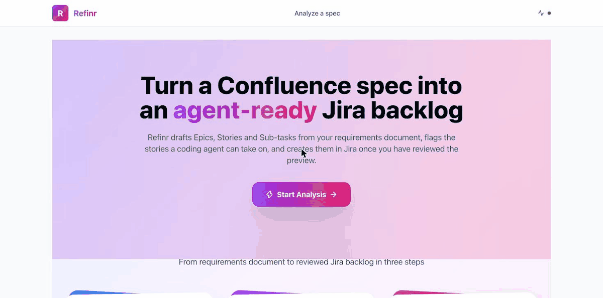
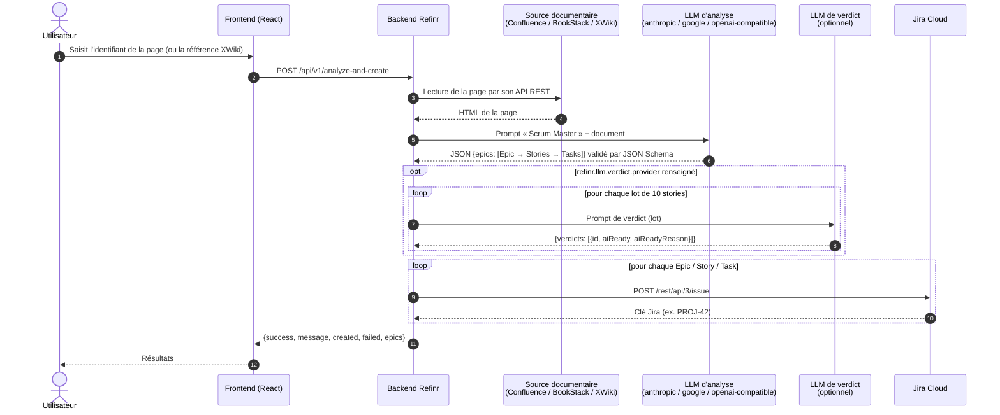
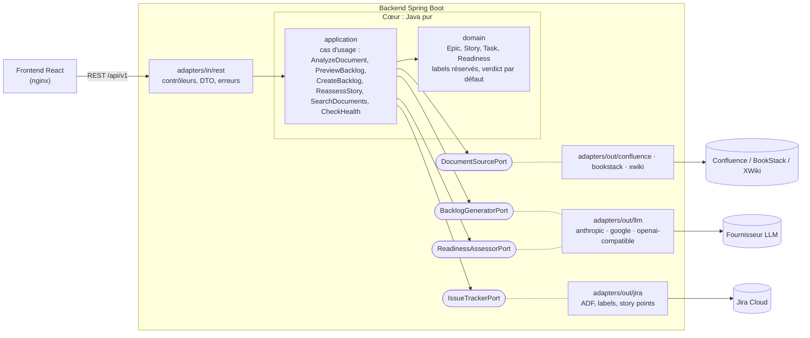

<div align="center">

# 📄 ➜ 🎯 Refinr

**Refinr transforme une spec Confluence, BookStack ou XWiki en backlog Jira ou OpenProject (Epic → Feature → Story → Sous-tâche) et indique, story par story, si un agent de code peut l'implémenter sans décision humaine.**

[English](README.md) · **Français**


[](LICENSE)

</div>

<p align="center">
  
</p>

---

## 🤔 Pourquoi

Les agents de code savent implémenter une story… quand elle est claire. Le vrai goulot d'étranglement est en amont :
savoir **quelles** stories peuvent leur être confiées sans aller-retour avec un humain.

Refinr ne se contente pas de découper une spec en tickets : il juge chaque story et pose un label **`ai-ready`**
(périmètre clair, critères testables, aucune dépendance externe non précisée) ou **`validation-necessaire`**
(il manque une décision, avec la raison). Le verdict est **recalculé sur le contenu final** au moment de la création,
et un doute vaut toujours `validation-necessaire`. Résultat : une file prête pour vos agents, en une requête JQL
`labels = "ai-ready"`, et une liste précise de questions pour le Product Owner sur le reste.

## ⚡ Démarrage rapide (Docker)

```bash
git clone https://github.com/chams-bensalem/refinr.git && cd refinr
cp .env.example .env           # renseignez la source documentaire, le gestionnaire de tickets et le fournisseur IA
docker compose up -d --build   # UI http://localhost:3000 · API http://localhost:8080
```

Ollama tourne sur votre machine ? Dans `.env`, mettez `LLM_ANALYSIS_BASE_URL=http://host.docker.internal:11434/v1`
(dans un conteneur, `localhost` désigne le conteneur lui-même). Vérifiez avec `curl localhost:8080/api/v1/health`.
Un modèle local inclus ? `docker compose --profile ollama up -d --build`
avec `LLM_ANALYSIS_BASE_URL=http://ollama:11434/v1`. Détails : [Avec Docker Compose](#avec-docker-compose).

## 🔌 Fournisseurs IA

| Fournisseur | `provider` | Statut |
|---|---|---|
| Ollama (local, par exemple `qwen3:8b`) | `openai-compatible` | ✅ testé en réel |
| Google Gemini | `google` | ✅ testé en réel (par exemple avec `gemini-3.6-flash`) |
| Anthropic Claude | `anthropic` | ✅ testé en réel (par exemple avec `claude-haiku-5-5` et `claude-opus-5-5`) |
| OpenAI | `openai-compatible` | ⚠️ non testé en réel (serveur HTTP simulé uniquement) |
| DeepSeek, Mistral, Groq, OpenRouter, LiteLLM, vLLM | `openai-compatible` | ⚠️ non testé en réel (même client que OpenAI / Ollama) |

« Testé en réel » = analyse et verdict exécutés de bout en bout contre la véritable API. Chaque client est par
ailleurs couvert par des tests sur serveur HTTP simulé (succès, `401`, `429` + nouvel essai, JSON invalide + relance,
délai dépassé). Un retour sur un fournisseur non testé est bienvenu : voir [CONTRIBUTING.md](CONTRIBUTING.md).

### Justesse du verdict : matrice de compatibilité

Mesurée avec `scripts/eval-verdict.sh` sur le jeu de référence de `eval/verdict/` (50 stories + deux jeux de contrôle
de 15, en français ; le contrôle 1 aussi traduit en anglais), prompt **`verdict-v3.2`**, lots de 10 comme en
production. Seul le **verdict** est mesuré (pas la génération). Seuils : **0 faux `ai-ready`** sur les étiquettes
`not-ready` / `sure` (bloquant), faux `validation-necessaire` ≤ 25 % sur les `ready` / `sure`, stabilité ≥ 90 % (non
bloquant). **Les étiquettes de référence ont été posées par une IA en position de PO : les mesures Anthropic sont
indicatives** (Claude évalué contre des étiquettes de Claude). La story **v020** a été réétiquetée après avoir vu les
réponses des modèles (`ready` → `not-ready`) ; cet arbitrage est **contesté** (deux modèles le contredisent, 3 fois sur
3) : les deux références sont affichées.

| Modèle | Prompt | Langues | Date | Exécutions | Faux `ai-ready`, étiquettes d'origine | Faux `ai-ready`, étiquettes arbitrées | Faux `validation-necessaire` (`ready` / `sure`) | Stabilité |
|---|---|---|---|---|---|---|---|---|
| Claude Haiku 5.5 | `verdict-v3.2` | fr, en | 2026-11-16 | 5 (fr), 5 (en) | 0 % (0/20 ; contrôles 0/10 ; en 0/5) | 0 % (0/21) | 11 % (2/18) ; contrôles 0 % et 13 % ; en 0 % | 78 % (contrôles 87 %, 93 % ; en 80 %) |
| Claude Opus 5.5 | `verdict-v3.2` | fr, en | 2026-11-16, 2026-11-22 | 3 (fr), 1 (en) | 0 % (0/20 ; contrôles 0/10 ; en 0/5) | 5 % (1/21 : v020, contestée) | 0 % (0/18) ; contrôles 0 % ; en 0 % | 94 % (contrôles 100 %, 93 % ; en non mesurée) |
| Gemini 3.6 Flash | `verdict-v3.2` | fr | 2026-11-22 | **partielle : 2 exécutions sur 3** (22 lots sur 24) | 0 % (0/20 ; contrôles 0/10) ; **v030 non tranchée** (prête 1 fois sur 2, sans majorité) | 5 % (1/21 : v020, contestée) ; v030 non tranchée | 0 % (0/18) ; contrôles 0 % | 90 % (contrôles 100 %, 100 %), partielle |

Détail par exécution, désaccords et coûts : `eval/verdict/results/` et `DECISIONS.md`. Un modèle ou un prompt absent
de ce tableau n'a pas été mesuré.

**Génération, niveau Feature (prompt `generation-v2`), limite connue de Gemini 3.6 Flash** (2026-11-23) : Gemini
regroupe en moins de Features ; le niveau Feature reste visible dès 2 Features explicites. Sur la spec à plusieurs
modules `reservation-salles`, 1 exécution sur 3 atteint 3 Features (Claude Haiku 5.5 : 2 sur 2) ; les petites specs
n'ont qu'une story. Détail : `eval/generation/results/2026-11-23-f1-summary.md`.

---

## 📚 Sommaire

- [Fonctionnalités](#-fonctionnalités)
- [Mode de fonctionnement](#️-mode-de-fonctionnement)
- [Architecture](#-architecture)
- [Prérequis](#-prérequis)
- [Configuration](#-configuration)
- [Lancer l'application](#️-lancer-lapplication)
- [Utilisation](#-utilisation)
- [Intégrations](#-intégrations)
- [Référence de l'API](#-référence-de-lapi)
- [Modèle de données](#️-modèle-de-données)
- [Tests](#-tests)
- [Dépannage](#-dépannage)
- [Limites connues & feuille de route](#️-limites-connues--feuille-de-route)
- [Contribuer](#-contribuer)
- [Licence](#-licence)

---

## 🚀 Fonctionnalités

**Sources documentaires (une par instance)**
- 📚 **Confluence Cloud** (défaut), **BookStack** et **XWiki** (v1.2) avec `source.provider` : la page est lue en
  HTML (inclusions BookStack et macros XWiki comme `{{include}}` / `{{code}}` développées), avec un compte dédié en
  lecture seule (cf. [Sources documentaires](#sources-documentaires)).
- 🔎 Recherche par titre dans toute la source ou dans un espace / livre (`GET /api/v1/documents/search`), et lien vers
  le document analysé dans l'aperçu.

**Analyse IA du cahier des charges**
- 🔌 **Fournisseur au choix**, séparément pour l'analyse et pour le verdict : `anthropic`, `google` ou
  `openai-compatible` (OpenAI, DeepSeek, Mistral, Groq, OpenRouter, Ollama, LiteLLM, vLLM…).
- 📐 **Sortie validée par JSON Schema** (mode JSON natif du fournisseur quand il existe). Sortie invalide ⇒ jusqu'à
  2 relances avec la liste des erreurs, puis un `502` propre. Sortie tronquée par la limite de tokens ⇒ erreur
  explicite, sans relance.
- 🧠 **Découpage Scrum proportionné** : un Epic pour un besoin court, un Epic par module pour un cahier des charges
  complet — sans jamais inventer de fonctionnalités absentes du document. Les pages vides sont refusées avec un `400`,
  sans appel à l'IA.
- 📝 **Stories normalisées** : *As a / I want / So that*, 2 à 5 critères d'acceptation *Given / When / Then*, story
  points en suite de Fibonacci, heures estimées par tâche, priorités et labels techniques nettoyés.

**Verdict « prêt pour un agent de code »**
- 🤖 `aiReady = true` **uniquement** si le périmètre est clair, les critères testables et aucune dépendance externe
  laissée non précisée. Verdict absent, ambigu ou en erreur ⇒ `validation-necessaire`.
- 🔀 Le verdict peut utiliser un **fournisseur différent** de l'analyse (ex. structure par Ollama local, verdict par
  Gemini, Claude ou un proxy LiteLLM), par lots de 10 stories, avec un cache adressé par le contenu.
- ♻️ **Recalculé à la création** (`create-jira`) : les `aiReady` / `aiReadyReason` du client sont ignorés, seules
  les stories modifiées sont rejugées.
- 🔁 **Réévaluation** : débloquez une story `validation-necessaire` avec une précision ; la description Jira d'origine
  (images, tableaux, liens) est conservée et complétée, le label mis à jour.

**Création des tickets (Jira ou OpenProject)**
- 🟦 **OpenProject** (v1.1) à la place de Jira avec `tracker.provider=openproject` : même hiérarchie, verdict dans un
  champ personnalisé de type liste, story points sur les User stories, réévaluation en commentaire (cf.
  [OpenProject](#openproject)).
- 🏗️ Epic → Story (liée via `parent`) → Sous-tâche, descriptions Markdown converties en **ADF** (titres, gras,
  italique, listes, code en ligne et blocs de code).
- 🎯 Projet cible par requête (`projectKey`) ou projet par défaut ; projets **team-managed** pris en charge
  (`jira.priority-enabled=false`) ; **story points** écrits dans le champ indiqué par `jira.story-points-field`.
- 👀 **Mode prévisualisation** : générer la structure, la modifier, puis l'envoyer à Jira.
- 🧾 **Résultat partiel plutôt que doublons** : la création de tickets n'est jamais rejouée ; un échec est signalé
  dans `created` / `failed` (`207` ou `502`) et les tickets restants sont quand même créés.

**Interface web**
- 🏠 Page **Analyze** : identifiant de page de la source active (libellé et aide adaptés) ou texte collé, aperçu
  Epics > Stories > Sous-tâches avec le verdict de chaque story et sa raison, création sur confirmation ; page
  **Results** avec les compteurs, les tickets créés et, après une création partielle, les éléments non créés avec leur
  raison.
- 🟢 Indicateurs d'état des services dans l'en-tête.

**Exploitation**
- 🩺 Health check par port sortant (la source documentaire active, le gestionnaire de tickets actif, chaque
  fournisseur IA, dont la clé et le modèle sont vérifiés par une lecture gratuite), en cache 45 s, sans jamais exposer
  de clé ni d'URL.
- 📊 Logs JSON structurés avec un `correlationId` par requête ; les réponses d'erreur ne renvoient jamais le message
  brut d'une exception.
- 🐳 Images multi-arch (`amd64` / `arm64`) non-root, conteneurs en lecture seule, ports liés à `127.0.0.1`, liste
  d'origines CORS, `X-API-Key` optionnelle, protection contre le DNS rebinding.

---

## ⚙️ Mode de fonctionnement



1. **Lecture** — le backend récupère la page dans la source active, en HTML : format *storage* de Confluence (token
   API Atlassian), HTML de la page BookStack (jeton d'API) ou HTML rendu par XWiki (compte technique).
2. **Analyse** — le contenu est injecté dans un prompt structuré ; le LLM répond en JSON, validé par un JSON Schema ;
   une sortie invalide est renvoyée avec la liste des erreurs.
3. **Verdict** — soit inclus dans l'analyse, soit calculé par un fournisseur dédié, par lots.
4. **Création** — chaque Epic, Story puis Sous-tâche est créée dans Jira avec une description ADF et le label
   `ai-ready` ou `validation-necessaire` sur les stories.
5. **Réévaluation** — `POST /reassess-story` relit une story `validation-necessaire`, la rejuge avec la précision
   fournie et met à jour sa description et son label. **Validation** — `POST /validate-story` marque `ai-ready` une
   story `validation-necessaire` sur décision humaine, sans appel à l'IA.

---

## 🧱 Architecture

Hexagonale (ports & adaptateurs) : le domaine et les cas d'usage sont en Java pur, sans Spring, client HTTP ni
bibliothèque JSON (règles vérifiées par des tests ArchUnit) ; chaque service externe est derrière un port.
`IssueTrackerPort` et `DocumentSourcePort` restent indépendants de l'outil, ce qui a rendu possibles l'adaptateur
OpenProject de la v1.1 et les adaptateurs BookStack et XWiki de la v1.2.



| Dossier | Rôle | Stack |
|---|---|---|
| [`backend/`](backend) | API REST | Java 25 · Spring Boot 4.1 · WebClient · Spring Resilience (`@Retryable`) |
| [`frontend/`](frontend) | Interface web | React 18 · TypeScript · Vite · Tailwind · TanStack Query |

Organisation des paquets sous `backend/src/main/java/fr/heliocraft/refinr/` : `domain/` (modèle, règles),
`application/` (`port/in`, `port/out`, `service`), `adapters/in/rest`,
`adapters/out/{confluence,bookstack,xwiki,jira,openproject,llm}`, `config/` (câblage, fournisseurs LLM, nouveaux
essais, sécurité HTTP, `correlationId`). Les choix techniques sont consignés dans [DECISIONS.md](DECISIONS.md).

---

## 📋 Prérequis

| Outil | Version | Usage |
|---|---|---|
| **Docker** + Compose v2 | récent | Le démarrage rapide — ni JDK ni Node nécessaires |
| **JDK** | 25 | Backend (Maven compile et teste toujours sur un JDK 25, par les toolchains) |
| **Maven** | 3.9+ | Build du backend |
| **Node.js** + npm | 22.12+ (référence : `.nvmrc`) | Frontend |
| **Ollama** | récent | LLM local optionnel (le fournisseur par défaut) |

- Une **source documentaire** : Confluence Cloud avec un
  [token API Atlassian](https://id.atlassian.com/manage-profile/security/api-tokens), BookStack (jeton d'API d'un
  compte dédié) ou XWiki (compte technique dédié) — cf. [Sources documentaires](#sources-documentaires).
- Un **gestionnaire de tickets** : Jira Cloud (types de tickets **`Epic`**, **`Story`** et **`Subtask`**, droits de
  création de tickets) ou OpenProject (cf. [OpenProject](#openproject)).
- Pour `google` : une [clé Google AI Studio](https://aistudio.google.com/apikey) ; pour `anthropic` ou un service
  `openai-compatible` hébergé : la clé de ce fournisseur.
- Le modèle local d'exemple `qwen3:8b` demande environ **8 Go de RAM/VRAM libres** ; sur une machine plus modeste, choisissez
  un modèle plus léger ou un fournisseur hébergé.

---

## 🔐 Configuration

Les secrets vivent **uniquement** dans le fichier `.env` à la racine du dépôt (ignoré par Git). Une vraie variable
d'environnement est prioritaire sur `.env`.

```bash
cp .env.example .env
# Lancer le backend hors Docker demande aussi le modèle de propriétés :
cp backend/src/main/resources/application-example.properties backend/src/main/resources/application.properties
```

`application.properties` ne contient que des références `${VAR:défaut}` et importe `.env`
(`spring.config.import=optional:file:../.env[.properties]`). Il est ignoré par Git : ne le commitez jamais.

### Par fournisseur IA

À renseigner dans `.env`. `LLM_ANALYSIS_*` pilote l'analyse ; les mêmes clés en `LLM_VERDICT_*` configurent un
fournisseur de verdict distinct, optionnel (`LLM_VERDICT_PROVIDER` vide = l'appel d'analyse produit aussi le verdict).
**Fournisseur et modèle sont obligatoires** (aucun fournisseur ni modèle par défaut) : sans eux, le démarrage échoue avec
un message qui nomme les variables à renseigner. Les noms de modèles ci-dessous ne sont que des exemples.

```bash
# Ollama (local, sans clé). En Docker : http://host.docker.internal:11434/v1, ou http://ollama:11434/v1 avec --profile ollama
LLM_ANALYSIS_PROVIDER=openai-compatible
LLM_ANALYSIS_BASE_URL=http://localhost:11434/v1
LLM_ANALYSIS_MODEL=qwen3:8b
LLM_ANALYSIS_REASONING_EFFORT=none   # empêche qwen3 de « réfléchir » au-delà du délai

# Google Gemini (base URL vide = URL officielle ; le modèle est un exemple, tout modèle accessible avec votre clé convient)
LLM_ANALYSIS_PROVIDER=google
LLM_ANALYSIS_BASE_URL=
LLM_ANALYSIS_MODEL=gemini-3.6-flash
LLM_ANALYSIS_API_KEY=your-gemini-api-key

# Anthropic (base URL vide = URL officielle ; le modèle est un exemple)
LLM_ANALYSIS_PROVIDER=anthropic
LLM_ANALYSIS_BASE_URL=
LLM_ANALYSIS_MODEL=claude-opus-5-5
LLM_ANALYSIS_API_KEY=your-anthropic-api-key

# Toute API compatible OpenAI : OpenAI, DeepSeek, Mistral, Groq, OpenRouter, LiteLLM, vLLM (base URL obligatoire, avec /v1)
LLM_ANALYSIS_PROVIDER=openai-compatible
LLM_ANALYSIS_BASE_URL=https://api.openai.com/v1
LLM_ANALYSIS_MODEL=your-openai-model
LLM_ANALYSIS_API_KEY=your-api-key
LLM_ANALYSIS_REASONING_EFFORT=
# Les modèles de raisonnement d'OpenAI refusent max_tokens :
#   LLM_ANALYSIS_MAX_TOKENS_PARAM=max_completion_tokens
```

Sur une machine lente (quelques tokens/s), augmentez `LLM_ANALYSIS_TIMEOUT` (ex. `30m`).

### Paramètres de génération

Refinr ne fait **aucune hypothèse sur le modèle** : vous choisissez le fournisseur, le modèle et sa version, et Refinr
n'a ni liste de modèles connus ni comportement fondé sur un nom de modèle. Les paramètres d'échantillonnage et de
réflexion ne sont **envoyés que s'ils sont configurés** ; sinon le fournisseur applique ses propres valeurs par défaut.

- **Température** : `LLM_ANALYSIS_TEMPERATURE` / `LLM_VERDICT_TEMPERATURE`, vides par défaut (non envoyée). Renseignée,
  elle est envoyée telle quelle à tous les fournisseurs, `anthropic` compris ; certains modèles récents la refusent.
- **Paramètres propres au fournisseur** (`extra-body`) : n'importe quel champ du corps de la requête du fournisseur,
  ajouté par les trois clients. La clé est un **chemin pointé**, fusionné comme un objet imbriqué. Écrivez le nom de
  propriété pointé tel quel dans `.env` : cela marche sous Docker Compose (`env_file` garde le nom) comme hors Docker.
  Une valeur JSON garde son type ; une valeur vide n'est pas envoyée.

  ```bash
  # Exemples seulement : vérifiez chaque paramètre dans la documentation de votre fournisseur
  # google
  refinr.llm.analysis.extra-body.generationConfig.thinkingConfig.thinkingLevel=low
  # anthropic
  refinr.llm.analysis.extra-body.output_config.effort=low
  refinr.llm.analysis.extra-body.thinking={"type":"adaptive"}
  # openai-compatible (ex. Ollama) : LLM_ANALYSIS_REASONING_EFFORT=none, soit
  refinr.llm.analysis.extra-body.reasoning_effort=none
  ```

  `refinr.llm.verdict.extra-body.` pour un fournisseur de verdict distinct. **Évitez la forme en majuscules**
  (`REFINR_LLM_ANALYSIS_EXTRABODY_…`) : Spring perd la casse (`thinkinglevel`) et change `_` en `.`
  (`reasoning_effort` deviendrait `reasoning.effort`).
- Une clé qui écraserait un champ géré par Refinr est **refusée au démarrage**, avec la clé nommée : les messages ou
  `contents` / `systemInstruction`, le schéma JSON (`response_format`, `generationConfig.responseJsonSchema`,
  `output_config.format`…), la limite de sortie, `model`, `temperature` (utilisez le réglage dédié) et `stream`.
- Un paramètre refusé par le fournisseur (**HTTP 400**) donne un message clair qui nomme le modèle : le paramètre
  lui-même quand le fournisseur le désigne par un champ structuré (`error.param` pour les API compatibles OpenAI,
  `fieldViolations` pour Google), sinon la liste des paramètres optionnels envoyés, pour savoir quoi retirer. Le texte
  d'erreur du fournisseur n'est jamais recopié.

#### Migration depuis l'ancienne configuration IA

Les anciennes clés sont **refusées au démarrage** (message listant la correspondance, jamais les valeurs) :

| Ancienne clé (`.env` / propriété) | Nouvelle clé |
|---|---|
| `AI_PROVIDER=ollama` / `ai.provider` | `LLM_ANALYSIS_PROVIDER=openai-compatible` |
| `AI_PROVIDER=gemini` | `LLM_ANALYSIS_PROVIDER=google` |
| `OLLAMA_BASE_URL` / `ollama.base-url` | `LLM_ANALYSIS_BASE_URL` **avec `/v1`** (ex. `http://localhost:11434/v1`) |
| `OLLAMA_MODEL`, `GEMINI_MODEL` | `LLM_ANALYSIS_MODEL` |
| `GEMINI_API_KEY` / `gemini.api-key` | `LLM_ANALYSIS_API_KEY` (ou `LLM_VERDICT_API_KEY`) |
| `AI_VERDICT_PROVIDER=litellm` | `LLM_VERDICT_PROVIDER=openai-compatible` |
| `AI_VERDICT_BASE_URL` | `LLM_VERDICT_BASE_URL` **avec `/v1`** (ex. `http://localhost:4000/v1`) |
| `AI_VERDICT_MODEL`, `AI_VERDICT_API_KEY` | `LLM_VERDICT_MODEL`, `LLM_VERDICT_API_KEY` |
| `ai.verdict.timeout-seconds=90` | `refinr.llm.verdict.timeout=90s` |

Les variables d'environnement **du système** ne sont pas contrôlées (une `GEMINI_API_KEY` peut servir à d'autres
outils) : seuls les fichiers de configuration et le `.env` le sont.

### Jira

```bash
JIRA_BASE_URL=https://your-site.atlassian.net
JIRA_USERNAME=you@example.com
JIRA_TOKEN=your-atlassian-api-token
JIRA_PROJECT_KEY=PROJ          # projet par défaut quand la requête ne donne pas de projectKey
JIRA_PRIORITY_ENABLED=true     # false pour un projet team-managed (sans champ priorité)
JIRA_STORY_POINTS_FIELD=       # ex. customfield_10016 ; vide = story points non envoyés
JIRA_HIERARCHY=two-levels      # three-levels sur un site Premium configuré avec un niveau Feature (cf. Niveau Feature)
```

- Les **projets team-managed** n'ont pas de champ *priority* : mettez `JIRA_PRIORITY_ENABLED=false`, sinon Jira
  refuse l'Epic avec *Field 'priority' cannot be set*.
- **Story points** : l'identifiant du champ dépend de votre site. Appelez `GET /rest/api/3/field` et cherchez
  *Story point estimate* (team-managed) ou *Story Points* (company-managed), souvent `customfield_10016`. Le champ doit
  figurer sur l'écran de création des stories.

### Sources documentaires

Refinr lit la spec dans **une seule** source documentaire par instance, choisie par `SOURCE_PROVIDER` : `confluence`
(défaut), `bookstack` ou `xwiki` (v1.2). Seules les propriétés de la source choisie sont requises : une instance
BookStack ou XWiki n'a besoin d'aucune variable `CONFLUENCE_*`. Dans chaque outil, utilisez un **compte dédié en
lecture seule** : Refinr n'écrit jamais dans la source.

#### Confluence

```bash
SOURCE_PROVIDER=confluence          # défaut
CONFLUENCE_BASE_URL=https://your-site.atlassian.net   # sans /wiki
CONFLUENCE_USERNAME=you@example.com
CONFLUENCE_TOKEN=your-atlassian-api-token
```

- **Droits** : lecture des espaces qui contiennent vos specs.
- **ID d'une page** : le nombre dans l'URL de la page (`…/wiki/spaces/SPACE/pages/123456789/Mon+cahier`). `space` de
  la recherche = clé d'espace.

#### BookStack

Vérifié avec BookStack v26.09 (API REST à jetons). BookStack ne publie **aucune image Docker officielle** : celle qui a
servi aux tests de Refinr est l'image **communautaire** [`linuxserver/bookstack`](https://hub.docker.com/r/linuxserver/bookstack).

```bash
SOURCE_PROVIDER=bookstack
BOOKSTACK_BASE_URL=https://bookstack.example.com   # en Docker, une instance locale : http://host.docker.internal:<port>
BOOKSTACK_TOKEN_ID=your-bookstack-token-id
BOOKSTACK_TOKEN_SECRET=your-bookstack-token-secret
BOOKSTACK_WEB_URL=                                 # liens de l'interface ; vide = BOOKSTACK_BASE_URL
```

- **Compte** : un utilisateur dédié dont le rôle n'a que *Access system API* et le droit *View* sur les pages
  (*Page : View All*, ou *View* sur les livres à analyser) ; *Book : View All* seulement pour chercher par **slug** de
  livre. Jeton d'API créé sur la fiche de l'utilisateur (*Settings → Users → {utilisateur} → API Tokens*).
- **ID d'une page** : sélectionnez du texte de la page ; la bulle affiche le permalien `…/link/42` : **42** est l'ID.
  Il ne change pas quand la page est renommée.
- **Recherche dans un livre** : préférez l'**id numérique du livre** comme `space`. Un slug de livre est d'abord
  résolu et exige *Book : View All* ; un slug inconnu ou invisible donne une recherche vide (avec un avertissement
  dans les logs du serveur).
- Contenu lu : le HTML de la page, inclusions BookStack (`{{@id}}`) développées. Une page que le compte ne voit pas
  répond « introuvable » (`404`) : BookStack ne fait pas la différence.

#### XWiki

Vérifié avec XWiki 18.4 LTS (API REST).

```bash
SOURCE_PROVIDER=xwiki
XWIKI_BASE_URL=https://xwiki.example.com     # HTTPS uniquement : le compte utilise HTTP Basic
XWIKI_USERNAME=refinr_bot                     # lettres, chiffres et _ uniquement
XWIKI_PASSWORD=your-xwiki-password
XWIKI_WEB_URL=                                # liens de l'interface ; vide = XWIKI_BASE_URL
XWIKI_WIKI=xwiki                              # wiki à lire (wiki principal par défaut)
```

> ⚠️ **HTTP Basic uniquement derrière HTTPS** : le mot de passe du compte technique accompagne chaque requête.
>
> ⚠️ **Retirez le compte de `XWiki.XWikiAllGroup`** (ou restreignez ce groupe) : XWiki y ajoute tout nouvel
> utilisateur, et ce groupe a par défaut le droit *edit* — donc *view* — sur **tout le wiki**. Donnez ensuite au compte
> le seul droit **View** sur les espaces à analyser (droits de chaque espace, dans son administration).

- **ID d'une page** : la **référence de la page** de l'onglet *Information*, en bas de la page, par ex.
  `Specs.Inventaire.WebHome` (préfixe `xwiki:` facultatif). Le chemin de la page `/bin/view/Specs/Inventaire/` écrit
  avec des points (`Specs.Inventaire`) fonctionne aussi : Refinr essaie la page imbriquée `Specs.Inventaire.WebHome`,
  puis la page terminale.
- **Pages renommées suivies** : l'ancienne référence continue de fonctionner (XWiki laisse une redirection, que
  Refinr suit).
- Contenu lu : le HTML **rendu par XWiki**, macros exécutées avec les droits du compte (`{{include}}`, `{{code}}`…) ;
  les blocs d'erreur des macros en échec (message et pile Java) sont retirés avant l'analyse.
- **Recherche** : sans espace, recherche en base sur le titre (sous-chaîne, insensible à la casse). Avec un espace
  (ex. `Specs` ou `Specs.Sous`), recherche Solr qui inclut les sous-espaces : **sensible aux accents** (`conges` ne
  trouve pas « congés ») et **légèrement différée** (une page toute neuve peut mettre quelques secondes à apparaître).
- Le health n'est `UP` que si XWiki reconnaît le compte : des identifiants faux n'échouent pas chez XWiki, ils
  basculent silencieusement en accès invité.

### OpenProject

Refinr crée le backlog dans **un seul** gestionnaire de tickets par instance : Jira (défaut) ou OpenProject (v1.1,
vérifié avec OpenProject 17.9). Le choix se fait par `TRACKER_PROVIDER=openproject` :

```bash
TRACKER_PROVIDER=openproject
OPENPROJECT_BASE_URL=https://openproject.example.com   # en Docker, une instance locale : http://host.docker.internal:<port>
OPENPROJECT_API_KEY=your-openproject-api-key
OPENPROJECT_PROJECT=my-project      # projet par défaut : identifiant (minuscules, chiffres, - et _) ou id numérique
OPENPROJECT_WEB_URL=                # liens de l'interface ; vide = OPENPROJECT_BASE_URL (ex. http://localhost:8090 en Docker)
# Optionnel (valeurs par défaut) :
# OPENPROJECT_TYPE_EPIC=Epic  OPENPROJECT_TYPE_STORY=User story  OPENPROJECT_TYPE_SUBTASK=Task  OPENPROJECT_TYPE_FEATURE=Feature
# OPENPROJECT_READINESS_FIELD=Agent readiness  OPENPROJECT_STORY_POINTS_ENABLED=true  OPENPROJECT_PRIORITY_ENABLED=true
```

**Préparation, une fois, par un administrateur OpenProject** (Refinr ne crée rien de tout cela) :

1. **Types** : activer *Epic* et *User story* dans le projet (*Paramètres du projet → Lots de travaux → Types* ;
   *Task* l'est par défaut).
2. **Champ du verdict** : créer un champ personnalisé de type **liste** nommé *Agent readiness*, avec les deux options
   `ai-ready` et `validation-necessaire` (*Administration → Champs personnalisés → Lots de travaux*), puis
   - l'activer **dans le projet** (*Paramètres du projet → Lots de travaux → Champs personnalisés*), **et**
   - l'ajouter au **formulaire de chaque type** *Epic*, *User story* et *Task* (*Administration → Types → {type} →
     Formulaire* : glisser le champ dans un groupe).

   Sans ces trois réglages, le champ est absent de l'API : Refinr le signale en les listant.
3. **Compte** : un compte dédié **non administrateur** (ex. `refinr-bot`), membre du projet avec ces 5 permissions :
   `view_work_packages`, `add_work_packages`, `edit_work_packages`, `add_work_package_comments`, `manage_subtasks`.
   Le rôle standard **Member** les contient toutes : c'est l'option la plus simple.
4. **Clé API** : *Administration → API et webhooks → API* : laisser *Activer les jetons d'API* coché ; puis, connecté
   avec le compte Refinr, *Mon compte → Jetons d'accès → API* → générer la clé pour `OPENPROJECT_API_KEY`.

Correspondance avec OpenProject :

- Epic → User story → Task via le **parent** des lots de travaux ; descriptions Markdown envoyées telles quelles.
- **Verdict** dans le champ *Agent readiness* de chaque User story (pas un label). OpenProject n'a pas de labels :
  les autres labels forment une dernière ligne `**Labels:** …` de la description.
- **Story points** sur les User stories uniquement (module Backlogs, actif par défaut), comme pour Jira ;
  **priorité** retrouvée par son nom (`Medium` → `Normal`).
- La **réévaluation** ajoute la précision et le nouveau verdict en **commentaire** (la description est conservée) et
  met à jour le champ.
- Les clés des tickets sont les ids des lots de travaux (ex. `39`) ; `projectKey` accepte un identifiant ou un id
  OpenProject.

### Niveau Feature (Epic → Feature → Story)

Depuis la 1.5, le backlog a quatre niveaux : **Epic** (le produit ou un grand domaine fonctionnel) → **Feature** (un
module ou une capacité utilisateur de la spec) → **Story** → **Sous-tâche**. Un besoin court reçoit **une seule
feature**, **implicite** : elle n'est pas un niveau distinct quand le gestionnaire le permet (ses stories vont sous
l'epic).

| Gestionnaire | Niveau Feature | Configuration |
|---|---|---|
| OpenProject | Natif quand le type `Feature` (`openproject.types.feature`) est **activé dans le projet** (*Paramètres du projet → Lots de travaux → Types*) : Epic → Feature → User story → Task. La feature implicite n'a pas de lot de travaux. Type non activé : pas de niveau Feature (ci-dessous), sans erreur. | `OPENPROJECT_TYPE_FEATURE=Feature` |
| Jira Free / Standard | Aucun : Jira ne permet pas d'insérer un niveau entre Epic et Story. | `JIRA_HIERARCHY=two-levels` (défaut) |
| Jira Premium | Configuré au-dessus de la Story : l'Epic natif renommé **Feature** (niveau 1) et un nouveau niveau **Epic** au-dessus (niveau 2). Chaque feature est un ticket, l'implicite comprise (au nom de son epic) : Jira exige que le parent d'une story soit un niveau au-dessus. Vérifié à la première création dans le projet (types présents, niveaux 1 et 2) ; sinon l'epic échoue en nommant les propriétés à corriger. | `JIRA_HIERARCHY=three-levels`, `JIRA_TYPE_EPIC`, `JIRA_TYPE_FEATURE`, `JIRA_TYPE_STORY`, `JIRA_TYPE_SUBTASK` |

**Sans niveau Feature** (`refinr.features.without-level`, `FEATURES_WITHOUT_LEVEL`) : `label` (défaut) garde les
stories sous leur epic et donne à chaque story d'une feature explicite un label `feature-<nom>` (OpenProject : sur la
ligne `**Labels:**` de la description), avec une entrée `warnings` dans l'aperçu et dans le résultat de la création ;
`refuse` répond `422` avant tout appel au gestionnaire. **Le plugin Obsidian ≤ 0.2.0 affiche ce `422` comme une
erreur inconnue** (il peut dire que des tickets ont peut-être été créés ; aucun ne l'a été).

### Tableau des propriétés

| Propriété | Défaut | Description |
|---|---|---|
| `source.provider` | `confluence` | Source documentaire de l'instance (une seule par instance) : `confluence`, `bookstack` ou `xwiki`. Valeur inconnue ou propriété absente de la source choisie : arrêt au démarrage avec un message explicite |
| `bookstack.base-url` | — | URL de BookStack (si `source.provider=bookstack`) |
| `bookstack.token-id` / `bookstack.token-secret` | — | Jeton d'API du compte Refinr |
| `bookstack.web-url` | *(vide)* | Adresse web utilisée uniquement pour les liens vers les pages ; vide = `bookstack.base-url` |
| `xwiki.base-url` | — | URL de XWiki (si `source.provider=xwiki`), en HTTPS |
| `xwiki.username` / `xwiki.password` | — | Compte technique (HTTP Basic) |
| `xwiki.web-url` | *(vide)* | Adresse web utilisée uniquement pour les liens vers les pages ; vide = `xwiki.base-url` |
| `xwiki.wiki` | `xwiki` | Wiki à lire (wiki principal par défaut) |
| `tracker.provider` | `jira` | Gestionnaire de tickets de l'instance (un seul par instance) : `jira` ou `openproject`. Valeur inconnue ou propriété absente du gestionnaire choisi : arrêt au démarrage avec un message explicite |
| `confluence.base-url` / `jira.base-url` | — | URL du site Atlassian Cloud (sans `/wiki`) ; `confluence.*` seulement si `source.provider=confluence` |
| `confluence.username` / `jira.username` | — | E-mail du compte Atlassian |
| `confluence.token` / `jira.token` | — | Token API Atlassian |
| `jira.project-key` | — | Clé du projet utilisé si `projectKey` n'est pas fourni |
| `jira.priority-enabled` | `true` | Envoie le champ `priority` (désactiver en team-managed) |
| `jira.story-points-field` | *(vide)* | Champ personnalisé des story points (ex. `customfield_10016`) ; vide = non envoyés |
| `jira.hierarchy` | `two-levels` | `two-levels` (Free, Standard : pas de niveau Feature) ou `three-levels` (Premium configuré avec un niveau Feature, vérifié à la première création) (`JIRA_HIERARCHY`) |
| `jira.types.epic` / `.feature` / `.story` / `.subtask` | `Epic` / `Feature` / `Story` / `Subtask` | Noms des types de tickets ; `.feature` seulement en `three-levels` (`JIRA_TYPE_EPIC`, `JIRA_TYPE_FEATURE`, `JIRA_TYPE_STORY`, `JIRA_TYPE_SUBTASK`) |
| `openproject.base-url` | — | URL d'OpenProject (avec `tracker.provider=openproject`) |
| `openproject.api-key` | — | Clé API du compte Refinr (*Mon compte → Jetons d'accès → API*) |
| `openproject.web-url` | *(vide)* | Adresse web utilisée uniquement pour les liens vers les lots de travaux créés ; vide = `openproject.base-url` |
| `openproject.project` | — | Projet par défaut (identifiant ou id numérique) si `projectKey` n'est pas fourni |
| `openproject.types.epic` / `.story` / `.subtask` | `Epic` / `User story` / `Task` | Types de work package utilisés pour chaque niveau |
| `openproject.types.feature` | `Feature` | Type du niveau Feature, utilisé quand il est activé dans le projet ; sinon pas de niveau Feature (`OPENPROJECT_TYPE_FEATURE`) |
| `refinr.features.without-level` | `label` | Gestionnaire sans niveau Feature : `label` (stories sous l'epic, label `feature-<nom>`, avertissement) ou `refuse` (`422` avant tout appel au gestionnaire) (`FEATURES_WITHOUT_LEVEL`) |
| `openproject.readiness-field` | `Agent readiness` | Champ personnalisé de type liste qui porte le verdict (options `ai-ready` / `validation-necessaire`) |
| `openproject.story-points-enabled` | `true` | Envoie `storyPoints` sur les User stories uniquement (module Backlogs) |
| `openproject.priority-enabled` | `true` | Envoie la priorité (par nom, `Medium` → `Normal`) |
| `refinr.llm.analysis.provider` | *(obligatoire)* | Fournisseur de l'analyse : `anthropic`, `google` ou `openai-compatible`. Aucun défaut : le démarrage échoue et nomme `LLM_ANALYSIS_PROVIDER` / `LLM_ANALYSIS_MODEL` |
| `refinr.llm.analysis.base-url` | *(vide)* | URL de l'API (avec `/v1` pour `openai-compatible`). Vide = URL officielle pour `anthropic` / `google` ; **obligatoire** pour `openai-compatible` (sinon échec au démarrage) |
| `refinr.llm.analysis.model` | *(obligatoire)* | Modèle de l'analyse (et du health check) ; aucun modèle par défaut |
| `refinr.llm.analysis.api-key` | *(vide)* | Clé API (obligatoire pour `anthropic` et `google`) |
| `refinr.llm.analysis.timeout` | `300s` | Délai maximal par appel d'analyse |
| `refinr.llm.analysis.temperature` | *(vide)* | Température (idem `refinr.llm.verdict.*`). Vide = non envoyée, défaut du fournisseur ; sinon envoyée telle quelle à tous les fournisseurs (`0.2` / `0.1` avant la 1.4) |
| `refinr.llm.analysis.max-tokens-param` | `max_tokens` | `openai-compatible` : nom du paramètre de limite de sortie, `max_tokens`, `max_completion_tokens` (modèles OpenAI à raisonnement) ou `none` (idem `refinr.llm.verdict.*`) |
| `refinr.llm.analysis.extra-body.*` | *(vide)* | Paramètres propres au fournisseur, ajoutés au corps de la requête par tous les fournisseurs, chemin pointé = objet imbriqué (voir [Paramètres de génération](#paramètres-de-génération)) ; `reasoning_effort` vient de `LLM_ANALYSIS_REASONING_EFFORT` (`none` pour Ollama) |
| `refinr.llm.analysis.max-output-tokens` | `32768` | Limite de tokens de sortie (sortie tronquée ⇒ erreur explicite) |
| `refinr.llm.analysis.max-retries` | `2` | Nouveaux essais sur `429`, `5xx` et fournisseur injoignable (idem `refinr.llm.verdict.*`) |
| `refinr.llm.analysis.retry-base-delay` | `2s` | Délai avant le 1ᵉʳ nouvel essai |
| `refinr.llm.analysis.retry-multiplier` | `4` | Facteur entre deux délais (défauts : 2 s puis 8 s) |
| `refinr.llm.analysis.retry-jitter` | `0.2` | Part aléatoire du délai (± 20 %) |
| `refinr.llm.analysis.retry-max-delay` | `30s` | Plafond du délai de backoff ; un délai annoncé par le fournisseur (`Retry-After`, `RetryInfo` de Gemini) est attendu s'il n'est pas plus long, sinon l'appel échoue aussitôt (`503` avec `Retry-After`) |
| `refinr.llm.max-repair-attempts` | `2` | Relances avec la liste des erreurs quand la sortie ne respecte pas le schéma JSON, puis `502` |
| `refinr.llm.verdict.provider` | *(vide)* | Fournisseur dédié au verdict `ai-ready` ; vide = celui de l'analyse |
| `refinr.llm.verdict.timeout` | `90s` | Délai maximal par appel de verdict |
| `refinr.llm.verdict.max-output-tokens` | `4096` | Limite de tokens de sortie du verdict |
| `refinr.llm.output-language` | `auto` | Langue de sortie du backlog et des raisons du verdict : `auto` (détection français / anglais, français par défaut) ou un code ISO 639-1 (`fr`, `en`, `de`…) ; le champ `language` d'une requête est prioritaire |
| `refinr.llm.verdict.batch-size` | `10` | Stories jugées par appel de verdict (`1` = un appel par story) |
| `refinr.llm.verdict.cache.ttl` | `24h` | Durée de vie du cache des verdicts réussis (`0s` = pas de cache) |
| `refinr.llm.verdict.cache.max-entries` | `1000` | Taille maximale du cache des verdicts (LRU) |
| `refinr.health.cache-ttl` | `45s` | Durée de mise en cache du health check (`0s` = pas de cache) |
| `refinr.security.allowed-hosts` | `localhost,127.0.0.1,[::1]` | Hôtes acceptés dans l'en-tête `Host` (protection contre le DNS rebinding), séparés par des virgules, port ignoré ; sinon `403`, y compris sur les health checks ; `*` et liste vide refusés au démarrage (`REFINR_ALLOWED_HOSTS`, même variable pour le frontend) |
| `refinr.cors.allowed-origins` | `http://localhost:3000` | Origines autorisées à appeler l'API depuis un navigateur (CORS), séparées par des virgules ; vide = même origine uniquement ; `*` refusé au démarrage (`CORS_ALLOWED_ORIGINS`) |
| `refinr.security.api-key` | *(vide)* | Clé d'API optionnelle : si renseignée, toute requête `/api/**` doit envoyer l'en-tête `X-API-Key` (sauf `/api/v1/health` et `/api/v1/health/live`), sinon `401` ; vide = désactivée (`REFINR_API_KEY`) |
| `refinr.http.max-body-bytes` | `5242880` | Taille maximale du corps d'une requête, en octets (5 Mio, comme le `client_max_body_size 5m` du proxy du frontend), appliquée aussi aux corps `chunked` ; au-delà `413` (`HTTP_MAX_BODY_BYTES`) |
| `refinr.document.max-content-chars` | `200000` | Taille maximale d'un document fourni en texte (`content`), en caractères Unicode, titre compris ; au-delà `413`, avant tout appel à l'IA (`DOCUMENT_MAX_CONTENT_CHARS`) |
| `refinr.jobs.max-concurrent` | `2` | Jobs d'analyse (`/api/v1/jobs/...`) exécutés en même temps (`JOBS_MAX_CONCURRENT`) |
| `refinr.jobs.max-queued` | `20` | Jobs en attente d'une place ; au-delà, la soumission reçoit `503` (`JOBS_MAX_QUEUED`) |
| `refinr.jobs.max-duration` | `30m` | Durée maximale d'un job avant la création des tickets ; au-delà, le job échoue (`504` dans son résultat) ; une création commencée va toujours au bout (`JOBS_MAX_DURATION`) |
| `refinr.jobs.retention` | `24h` | Durée de conservation d'un job terminé et de son résultat, comptée depuis sa fin (`JOBS_RETENTION`) |
| `refinr.jobs.max-retained` | `100` | Nombre maximal de jobs gardés (en cours et terminés, au moins `max-concurrent` + `max-queued`) ; plein, le job terminé le plus ancien est retiré (`JOBS_MAX_RETAINED`) |
| `refinr.jobs.shutdown-grace` | `30s` | À l'arrêt : plus de nouveau job, les jobs qui créent les tickets ont ce délai pour finir (compté depuis le début de l'arrêt, en même temps que les requêtes HTTP en cours), les autres sont interrompus ; garder le délai d'arrêt du conteneur au-dessus (`JOBS_SHUTDOWN_GRACE`) |

`.env.example` liste toutes les variables d'environnement. Le frontend n'en demande aucune : il lit l'URL de l'API au
chargement de la page dans `/config.js` (`REFINR_API_BASE_URL` dans l'image Docker, défaut `/api/v1`, même origine).

### Vérifier la connexion

Une fois le backend démarré :

```bash
curl -s http://localhost:8080/api/v1/health | jq
```

```json
{
  "status": "UP",
  "services": {
    "confluence": { "status": "UP" },
    "jira":       { "status": "UP" },
    "ai":         { "status": "UP", "provider": "openai-compatible", "model": "qwen3:8b" }
  }
}
```

La clé de la source est celle de la source active (`confluence`, `bookstack` ou `xwiki`), de même pour le gestionnaire
de tickets (`jira` ou `openproject`). `DEGRADED` signifie qu'au moins un service est `DOWN` ; le champ `error` donne une
cause courte et sans donnée sensible : `HTTP 401` (token invalide), `HTTP 404` (projet introuvable), `unreachable`,
`timeout`, `model qwen3:8b not found` (modèle Ollama non téléchargé)… `aiVerdict` apparaît quand un fournisseur de
verdict distinct est configuré. Le résultat est gardé en cache `refinr.health.cache-ttl` (45 s) ; le détail est dans
les logs du backend.

---

## ▶️ Lancer l'application

### Avec Docker Compose

```bash
cp .env.example .env
docker compose up -d --build                      # backend + frontend
docker compose --profile ollama up -d --build     # + un Ollama inclus, qui télécharge LLM_ANALYSIS_MODEL au premier démarrage (qwen3:8b si non renseigné, l'exemple du profil)
curl localhost:8080/api/v1/health
```

| Service | Image | Port (hôte) | Détails |
|---|---|---|---|
| `backend` | `refinr-backend` — JRE 25 Alpine, utilisateur non-root `10001` | `127.0.0.1:8080` | Configuration par variables d'environnement uniquement (`.env`), sonde `GET /api/v1/health/live` |
| `frontend` | `refinr-frontend` — nginx non-root, fichiers statiques | `127.0.0.1:3000` | Proxy `/api` → `REFINR_BACKEND_URL` ; ajoute `X-API-Key` côté serveur si `REFINR_API_KEY` est défini |
| `ollama` *(profil `ollama`)* | `ollama/ollama` | — (réseau interne) | Joignable à `http://ollama:11434/v1` |

Dans un conteneur, `localhost` désigne le conteneur lui-même : un Ollama lancé sur votre machine est à
`http://host.docker.internal:11434/v1`.

**Arrêt** : `docker compose stop` laisse au backend `stop_grace_period` (45 s dans `docker-compose.yml`, 10 s par
défaut chez Docker) avant de le tuer. Pendant ce temps, les jobs d'analyse qui créent les tickets finissent
(`JOBS_SHUTDOWN_GRACE`, 30 s) pendant que les requêtes HTTP en cours se terminent
(`spring.lifecycle.timeout-per-shutdown-phase`, 30 s). **Si vous augmentez `JOBS_SHUTDOWN_GRACE`, gardez
`stop_grace_period` au-dessus** (de même pour `docker stop -t`, `terminationGracePeriodSeconds` de Kubernetes), sinon
une création en cours est coupée.

#### Sécurité

- **`X-API-Key` protège l'accès direct à l'API** (`:8080`, scripts), **pas l'interface web** : le proxy du frontend
  ajoute la clé à chaque appel `/api`, donc quiconque atteint le frontend utilise l'API avec elle.
- **N'exposez pas le frontend sur Internet sans authentification placée devant** (reverse proxy avec SSO / OAuth2,
  VPN, réseau privé). Par défaut, les ports ne sont publiés que sur `127.0.0.1`.
- **Hôtes autorisés** (`REFINR_ALLOWED_HOSTS`) : protection contre le *DNS rebinding* (une page malveillante qui fait
  pointer son propre domaine vers `127.0.0.1` pour piloter votre API locale avec la clé du proxy) : nginx ferme la
  connexion (`444`) et le backend répond `403` à tout `Host` non listé, toujours, même sans clé d'API.
- **Déploiement réseau** : ajoutez le nom DNS ou l'IP par lesquels Refinr est joint, par exemple
  `REFINR_ALLOWED_HOSTS=localhost,127.0.0.1,[::1],refinr.intranet.example,10.0.0.12`. Derrière un reverse proxy, gardez
  le `Host` d'origine (`proxy_set_header Host $host`) ou listez le nom qu'il envoie. Noms exacts seulement, pas de
  joker. Appeler l'API depuis une autre origine demande aussi d'ajouter cette origine à `CORS_ALLOWED_ORIGINS`.

### Sans Docker

```bash
ollama serve && ollama pull qwen3:8b                 # 1. LLM local (modèle d'exemple, à renseigner dans .env)
(cd backend && mvn spring-boot:run)                   # 2. API → http://localhost:8080
(cd frontend && npm install && npm run dev)           # 3. UI  → http://localhost:3000 (Vite proxifie /api)
```

Build de production : `(cd backend && mvn clean package && java -jar target/refinr-1.4.0.jar)` et
`(cd frontend && npm run build)` (résultat dans `frontend/dist/`).

---

## 🧭 Utilisation

### Trouver l'identifiant d'une page

Voir [Sources documentaires](#sources-documentaires) pour chaque outil (Confluence : le nombre dans l'URL ; BookStack :
le nombre du permalien ; XWiki : la référence de la page), ou recherchez par titre, dans toute la source ou dans un
espace / livre :

```bash
curl -G "http://localhost:8080/api/v1/documents/search" --data-urlencode "title=cahier" --data-urlencode "space=SPACE"
# { "success": true, "results": [ { "id": "123456789", "title": "Mon cahier des charges", "url": "https://your-site.atlassian.net/wiki/..." } ] }
```

### Interface web

1. Ouvrez <http://localhost:3000> et vérifiez que les indicateurs de santé de l'en-tête sont **verts**.
2. Ouvrez **Analyze a spec**.
3. Choisissez **Confluence page** (ou **BookStack page** / **XWiki page**, selon la source active) et collez
   l'identifiant de la page, ou **Pasted text** et collez le cahier des charges lui-même (Markdown ou texte brut, titre
   optionnel ; un compteur indique la taille et la limite). Cliquez sur **Preview** : rien n'est encore créé ; pour
   une page, l'aperçu propose un lien vers elle.
4. Relisez l'aperçu Epics > Stories > Sous-tâches et, pour chaque story, le badge `ai-ready` / `validation-necessaire`
   et sa raison.
5. Cliquez sur **Create in Jira** (ou OpenProject ; le serveur recalcule le verdict sur ce contenu), puis consultez le
   récapitulatif sur **Results**.

### API : prévisualiser, modifier, puis créer (recommandé)

```bash
# 1. Prévisualiser la structure sans rien créer
curl -s -X POST http://localhost:8080/api/v1/analyze-preview \
  -H "Content-Type: application/json" -d '{"documentId": "123456789"}' > preview.json

# 2. (optionnel) modifier les epics dans preview.json — le verdict ai-ready est recalculé à la création

# 3. Les créer dans Jira (projectKey optionnel)
jq '.epics' preview.json | curl -s -X POST "http://localhost:8080/api/v1/create-jira?projectKey=PROJ" \
  -H "Content-Type: application/json" -d @-
```

Ou en une seule étape : `POST /api/v1/analyze-and-create` avec `{"documentId": "123456789", "projectKey": "DEMO"}`.

### API : document fourni en texte

Quelle que soit la source configurée (rien n'y est lu) : envoyez `content` (Markdown ou texte brut) et un `title`
optionnel à la place de `documentId`, sur `analyze-preview` ou `analyze-and-create` :

```bash
jq -n --rawfile content cdc.md '{title: "Gestion des stocks", content: $content}' |
  curl -s -X POST http://localhost:8080/api/v1/analyze-preview -H "Content-Type: application/json" -d @-
```

### API : analyses longues en jobs

Une analyse peut durer plusieurs minutes. Soumettez-la en job, puis suivez son état et lisez son résultat, qui est
exactement la réponse de l'endpoint synchrone (même statut, mêmes en-têtes, même corps) :

```bash
# 1. Soumission (même corps que /analyze-preview) : 202, adresse du job dans Location
curl -s -X POST http://localhost:8080/api/v1/jobs/analyze-preview \
  -H "Content-Type: application/json" -d '{"documentId": "123456789"}'
# { "success": true, "jobId": "1a2b3c4d-…", "type": "analyze-preview", "status": "queued",
#   "statusUrl": "/api/v1/jobs/1a2b3c4d-…", "resultUrl": "/api/v1/jobs/1a2b3c4d-…/result" }

# 2. État : queued, running (avec son étape), succeeded ou failed (avec le statut HTTP du résultat)
curl -s http://localhost:8080/api/v1/jobs/1a2b3c4d-…
# { "success": true, "jobId": "1a2b3c4d-…", "type": "analyze-preview", "status": "succeeded", "step": "generating",
#   "createdAt": "…", "startedAt": "…", "finishedAt": "…", "outcome": { "httpStatus": 200 } }

# 3. Résultat : la réponse de POST /analyze-preview (409 tant que le job tourne)
curl -s http://localhost:8080/api/v1/jobs/1a2b3c4d-…/result > preview.json
```

Les jobs sont gardés en mémoire : un redémarrage les perd (`404`), resoumettez. Avant d'envoyer `analyze-and-create`
en job depuis un script, assurez-vous qu'il n'est pas envoyé deux fois (pas encore de clé d'idempotence).

### Débloquer une story `validation-necessaire`

```bash
curl -s -X POST http://localhost:8080/api/v1/reassess-story -H "Content-Type: application/json" \
  -d '{"issueKey": "PROJ-42", "precision": "La connexion passe par OAuth2 GitLab ; la maquette est validée."}'
# { "success": true, "issueKey": "PROJ-42", "aiReady": true, "aiReadyReason": "Périmètre et critères désormais complets.", "aiReadySource": "model" }
```

Ou validez-la vous-même, sans appel à l'IA (même garde : `409` si la story n'est pas `validation-necessaire`) :

```bash
curl -s -X POST http://localhost:8080/api/v1/validate-story -H "Content-Type: application/json" \
  -d '{"issueKey": "PROJ-42"}'
# { "success": true, "issueKey": "PROJ-42", "aiReady": true, "aiReadyReason": "validée par un humain, sans appel au modèle", "aiReadySource": "human" }
```

### Chaîne : questions au PO, sous-tâches des seules stories prêtes

Ajoutez `"pipeline": true` à `analyze-preview` ou `analyze-and-create` (synchrone ou job). Refinr enchaîne alors des
étapes courtes : génération **sans sous-tâches** (prompt `generation-v3`), verdict par lots (prompt 2, toujours
exécuté), **questions au PO**, puis sous-tâches des **seules stories prêtes** (prompt 4) ; `analyze-and-create` crée
ensuite les tickets. Une story bloquée est créée sans sous-tâches : elles viendront quand elle deviendra prête. Sans
l'option, rien ne change (par défaut, toujours `generation-v2`, avec des sous-tâches pour chaque story).

```bash
curl -s -X POST http://localhost:8080/api/v1/analyze-preview -H "Content-Type: application/json" \
  -d '{"documentId": "123456789", "pipeline": true}' | jq '.questions'
# [ { "question": "Quel séparateur CSV est attendu ?", "stories": [ { "title": "Exporter les commandes", "key": null } ] } ]
```

`questions` donne une entrée par question bloquante distincte (tirée de `aiReadyReason`, doublons exacts regroupés,
sans appel à l'IA), avec les stories qu'elle bloque (`key` rempli après la création). Le PO répond story par story,
avec `reassess-story` (la réponse est la `precision`) ou `validate-story`. Ajoutez `"createTasks": true` et, si la
story devient `ai-ready`, Refinr génère et crée ses sous-tâches dans le même appel (`tasks: { created, failed }`) :

```bash
curl -s -X POST http://localhost:8080/api/v1/reassess-story -H "Content-Type: application/json" \
  -d '{"issueKey": "PROJ-42", "precision": "Séparateur point-virgule, UTF-8.", "createTasks": true}'
```

`POST /api/v1/story-tasks` `{"issueKey": "PROJ-42"}` fait de même pour une story `ai-ready` (par exemple validée
directement dans le gestionnaire). **Les sous-tâches ne sont jamais créées deux fois** : une story qui a déjà des
sous-tâches n'est pas touchée, et la réponse en donne le nombre (`"tasksSkipped": "the story already has 2
sub-tasks"`). Si une création précédente s'est arrêtée en cours (des sous-tâches créées, d'autres dans `failed`),
Refinr ne la complète pas : ajoutez les sous-tâches manquantes dans le gestionnaire, ou supprimez celles qui existent
et rappelez `story-tasks`. Deux appels simultanés pour la même story : le second reçoit `409`, comme un appel fait pendant
qu'`analyze-and-create` crée encore les sous-tâches de cette story (verrou dans le processus Refinr : une seule
instance, comme les jobs).

**Cas de test** (chaîne, stories prêtes seulement) : après leurs sous-tâches, le prompt 5 (`test-cases-v1`) écrit 1 à
3 cas de test par critère d'acceptation, dans une section `### Test cases` de la description de la story, avant la
ligne de verdict (`- **TC1 (AC2, error):** titre — Given …, When …, Then …` ; `testCases` sur chaque story de la
réponse). Refinr contrôle la couverture : chaque critère a 1 à 3 cas et chaque cas désigne un critère existant ;
sinon une seule réparation, pour cette story seulement. Si la réparation échoue, **aucune section partielle** n'est
écrite : la story n'a pas de `testCases`, reçoit `testCasesError` (par exemple `test cases not written: AC2 has no
test case`) et un avertissement la nomme ; ses sous-tâches et son verdict restent intacts. Quand une story devient
prête plus tard (`story-tasks`, `createTasks`), ses cas de test sont ajoutés au même endroit. `story-tasks` sur une
story qui a déjà ses sous-tâches mais pas de section de cas de test ne génère que les cas de test (`tasksSkipped` et
`testCases`) : c'est aussi la reprise après un `testCasesError`. Une section n'est jamais ajoutée deux fois (repérée
par son titre). La description est limitée à 32 767 caractères (limite de Jira) : au-delà, la section n'est pas
écrite et la réponse le dit, jamais de troncature. `create-jira` valide les cas de test modifiés par un client
(`400` sinon) : chaque cas désigne un critère existant et, pour une story qui a des cas de test, chaque critère en a
1 à 3 (le `400` nomme la story et les critères) ; une story envoyée sans cas de test est créée sans section. Si le
prompt 5 échoue pour tout le backlog (par exemple `503`), le reste continue : chaque story prête reçoit
`testCasesError` et un seul avertissement le signale. **Limite connue (Jira)** : Jira n'a pas de verrou optimiste ; la description est relue juste avant
d'être réécrite, mais une modification humaine faite entre-temps peut être écrasée.

### Alimenter votre agent de code

Interrogez Jira avec `labels = "ai-ready"` ; dans OpenProject, filtrez les lots de travaux sur *Agent readiness* =
`ai-ready` (et enregistrez la requête pour votre agent).

### Conseils pour un bon résultat

- Structurez la page par **module / fonctionnalité** (titres clairs) : chaque module devient un Epic.
- Précisez les **rôles utilisateurs**, les **règles métier** et les **contraintes techniques** (stack, API, sécurité).
- Nommez explicitement les dépendances externes (accès, clés d'API, maquettes) : sinon les stories finissent en
  `validation-necessaire`.
- Lancez `analyze-preview` sur un nouveau document avant toute création massive.

---

## 🧩 Intégrations

### Plugin Obsidian

[**Refinr for Obsidian**](https://github.com/chams-bensalem/refinr-obsidian) (dépôt séparé, MIT) est un client de
cette API REST : il envoie la note active d'un coffre Obsidian à votre serveur Refinr, affiche l'aperçu du backlog
(Epic → Story → Sub-task avec les verdicts `ai-ready` / `validation-necessaire`), crée les tickets dans le gestionnaire
configuré sur le serveur (Jira ou OpenProject), consigne ce qui a été créé dans le frontmatter de la note et réévalue
depuis la note une story en attente de validation. Il ne contient aucune logique d'IA ni de gestionnaire de tickets :
tout est fait par Refinr.

- **Refinr 1.3.0 ou plus récent requis** (1.4.0 pour la langue de sortie, l'origine du verdict et la validation humaine
  du plugin 0.2.0) : le plugin envoie la note en texte (`content`, frontmatter retiré,
  inclusions développées) à `analyze-preview`, et lit la limite de taille sur `GET /api/v1/source`
  (`maxContentChars`).
- **Desktop uniquement** pour l'instant (Windows, macOS, Linux ; Obsidian 1.13.0 ou plus récent) : le mobile n'a pas
  encore été testé.
- Refinr n'accepte par défaut que `localhost`, `127.0.0.1` et `[::1]` : pour l'atteindre par une autre adresse,
  ajoutez ce nom d'hôte à `REFINR_ALLOWED_HOSTS`. La clé d'API (`X-API-Key`) est rangée dans le stockage de secrets
  d'Obsidian, jamais dans le coffre.

Installez-le depuis le catalogue communautaire d'Obsidian : [community.obsidian.md/plugins/refinr](https://community.obsidian.md/plugins/refinr)
(ou *Paramètres → Modules complémentaires → Parcourir*, recherche « Refinr »). Réglages et utilisation : voir le README
du plugin.

## 📡 Référence de l'API

Base URL : `http://localhost:8080/api/v1`

**Langue de sortie.** `analyze-preview`, `analyze-and-create` et `reassess-story` acceptent un champ optionnel
`"language"` dans leur corps JSON, `create-jira` un paramètre de requête optionnel `language` : un code ISO 639-1
(`fr`, `en`, `de`…, casse ignorée). Toute autre valeur (`xx`, `fr-FR`, une chaîne vide, un texte libre) renvoie `400`
avec `"language must be an ISO 639-1 code (e.g. fr, en)"` ; la valeur n'est jamais recopiée ni insérée dans un prompt
(seul le nom de la langue l'est). Priorité : la requête, puis `refinr.llm.output-language`, puis la détection français /
anglais du document (de chaque story pour `create-jira`, du titre et de la description pour `reassess-story`), français
par défaut. Seuls le français et l'anglais ont un prompt natif et sont mesurés (`eval/verdict/`) ; les autres langues
passent par le prompt anglais et sont prises en charge sans être mesurées. Les lignes écrites par Refinr dans les
tickets et le label `validation-necessaire` ne changent pas.

| Méthode | Endpoint | Corps / paramètres | Description |
|---|---|---|---|
| `POST` | `/analyze-and-create` | `{ "documentId": "…", "projectKey": "PROJ" }` ou `{ "content": "…", "title": "…", "projectKey": "PROJ" }` *(documentId : ID de page ou référence XWiki dans la source active ; content : le document lui-même, Markdown ou texte brut, title optionnel ; projectKey optionnel : projet du gestionnaire de tickets actif — clé Jira `^[A-Z][A-Z0-9]{1,9}$`, ou identifiant OpenProject `^[a-z0-9_-]{1,100}$` / id numérique)* · `"pipeline": true` *(optionnel : la chaîne ; sous-tâches des seules stories prêtes, ajoute `questions`)* | Lit (ou prend le texte), analyse et crée toute la hiérarchie dans le gestionnaire actif |
| `POST` | `/analyze-preview` | `{ "documentId": "…" }` ou `{ "content": "…", "title": "…" }` · `"projectKey": "PROJ"` *(optionnel, même format qu'`/analyze-and-create` : projet dont le niveau Feature donne les `warnings` ; sinon le projet par défaut)* · `"pipeline": true` *(optionnel : la chaîne, voir plus haut ; ajoute `questions`)* | Analyse sans créer de tickets ; `documentUrl` (lien vers la page) ajouté s'il est connu, jamais pour un texte |
| `POST` | `/create-jira` | `Epic[]` (JSON) · `?projectKey=PROJ` *(optionnel, même format)* · `&language=de` *(optionnel)* | Crée une structure déjà générée ; le serveur recalcule le verdict (`aiReady` / `aiReadyReason` du client ignorés) |
| `POST` | `/reassess-story` | `{ "issueKey": "PROJ-42", "precision": "…" }` · `"createTasks": true` *(optionnel : sous-tâches créées si la story devient `ai-ready`)* | Réévalue une story `validation-necessaire` (`409` si elle ne l'est pas) |
| `POST` | `/validate-story` | `{ "issueKey": "PROJ-42" }` · `"createTasks": true` *(optionnel, avec `language`)* | Marque `ai-ready` une story `validation-necessaire` sur décision humaine, sans appel à l'IA (`409` si elle ne l'est pas) ; ligne de verdict ajoutée au ticket |
| `POST` | `/story-tasks` | `{ "issueKey": "PROJ-42", "language": "fr" }` *(language optionnel)* | Chaîne : génère et crée les sous-tâches d'une story `ai-ready` qui n'en a aucune, dans son projet (`409` si elle n'est pas `ai-ready` ou si un autre appel les crée déjà) ; une story qui a des sous-tâches n'est pas touchée (`tasksSkipped`) ; puis ses cas de test, si elle n'a pas de section de cas de test (`testCases`, `testCasesSkipped` ou `testCasesError`) |
| `POST` | `/jobs/analyze-preview` | même corps que `/analyze-preview` | Exécute l'aperçu en job : `202`, `Location: /api/v1/jobs/{id}` |
| `POST` | `/jobs/analyze-and-create` | même corps que `/analyze-and-create` | Exécute l'analyse et la création en job : `202`, `Location: /api/v1/jobs/{id}` |
| `GET` | `/jobs/{id}` | — | État du job : `queued`, `running`, `succeeded` ou `failed`, étape en cours (`step`), dates, `outcome` une fois terminé |
| `GET` | `/jobs/{id}/result` | — | Réponse de l'endpoint synchrone, rejouée (statut, `Retry-After`, corps) ; `409` tant que le job n'est pas fini |
| `DELETE` | `/jobs/{id}` | — | Annule un job en attente ou efface un job terminé (`204`) ; `409` s'il est en cours |
| `GET` | `/documents/search` | `?title=…&space=…` *(space optionnel : clé d'espace Confluence, id ou slug de livre BookStack, référence d'espace XWiki)* | Recherche par titre dans la source active, 25 résultats au plus : `{ success, results: [{ id, title, url }] }` |
| `GET` | `/source` | — | Source documentaire active et limite du texte : `{ "name": "Confluence", "maxContentChars": 200000 }` (`"BookStack"` ou `"XWiki"` ; utilisé par l'interface web) |
| `GET` | `/tracker` | — | Gestionnaire de tickets actif : `{ "name": "Jira" }` ou `{ "name": "OpenProject" }` (utilisé par l'interface web) |
| `GET` | `/health` | — | Santé détaillée de la source active (`confluence`, `bookstack` ou `xwiki`) / du gestionnaire de tickets actif (`jira` ou `openproject`) / de l'IA (analyse, et verdict s'il est distinct), en cache 45 s |
| `GET` | `/health/live` | — | Sonde de vivacité `{ "status": "UP" }`, sans appel externe |

- **Clé d'API** : si `REFINR_API_KEY` est définie, envoyez `X-API-Key: <clé>` (`/health` et `/health/live` exceptés),
  sinon `401`.
- **CORS** : seules les origines de `refinr.cors.allowed-origins`. **Hôte** : un `Host` absent de
  `refinr.security.allowed-hosts` reçoit `403`.
- **Erreurs** : `{ "success": false, "error": "<message générique>", "correlationId": "…" }` — jamais l'exception
  brute ; le `correlationId` mène au détail dans les logs.
- **Features** (depuis la 1.5, ajouts) : chaque epic a `features: [{ name, description, priority, labels, implicit,
  jiraKey, jiraUrl, stories }]` ; `implicit` vaut `true` pour la seule feature de son epic. **`epics[].stories` est
  gardé** : toutes les stories de l'epic, à plat (déprécié, gardé au moins jusqu'à la 2.0, utilisé par l'interface web
  et le plugin Obsidian 0.2.0). Dans `create-jira` : `stories` seul (forme d'avant) → une feature implicite ;
  `features` seul → utilisé ; les deux → les features quand `stories` contient les mêmes stories (aperçu renvoyé tel
  quel), sinon `stories` l'emporte (modifié dans la forme d'avant), avec un avertissement. Les tickets de type
  `feature` figurent dans `created` / `failed`. `warnings: ["…"]` (à la racine des réponses d'aperçu et de création,
  absent s'il est vide) : features gardées en labels, création qui sera refusée, forme d'avant modifiée, ou *The
  Feature level of the tracker could not be checked* (aperçu seulement : le gestionnaire est interrogé 5 s au plus, la
  réponse gardée 1 h par projet, un échec 1 min ; la création revérifie), ou, quand un droit manque au compte, la
  raison (OpenProject : *Refinr has no permission to create work packages in project X* ; l'aperçu lit le projet et ses
  types, droit de lecture seul, jamais le formulaire de création).
  `/jobs/{id}/result` suit, puisqu'il rejoue la réponse synchrone.
- **Origine du verdict** `aiReadySource` (depuis la 1.4, sur chaque story de `analyze-preview`, `analyze-and-create` et
  `create-jira`, et dans `reassess-story` / `validate-story`) : `model` (verdict du modèle), `fallback` (aucun verdict
  fiable : jamais `ai-ready`, raison `verdict indisponible (<cause>) : validation humaine necessaire`) ou `human`
  (`validate-story`). Calculée par le serveur : une valeur envoyée par le client est ignorée.
- **Quota ou surcharge du fournisseur IA** (`analyze-preview`, `analyze-and-create`, `reassess-story`) : HTTP `429` du
  fournisseur → `503` *The AI provider quota or rate limit was reached* ; HTTP `503` / `529` → `503` *The AI provider
  is temporarily overloaded* ; après les nouveaux essais, ou aussitôt quand le fournisseur demande d'attendre plus que
  `retry-max-delay`. Quand le fournisseur annonce un délai (`Retry-After`, `RetryInfo` de Gemini), la réponse porte un
  en-tête `Retry-After` (secondes, exposé aux navigateurs par CORS) et un champ `retryAfterSeconds` ; jamais sinon.
  Tout autre échec du fournisseur reste en `502`. Les verdicts n'échouent jamais : `create-jira` répond toujours `200`
  avec le verdict de repli.
- **Erreurs de document** (`analyze-*`) : `400` si `documentId` est absent ou mal formé, ou si le document est vide ;
  `404` si la page est introuvable ou invisible pour le compte Refinr ; `502` si la source est indisponible
  (identifiants ou droits refusés, erreur, délai) — avec un message sûr qui cite la page et le statut HTTP, jamais une
  URL ni un corps brut.
- **Document fourni en texte** (`content`, `title` optionnel) : exclusif de `documentId` / `confluencePageId`
  (`content` avec un identifiant non vide → `400`) ; `content` vide ou blanc → le `400` document vide ; `title` sans
  `content` → `400` ; texte plus long que `refinr.document.max-content-chars` (200 000 caractères Unicode par défaut,
  ligne `# titre` comprise) → `413` avec la limite dans le message. Le titre est placé en tête du texte envoyé à l'IA,
  sous forme d'une ligne `# titre`. Les logs indiquent la taille du texte, jamais son contenu.
- **Taille du corps** : un corps de requête au-delà de `refinr.http.max-body-bytes` (5 Mio, `Content-Length` ou
  `chunked`) → `413`.
- **Jobs** (depuis la 1.5, ajouts ; les endpoints synchrones ne changent pas) : la soumission contrôle la requête comme
  l'endpoint synchrone (mêmes `400` et `413`, aucun job créé), puis répond `202` avec l'adresse du job (`Location`,
  exposé par CORS) ; `503` *Too many analysis jobs waiting, try again later* quand `refinr.jobs.max-queued` jobs
  attendent déjà (sans `Retry-After`). `GET /jobs/{id}` : `status` (`queued`, `running`, `succeeded`, `failed`), `step`
  (`reading-document`, `generating`, `assessing`, `creating-issues`), `createdAt` / `startedAt` / `finishedAt`
  (ISO 8601, UTC) et, une fois terminé, `outcome` (`httpStatus`, `retryAfterSeconds` quand le fournisseur a annoncé un
  délai). Un job est `succeeded` seulement si son résultat est un `2xx` (`200`, ou `207` pour une création
  partielle), et `failed` à partir de `400`, pour les deux types de job (une création où aucun ticket n'a pu être créé,
  `502`, est `failed`) ; `outcome.httpStatus` garde le code exact. `GET /jobs/{id}/result` rejoue la réponse synchrone, `503` + `Retry-After` compris (délai annoncé au moment
  de l'échec) ; un job au-delà de `refinr.jobs.max-duration` donne `504` *The analysis exceeded its maximum duration*.
  `DELETE /jobs/{id}` : `204` pour un job en attente (il ne s'exécutera pas) ou terminé, `409` s'il est en cours.
  Identifiants de jobs : UUID aléatoires ; identifiant inconnu, expiré ou mal formé → `404` *Unknown or expired job*.
  Jobs gardés en mémoire (`refinr.jobs.*`) : perdus au redémarrage. Les logs n'indiquent que les 8 premiers caractères
  d'un identifiant de job, jamais le document ni le résultat.
- **Alias dépréciés** (toujours acceptés) : `confluencePageId` à la place de `documentId` (les deux avec des valeurs
  différentes → `400`) ; `GET /confluence/search?spaceKey=…&title=…`, qui répond avec les en-têtes `Deprecation` et
  `Link: </api/v1/documents/search>; rel="successor-version"`.

**Réponses de création** (`analyze-and-create`, `create-jira`) :

| Statut | Cas | `success` |
|---|---|---|
| `200` | Tous les tickets ont été créés | `true` |
| `207` | Création partielle : certains tickets créés, d'autres non | `false` |
| `400` | `projectKey` invalide, ou document vide / sans texte à analyser | `false` |
| `413` | Texte plus long que `refinr.document.max-content-chars`, ou corps au-delà de `refinr.http.max-body-bytes` (rien n'est créé, aucun appel à l'IA) | `false` |
| `502` | Aucun ticket n'a pu être créé, sortie IA inexploitable (invalide après relances, ou tronquée), ou fournisseur IA indisponible | `false` |
| `503` | Quota ou surcharge du fournisseur IA (`analyze-and-create` seulement ; rien n'est créé), avec `Retry-After` et `retryAfterSeconds` quand le fournisseur annonce un délai | `false` |
| `422` | Features explicites, pas de niveau Feature dans le gestionnaire et `refinr.features.without-level=refuse` (rien n'est créé, aucun appel au gestionnaire) | `false` |

Un échec n'interrompt pas la création : l'élément est listé dans `failed` (avec une raison : statut HTTP et erreurs de
validation du gestionnaire de tickets), ses enfants aussi (`Not created: parent … failed`), et les éléments suivants
sont quand même créés.

```json
{
  "success": false,
  "message": "Partially created: 2 issues created, 2 not created",
  "created": [
    { "type": "epic",  "title": "Epic: Authentification", "key": "PROJ-1" },
    { "type": "story", "title": "Connexion OAuth2",       "key": "PROJ-2" }
  ],
  "failed": [
    { "type": "story",   "title": "Export PDF",     "reason": "Jira rejected the story (HTTP 400): priority: Field 'priority' cannot be set." },
    { "type": "subtask", "title": "Générer le PDF", "reason": "Not created: parent story Export PDF failed" }
  ],
  "epics": [ { "name": "Epic: Authentification", "jiraKey": "PROJ-1", "stories": [ … ] } ]
}
```

**Nouveaux essais** — lectures et appels IA uniquement ; **la création de tickets n'est jamais rejouée** (un `POST`
n'est pas idempotent et un nouvel essai après un succès côté serveur créerait un doublon ; les échecs vont dans
`failed` et vous ne renvoyez que ceux-là) :

| Appel | Nouvel essai | Détail |
|---|---|---|
| Lecture d'une page Confluence | ✅ sur HTTP `429` et `500` | 2 nouveaux essais, après 1 s puis 2 s (`503` et autres erreurs : pas de nouvel essai) |
| Lecture et recherche BookStack / XWiki | ✅ sur HTTP `429` et `5xx` | 2 nouveaux essais, après 1 s puis 2 s ; délai de 30 s par appel |
| Appels IA (analyse, verdict, réévaluation), tous fournisseurs | ✅ sur HTTP `429`, `5xx` (dont `503` de Gemini et `529` d'Anthropic) et fournisseur injoignable | 2 nouveaux essais, après le délai annoncé par le fournisseur (`Retry-After`, `RetryInfo` de Gemini) s'il ne dépasse pas `retry-max-delay` (30 s), échec immédiat (`503`) s'il est plus long, sinon 2 s puis 8 s à ± 20 % près (`refinr.llm.*.max-retries`, `retry-base-delay`, `retry-multiplier`, `retry-jitter`, `retry-max-delay`) ; jamais après un délai dépassé (300 s analyse, 90 s verdict) ni sur une autre erreur `4xx` (`401` : clé refusée) |
| Sortie IA invalide (JSON illisible ou non conforme au schéma) | ✅ relance **avec la liste des erreurs** | `refinr.llm.max-repair-attempts` (2) relances, puis `502` (`create-jira` : `validation-necessaire`) |
| Sortie IA tronquée (limite de tokens) | ❌ | `502` explicite : augmenter `max-output-tokens` |
| Recherche Confluence | ❌ | |
| **Création de tickets** (Epic, Story, Sous-tâche) | ❌ | Réponse partielle (`created` / `failed`, `207` ou `502`) |
| Lecture / mise à jour Jira (`reassess-story`), health check | ❌ | |

---

## 🗂️ Modèle de données

```jsonc
{
  "name": "Epic: Gestion des utilisateurs",
  "description": "…",
  "priority": "High",                 // High | Medium | Low
  "labels": ["backend", "security"],
  "jiraKey": "PROJ-1",                // renseigné après création
  "stories": [{
    "title": "Connexion OAuth2",
    "asA": "Utilisateur", "iWant": "me connecter avec GitLab", "soThat": "accéder à mes dépôts",
    "description": "…",
    "acceptanceCriteria": ["Given …, When …, Then …"],
    "estimatedStoryPoints": 5,
    "priority": "High",
    "labels": ["backend", "api"],
    "aiReady": false,
    "aiReadyReason": "Le fournisseur OAuth et les scopes ne sont pas précisés.",
    "tasks": [ { "title": "Créer le service OAuth", "description": "…", "estimatedHours": 4, "labels": ["backend"] } ]
  }]
}
```

| Label de story | Signification |
|---|---|
| `ai-ready` | Un agent de code peut l'implémenter sans décision humaine |
| `validation-necessaire` | Information manquante : validation ou précision humaine requise |

Ces deux labels sont **réservés** : si l'IA les pose ailleurs, ils sont supprimés — seul le verdict explicite les pose.

---

## 🧪 Tests

```bash
cd backend && mvn test                     # tests unitaires, d'intégration (MockWebServer), d'architecture (ArchUnit), de contrat
cd frontend && npm run lint && npm run build
scripts/check-spdx.sh                      # chaque fichier source porte l'en-tête SPDX AGPL-3.0-only
```

Compilation et tests s'exécutent toujours sur un **JDK 25** (`maven-toolchains-plugin`, goal `select-jdk-toolchain`),
même si Maven lui-même tourne sur un autre JDK : le JDK 25 est découvert automatiquement (`JAVA_HOME`, variables du
type `JAVA25_HOME`, `~/.m2/toolchains.xml`, dossiers d'installation usuels) ; sans lui, le build échoue explicitement.

Les appels HTTP externes sont simulés avec OkHttp MockWebServer : aucun accès réseau ni token n'est requis. La CI
(`.github/workflows/ci.yml`) s'exécute à chaque PR : tests backend sur JDK 25, lint + build frontend, en-têtes SPDX,
gitleaks sur tout l'historique, build des images multi-arch et test `docker compose up`. Dependabot propose chaque
semaine les mises à jour Maven, npm, Docker et GitHub Actions.

---

## 🩹 Dépannage

| Symptôme | Cause probable | Solution |
|---|---|---|
| `ai: DOWN — model qwen3:8b not found` | Modèle non téléchargé | `ollama pull qwen3:8b` |
| `ai: DOWN — unreachable` | Ollama arrêté, ou mauvaise base URL | `ollama serve` ; vérifier `LLM_ANALYSIS_BASE_URL` (avec `/v1`) |
| `ai: DOWN — HTTP 401` | Clé du fournisseur refusée | Vérifier `LLM_ANALYSIS_API_KEY` / `LLM_VERDICT_API_KEY` |
| Démarrage refusé : *set LLM_ANALYSIS_PROVIDER, LLM_ANALYSIS_MODEL…* | Aucun fournisseur ou modèle configuré (plus de défaut depuis la 1.4) | Renseigner les variables nommées dans `.env` (exemples dans `.env.example`) ; l'Ollama local d'avant la 1.4 = `openai-compatible` + `http://localhost:11434/v1` + `qwen3:8b` |
| Démarrage refusé : *extra-body key '…' overrides the field '…'* | Une clé `extra-body` vise un champ géré par Refinr | La retirer, ou utiliser le réglage dédié (ex. `LLM_ANALYSIS_TEMPERATURE`) |
| `502` : *rejected the optional parameter …* / *sent optional parameters: …* | Le modèle refuse une température ou un paramètre `extra-body` | Retirer ce paramètre de `.env` |
| Démarrage refusé : *Obsolete LLM configuration* | Clés antérieures à la 1.0 (`ai.provider`, `GEMINI_API_KEY`…) | Les renommer selon le message (voir [Migration depuis l'ancienne configuration IA](#migration-depuis-lancienne-configuration-ia)) |
| `confluence: DOWN` / `401` | Token ou e-mail Atlassian invalide | Régénérer le token, vérifier `*_USERNAME` |
| Démarrage refusé : *Missing configuration for source.provider=…* / *Unknown source.provider* | Propriété absente pour la source choisie (`application.properties` local antérieur à la 1.2), ou faute de frappe | Recopier la ligne `source.provider` et le bloc `bookstack.*` / `xwiki.*` depuis `application-example.properties` |
| `bookstack: DOWN — HTTP 401` / `HTTP 403` | Jeton faux, ou rôle sans *Access system API* | Vérifier `BOOKSTACK_TOKEN_ID` / `BOOKSTACK_TOKEN_SECRET` et le rôle |
| `xwiki: DOWN — credentials refused (guest access)` | Nom d'utilisateur ou mot de passe faux (XWiki bascule silencieusement en invité) | Vérifier `XWIKI_USERNAME` (sensible à la casse) et `XWIKI_PASSWORD` |
| `404` *…not found or not visible to the account* | ID ou référence de page faux, ou page invisible pour le compte | Vérifier l'identifiant ([Sources documentaires](#sources-documentaires)) et les droits du compte sur la page |
| `502` *… rejected the credentials* / *… is unreachable* | Identifiants refusés par la source, source arrêtée ou injoignable | Voir `GET /api/v1/health` |
| Recherche BookStack dans un livre sans résultat | Slug de livre inconnu ou invisible (exige *Book : View All*) | Utiliser l'id numérique du livre comme `space` |
| Recherche XWiki dans un espace sans une page attendue | Solr est sensible aux accents et indexe avec quelques secondes de retard | Chercher avec les accents exacts, ou sans `space` (recherche en base) |
| `jira: DOWN` / `404` | Clé de projet inconnue ou inaccessible | Vérifier la clé et les droits du compte |
| `Field 'priority' cannot be set` | Projet team-managed | `JIRA_PRIORITY_ENABLED=false` |
| `issuetype … invalid` | Types `Epic` / `Story` / `Subtask` absents | Vérifier les types de tickets du projet Jira |
| `502` *did not produce a valid result* | Sortie non conforme au schéma, même après relances | Utiliser un modèle plus capable |
| `502` *output was truncated* | Limite de tokens atteinte | Augmenter `refinr.llm.analysis.max-output-tokens` |
| `502` *The AI provider is unavailable* | Injoignable, clé refusée ou délai dépassé (après les nouveaux essais) | Voir `GET /api/v1/health` et les logs (`correlationId`) |
| `503` *quota or rate limit was reached* / *temporarily overloaded* | `429` du fournisseur, ou `503` / `529` | Réessayer après `Retry-After` (`retryAfterSeconds`) quand il est donné ; pour un quota journalier, attendre sa remise à zéro ou l'augmenter |
| `ai: UP` mais chaque analyse échoue : *does not know the model or endpoint (HTTP 404)* | Modèle retiré pour la génération : le health Google ne fait que lire le modèle (`GET /v1beta/models/{modèle}`), qui peut encore répondre pour un modèle retiré | Passer `LLM_ANALYSIS_MODEL` à un modèle actuel (par exemple `gemini-3.6-flash`) |
| IA surchargée : *HTTP 503* | Fournisseur saturé (forte demande) | Réessayer quelques minutes plus tard |
| Démarrage refusé : *Missing configuration for tracker.provider=…* | Propriété absente pour le gestionnaire choisi (`application.properties` local antérieur à la 1.1) | Recopier les lignes `tracker.provider` et `openproject.*` depuis `application-example.properties` |
| `openproject: DOWN — openproject.project not set` / `HTTP 404` | Projet par défaut absent ou inconnu | Renseigner `OPENPROJECT_PROJECT` (identifiant ou id) et vérifier que le compte en est membre |
| Les liens vers les lots de travaux créés pointent vers `host.docker.internal` | Les liens reprennent `OPENPROJECT_BASE_URL`, l'adresse par laquelle Refinr joint OpenProject | Renseigner `OPENPROJECT_WEB_URL` avec l'adresse du navigateur (ex. `http://localhost:8090`) |
| `openproject: DOWN — HTTP 400` (*Invalid host_name configuration*) | OpenProject refuse le nom d'hôte utilisé par Refinr (ex. `host.docker.internal` pour une instance locale) | Côté OpenProject, l'ajouter : `OPENPROJECT_ADDITIONAL__HOST__NAMES=host.docker.internal:<port>` |
| *field 'Agent readiness' not found* / *has no option* | Préparation OpenProject incomplète | Appliquer les 3 réglages de la section [OpenProject](#openproject) |
| Réévaluation en échec, logs : *could not comment work package … (HTTP 404)* | Le compte n'a pas `add_work_package_comments` (OpenProject répond 404 et non 403) | Donner le rôle **Member** au compte, ou cette permission |
| `400` *The document is empty or contains no text to analyze* | Page vide, non publiée ou sans texte (images seules) | Publier le contenu de la page, puis relancer |
| Toutes les stories en `validation-necessaire` | Fournisseur de verdict injoignable | Vérifier `LLM_VERDICT_BASE_URL` / `LLM_VERDICT_API_KEY`, ou vider `LLM_VERDICT_PROVIDER` |
| `403` *Host not allowed* / connexion fermée | Hôte absent de `REFINR_ALLOWED_HOSTS` | Ajouter le nom ou l'IP par lesquels Refinr est joint |
| `403` dans l'interface (ex. *Preview failed — HTTP 403*) après un changement de port du frontend | La nouvelle origine du navigateur n'est pas dans `CORS_ALLOWED_ORIGINS` (défaut `http://localhost:3000`) | Ajouter la nouvelle origine, ex. `CORS_ALLOWED_ORIGINS=http://localhost:3006`, puis redémarrer le backend |

---

## 🗺️ Limites connues & feuille de route

**Limites actuelles (v1.4)**

- La création n'est pas transactionnelle : un échec en cours de route laisse les tickets déjà créés
  (réponse partielle `created` / `failed` ; ne renvoyez que ce qui a échoué).
- Une seule source documentaire par instance (Confluence Cloud, BookStack ou XWiki) et un seul gestionnaire de tickets
  par instance (Jira Cloud, types `Epic`, `Story` et `Subtask` requis, ou OpenProject, préparation décrite dans
  [OpenProject](#openproject)) ; une spec peut aussi être collée en texte (pas encore d'envoi de fichier).
- L'aperçu de l'interface web est en lecture seule et la réévaluation n'y figure pas encore (modification de l'aperçu
  et réévaluation disponibles par l'API).
- Pas d'authentification des utilisateurs : une clé d'API partagée, ajoutée par le proxy (cf. [Sécurité](#sécurité)).
- Cache des verdicts en mémoire, local à chaque instance.
- Jobs d'analyse gardés en mémoire, locaux à chaque instance : un redémarrage les perd (resoumettre).

**Feuille de route**

- [x] **v1.0** — Confluence → Jira, verdict `ai-ready`, fournisseurs `anthropic` / `google` / `openai-compatible`,
  images Docker multi-arch, CI.
- [x] **v1.1** — **OpenProject** comme gestionnaire de tickets (`tracker.provider=openproject`, nouvel adaptateur de
  `IssueTrackerPort`).
- [x] **v1.2** — **BookStack** et **XWiki** comme sources documentaires (`source.provider`, nouveaux adaptateurs de
  `DocumentSourcePort`), `documentId` et `/documents/search` neutres.
- [x] **v1.3** — document fourni en **texte** (`content`, texte collé dans l'interface web) et **plugin Obsidian**
  (dans son propre dépôt, publié dans le catalogue communautaire d'Obsidian, cf. [Intégrations](#-intégrations)).
- [x] **v1.4** — justesse du verdict **mesurée** (jeu de référence, `scripts/eval-verdict.sh`, matrice de
  compatibilité), **langue** de sortie, quota ou surcharge du fournisseur → `503` + `Retry-After`, origine du verdict
  `aiReadySource` et validation humaine (`validate-story`).
- [ ] Envoi de fichier (Markdown, Word, PDF).
- [ ] Console d'administration (sources et gestionnaires configurés depuis l'interface, plusieurs sources par instance).
- [ ] **Linear** et **GitHub Issues** comme gestionnaires de tickets.
- [ ] **Serveur MCP** pour piloter Refinr depuis un agent de code.
- [ ] Démo hébergée avec BYOK (*bring your own key*) et vraie authentification des utilisateurs ; modification de
  l'aperçu et réévaluation dans l'interface web.

---

## 🤝 Contribuer

Les contributions sont les bienvenues : lisez [CONTRIBUTING.md](CONTRIBUTING.md) (mise en place, hooks git,
conventions) et le [Code de conduite](CODE_OF_CONDUCT.md). Une première contribution demande la signature du
[CLA](CLA.md), en un clic sur la pull request. Vulnérabilité : n'ouvrez pas d'issue publique, voir
[SECURITY.md](SECURITY.md).

## 📜 Licence

Copyright © 2026 Chams Bensalem. Refinr est distribué sous licence
**[GNU Affero General Public License v3.0 only](LICENSE)** (`AGPL-3.0-only`) : chaque fichier source porte l'en-tête
`SPDX-License-Identifier: AGPL-3.0-only`. Si vous proposez une version modifiée de Refinr à des utilisateurs via un
réseau, vous devez leur donner accès à son code source (article 13 de l'AGPL).
