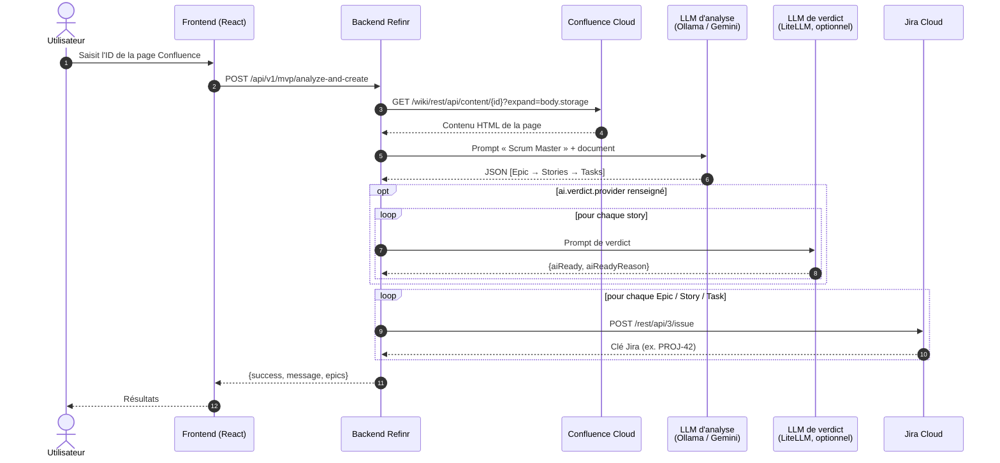

<div align="center">

# 📄 ➜ 🎯 Refinr

**Transformez un cahier des charges Confluence en backlog Jira Scrum prêt à l'emploi, grâce à l'IA.**

Epics · User Stories · Sous-tâches · Critères d'acceptation · Story points · Verdict « prêt pour un agent de code »


</div>

---

## 📚 Sommaire

- [Présentation](#-présentation)
- [Fonctionnalités](#-fonctionnalités)
- [Mode de fonctionnement](#️-mode-de-fonctionnement)
- [Architecture du projet](#-architecture-du-projet)
- [Prérequis](#-prérequis)
- [Installation](#️-installation)
- [Configuration & connexion aux services](#-configuration--connexion-aux-services)
- [Lancer l'application](#️-lancer-lapplication)
- [Utilisation](#-utilisation)
- [Référence de l'API](#-référence-de-lapi)
- [Modèle de données](#️-modèle-de-données)
- [Tests](#-tests)
- [Dépannage](#-dépannage)
- [Limites connues & feuille de route](#️-limites-connues--feuille-de-route)

---

## ✨ Présentation

**Refinr** lit une page Confluence (cahier des charges, spécification, besoin rapide…), la fait analyser par un LLM jouant le rôle de **Scrum Master / Product Owner**, puis crée automatiquement toute la hiérarchie correspondante dans un projet Jira :

```
Epic  ──►  User Story  ──►  Sous-tâche
```

Chaque story reçoit en plus un **verdict de maturité** : `ai-ready` (un agent de code peut l'implémenter sans décision humaine) ou `validation-necessaire` (il manque une information). Ce verdict est conçu pour alimenter un agent de code via JQL `labels = "ai-ready"`.

Le projet est un monorepo :

| Dossier | Rôle | Stack |
|---|---|---|
| [`backend/`](backend) | API backend | Java 25 · Spring Boot 4.1 · WebClient · Spring Resilience (`@Retryable`) |
| [`frontend/`](frontend) | Interface web | React 18 · TypeScript · Vite · Tailwind · TanStack Query |

---

## 🚀 Fonctionnalités

### Analyse IA du cahier des charges
- 📖 **Lecture Confluence** : récupération du contenu d'une page via son ID (format *storage*) et recherche de pages par espace + titre (CQL).
- 🧠 **Découpage Scrum proportionné** : 1 Epic pour un besoin court, un Epic par module pour un cahier des charges complet — sans jamais inventer de fonctionnalités absentes du document.
- 📝 **User stories normalisées** : format *As a / I want / So that*, titre, description.
- ✅ **Critères d'acceptation testables** au format *Given / When / Then* (2 à 5 par story).
- 🔢 **Estimation en story points** (suite de Fibonacci : 1, 2, 3, 5, 8, 13) et heures estimées par tâche.
- 🏷️ **Priorités et labels techniques** (`backend`, `frontend`, `api`, `security`, `devops`…), nettoyés et normalisés automatiquement.

### Verdict « prêt pour un agent de code »
- 🤖 Chaque story est évaluée : `aiReady = true` **uniquement** si le périmètre est clair, les critères testables et sans dépendance externe non précisée.
- 🔀 Le verdict peut être confié à un **fournisseur IA distinct** de l'analyse (ex. structure par Ollama local, verdict par un pool Gemini via un proxy LiteLLM).
- 🛡️ **Sécurité par défaut** : verdict absent, ambigu ou en erreur ⇒ `validation-necessaire`.
- ♻️ **Verdict recalculé à la création** (`create-jira`) : le contenu a pu être modifié depuis l'aperçu, le serveur rejuge donc chaque story sur son contenu final (un appel au fournisseur de verdict par story) ; les champs `aiReady` / `aiReadyReason` envoyés par le client sont **ignorés**.
- 🔁 **Réévaluation** : une story en attente peut être réévaluée avec une précision de l'utilisateur ; la description Jira d'origine est conservée (images, tableaux, liens) et complétée, le label est mis à jour.

### Création Jira
- 🏗️ Création complète Epic → Story (liée via `parent`) → Subtask.
- 📝 Descriptions écrites en Markdown et converties en **ADF** (titres, gras, italique, listes, code en ligne et blocs de code) : rendu natif dans Jira, critères d'acceptation en liste.
- 🎯 Projet cible **configurable par requête** (`projectKey`) ou projet par défaut.
- ⚙️ Compatible projets **team-managed** (sans champ *priority*) via `jira.priority-enabled=false`.
- 🔢 **Story points** envoyés dans le champ configuré par `jira.story-points-field` (désactivé si vide). L'identifiant dépend de l'instance : `GET /rest/api/3/field`, champ nommé *Story point estimate* (team-managed) ou *Story Points* (company-managed), souvent `customfield_10016`. Le champ doit figurer sur l'écran de création des stories.
- 👀 **Mode prévisualisation** : générer la structure sans rien créer, l'ajuster, puis l'envoyer à Jira.

### Fiabilité & observabilité
- 🔄 **Nouveaux essais ciblés** (lectures et appels IA uniquement) ; la création Jira n'est **jamais** rejouée, pour ne pas créer de doublons :

  | Appel | Nouvel essai | Détail |
  |---|---|---|
  | Lecture d'une page Confluence | ✅ sur HTTP `429` et `500` | 2 nouveaux essais, après 1 s puis 2 s (`503` et autres erreurs : pas de nouvel essai) |
  | Analyse IA du document (Gemini / Ollama) | ✅ sur HTTP `429` et `500` | idem : 2 nouveaux essais, 1 s puis 2 s |
  | Verdict via LiteLLM (`ai.verdict.provider=litellm`) | ✅ sur `429`, `5xx` et proxy injoignable | 3 tentatives au total, pause `ai.verdict.retry-delay-ms` × n° de tentative, délai `ai.verdict.timeout-seconds` par tentative (pas de nouvel essai après un délai dépassé) |
  | Verdict par Gemini / Ollama (`create-jira`, `reassess-story`) | ❌ | un échec ⇒ `validation-necessaire` (`create-jira`) ou erreur `500` (`reassess-story`) |
  | Recherche Confluence | ❌ | |
  | **Création Jira** (Epic, Story, Subtask) | ❌ | POST non idempotent : un échec est listé dans la réponse partielle (`created` / `failed`, statut `207` ou `502`), les autres éléments sont créés ; relancez seulement ce qui a échoué |
  | Lecture / mise à jour Jira (`reassess-story`), health check | ❌ | |
- ⏱️ Timeout borné sur le fournisseur de verdict (90 s par défaut).
- 🩺 **Health check détaillé** : état de Confluence, Jira et du fournisseur IA (présence du modèle Ollama incluse).
- 📊 **Logs JSON structurés** (Logstash) avec `correlationId` par requête.

### Interface web
- 🏠 Page d'accueil, page **Analyze** (saisie de l'ID de page Confluence, suivi des étapes), page **Results** (compteurs Epics / Stories / Subtasks).
- 🟢 Indicateurs d'état des services dans l'en-tête.

---

## ⚙️ Mode de fonctionnement



**En résumé :**

1. **Lecture** — le backend récupère la page Confluence avec un token API Atlassian (Basic Auth).
2. **Analyse** — le contenu est injecté dans un prompt structuré ; le LLM répond en JSON strict, que le backend nettoie (suppression des balises markdown) puis désérialise.
3. **Verdict** — soit inclus dans l'analyse, soit calculé story par story par un fournisseur dédié (3 tentatives, backoff, timeout).
4. **Création** — chaque Epic, Story puis Sous-tâche est créée dans Jira ; la description est convertie en ADF (Atlassian Document Format) et la story reçoit le label `ai-ready` ou `validation-necessaire`.
5. **Réévaluation** (cycle de vie) — `POST /reassess-story` relit une story Jira en `validation-necessaire`, la réévalue avec la précision fournie et met à jour description + label.

---

## 🧱 Architecture du projet

```
refinr/
├── .env.example                             # Modèle des secrets locaux (à copier en .env)
└── backend/
    ├── pom.xml
    └── src/
        ├── main/
        │   ├── java/fr/heliocraft/refinr/
        │   │   ├── RefinrApplication.java           # Point d'entrée Spring Boot
        │   │   ├── domain/
        │   │   │   ├── model/                       # Epic, Story, Task, Readiness, TrackedStory (Java pur)
        │   │   │   └── service/                     # Règles : labels réservés, verdict par défaut, normalisation
        │   │   ├── application/
        │   │   │   ├── port/in/                     # AnalyzeDocument, PreviewBacklog, CreateBacklog, ReassessStory, SearchDocuments
        │   │   │   ├── port/out/                    # DocumentSourcePort, IssueTrackerPort, LlmPort
        │   │   │   └── service/                     # Implémentation des cas d'usage
        │   │   ├── adapters/
        │   │   │   ├── in/rest/                     # MvpController (/api/v1/mvp/*), HealthCheckController, DTO JSON
        │   │   │   └── out/
        │   │   │       ├── confluence/              # ConfluenceDocumentSource
        │   │   │       ├── jira/                    # JiraIssueTracker : labels, priorité, ADF, réévaluation
        │   │   │       └── llm/                     # LlmBacklogAnalyzer : analyse (Ollama/Gemini) + verdict (LiteLLM/Ollama/Gemini)
        │   │   └── config/                          # Câblage des cas d'usage, WebClient, Retry, LoggingFilter (correlationId)
        │   └── resources/
        │       ├── application-example.properties   # Modèle de configuration (à copier)
        │       ├── application.properties           # Copie locale du modèle — ignorée par Git
        │       └── logback-spring.xml               # Logs JSON
        └── test/                                    # Tests unitaires + intégration (MockWebServer)
```

---

## 📋 Prérequis

### Logiciels

| Outil | Version | Usage |
|---|---|---|
| **JDK** | 25 | Backend |
| **Maven** | 3.9+ | Build backend |
| **Node.js** + npm | 18+ | Frontend |
| **Ollama** | récent | Analyse IA locale (fournisseur par défaut) |
| Proxy **LiteLLM** | optionnel | Verdict IA séparé (API compatible OpenAI) |

### Comptes & accès

- Un site **Atlassian Cloud** (`https://<votre-site>.atlassian.net`) avec Confluence et Jira.
- Un **token API Atlassian** : <https://id.atlassian.com/manage-profile/security/api-tokens>.
- Les droits de **lecture** sur l'espace Confluence et de **création de tickets** dans le projet Jira.
- Le projet Jira doit proposer les types de tickets **`Epic`**, **`Story`** et **`Subtask`**.
- *(Si `ai.provider=gemini`)* une clé **Google AI Studio** : <https://aistudio.google.com/apikey>.

### Matériel (mode Ollama)

Le modèle par défaut `qwen3:8b` nécessite environ **8 Go de RAM/VRAM libres**. Sur une machine plus modeste, choisissez un modèle plus léger ou passez sur Gemini.

---

## 🛠️ Installation

### 1. Cloner le dépôt

```bash
git clone https://github.com/<your-org>/refinr.git
cd refinr
git config core.hooksPath .githooks   # active les hooks pre-commit (gitleaks) et commit-msg
```

### 2. Préparer l'IA locale (Ollama)

```bash
# macOS
brew install ollama
ollama serve            # démarre le serveur sur http://localhost:11434
ollama pull qwen3:8b    # télécharge le modèle par défaut
```

### 3. Installer le frontend

```bash
cd frontend
npm install
```

---

## 🔐 Configuration & connexion aux services

### Backend

Les secrets vivent **uniquement** dans le fichier `.env` à la racine du dépôt (ignoré par Git).
Copiez les deux modèles puis renseignez vos valeurs dans `.env` :

```bash
cp .env.example .env
cp backend/src/main/resources/application-example.properties backend/src/main/resources/application.properties
```

`application.properties` ne contient que des références `${VAR:défaut}` et importe `.env`
(`spring.config.import=optional:file:../.env[.properties]`). Une vraie variable d'environnement est prioritaire sur `.env`.

> ⚠️ `application.properties` est listé dans `.gitignore` : **ne le commitez jamais**. Préférez les variables d'environnement pour les secrets (`${JIRA_TOKEN:}`, etc.).

```properties
server.port=8080

# --- Confluence -------------------------------------------------
confluence.base-url=${CONFLUENCE_BASE_URL:https://your-site.atlassian.net}
confluence.username=${CONFLUENCE_USERNAME:you@example.com}
confluence.token=${CONFLUENCE_TOKEN:}
confluence.space-key=SPACE

# --- Jira -------------------------------------------------------
jira.base-url=${JIRA_BASE_URL:https://your-site.atlassian.net}
jira.username=${JIRA_USERNAME:you@example.com}
jira.token=${JIRA_TOKEN:}
jira.project-key=PROJ            # projet par défaut
jira.priority-enabled=true       # false pour un projet team-managed
jira.story-points-field=         # ex. customfield_10016 ; vide = story points non envoyés

# --- IA : analyse (structure Epic/Story/Task) -------------------
ai.provider=ollama               # ollama | gemini
ollama.base-url=http://localhost:11434
ollama.model=qwen3:8b
gemini.api-key=${GEMINI_API_KEY:}
gemini.model=gemini-2.5-flash

# --- IA : verdict ai-ready (optionnel) --------------------------
# Vide = le verdict est produit par l'appel d'analyse
ai.verdict.provider=litellm      # litellm | ollama | gemini | (vide)
ai.verdict.base-url=${AI_VERDICT_BASE_URL:http://localhost:4000}
ai.verdict.model=gemini-2.5-flash
ai.verdict.api-key=${AI_VERDICT_API_KEY:}
ai.verdict.timeout-seconds=90
ai.verdict.retry-delay-ms=2000
```

#### Tableau des propriétés

| Propriété | Défaut | Description |
|---|---|---|
| `confluence.base-url` / `jira.base-url` | — | URL du site Atlassian Cloud (sans `/wiki`) |
| `confluence.username` / `jira.username` | — | E-mail du compte Atlassian |
| `confluence.token` / `jira.token` | — | Token API Atlassian |
| `jira.project-key` | — | Clé du projet utilisé si `projectKey` n'est pas fourni |
| `jira.priority-enabled` | `true` | Envoie le champ `priority` (désactiver en team-managed) |
| `jira.story-points-field` | *(vide)* | Champ personnalisé des story points (ex. `customfield_10016`, cf. ci-dessous) ; vide = non envoyés |
| `ai.provider` | `ollama` | Fournisseur de l'analyse : `ollama` ou `gemini` |
| `ollama.model` | `qwen3:8b` | Modèle Ollama utilisé |
| `gemini.api-key` | — | Clé API Google Gemini |
| `gemini.model` | `gemini-2.5-flash` | Modèle Gemini de l'analyse (et du health check) |
| `ai.verdict.provider` | *(vide)* | Fournisseur dédié au verdict `ai-ready` |
| `ai.verdict.model` | `gemini-2.5-flash` | Modèle du verdict (nom du modèle Gemini, ou alias côté LiteLLM) |
| `ai.verdict.timeout-seconds` | `90` | Délai maximal par appel de verdict |

#### Variables d'environnement (recommandé)

Voir `.env.example` pour la liste complète (`CONFLUENCE_TOKEN`, `JIRA_TOKEN`, `GEMINI_API_KEY`,
`AI_VERDICT_API_KEY`…). Les mêmes noms peuvent être fournis comme variables d'environnement.

### Frontend

Aucune variable n'est nécessaire : le client appelle `/api/v1`.

En développement, Vite **proxifie `/api` vers `http://localhost:8080`** (voir `vite.config.ts`) : aucune configuration CORS supplémentaire n'est nécessaire.

### Vérifier la connexion

Une fois le backend démarré :

```bash
curl -s http://localhost:8080/api/v1/health | jq
```

```json
{
  "status": "UP",
  "services": {
    "confluence": { "status": "UP" },
    "jira":       { "status": "UP" },
    "ai":         { "status": "UP", "provider": "ollama", "model": "qwen3:8b" }
  }
}
```

`DEGRADED` signifie qu'au moins un service est `DOWN` ; le champ `error` donne une cause courte et sans donnée sensible : `HTTP 401` (token invalide), `HTTP 404` (projet introuvable), `unreachable` (service injoignable), modèle Ollama non téléchargé… Le détail est dans les logs du backend.

En cas d'erreur, les endpoints `/mvp/*` renvoient `{ "success": false, "error": "<message générique>", "correlationId": "…" }` : jamais le message brut de l'exception ; le `correlationId` permet de retrouver le détail dans les logs.

---

## ▶️ Lancer l'application

```bash
# 1. IA locale
ollama serve

# 2. Backend  →  http://localhost:8080
cd backend
mvn spring-boot:run

# 3. Frontend →  http://localhost:3000
cd frontend
npm run dev
```

Build de production :

```bash
(cd backend && mvn clean package && java -jar target/refinr-1.0.0.jar)
(cd frontend && npm run build)   # génère frontend/dist/
```

---

## 🧭 Utilisation

### Trouver l'ID d'une page Confluence

Ouvrez la page dans Confluence : l'ID est le nombre dans l'URL.

```
https://votre-site.atlassian.net/wiki/spaces/SPACE/pages/123456789/Mon+cahier+des+charges
                                                         ^^^^^^^^^
```

Ou recherchez-la via l'API :

```bash
curl "http://localhost:8080/api/v1/mvp/confluence/search?spaceKey=SPACE&title=cahier"
```

```json
{ "success": true, "results": [ { "id": "123456789", "title": "Mon cahier des charges", "url": "https://your-site.atlassian.net/wiki/spaces/SPACE/pages/123456789/Mon+cahier+des+charges" } ] }
```

### Via l'interface web

1. Ouvrez <http://localhost:3000> et vérifiez que les indicateurs de santé de l'en-tête sont **verts**.
2. Cliquez sur **Analyze**.
3. Collez l'**ID de la page Confluence** et lancez l'analyse.
4. Suivez les étapes : *lecture Confluence → analyse IA → création Jira*.
5. Sur la page **Results**, consultez le récapitulatif puis ouvrez votre projet Jira.

### Via l'API (workflow recommandé : prévisualiser puis créer)

```bash
# 1. Prévisualiser la structure sans rien créer
curl -s -X POST http://localhost:8080/api/v1/mvp/analyze-preview \
  -H "Content-Type: application/json" \
  -d '{"confluencePageId": "123456789"}' > preview.json

# 2. (optionnel) Relire / modifier les epics dans preview.json
#    (le verdict ai-ready sera recalculé à la création : inutile de modifier aiReady / aiReadyReason)

# 3. Créer dans Jira à partir de la prévisualisation (projectKey optionnel)
jq '.epics' preview.json | curl -s -X POST "http://localhost:8080/api/v1/mvp/create-jira?projectKey=PROJ" \
  -H "Content-Type: application/json" -d @-
```

Ou en une seule étape, éventuellement dans un autre projet :

```bash
curl -s -X POST http://localhost:8080/api/v1/mvp/analyze-and-create \
  -H "Content-Type: application/json" \
  -d '{"confluencePageId": "123456789", "projectKey": "DEMO"}'
```

### Débloquer une story `validation-necessaire`

```bash
curl -s -X POST http://localhost:8080/api/v1/mvp/reassess-story \
  -H "Content-Type: application/json" \
  -d '{"issueKey": "PROJ-42", "precision": "L’authentification se fait via OAuth2 GitLab, la maquette est validée."}'
```

```json
{ "success": true, "issueKey": "PROJ-42", "aiReady": true, "aiReadyReason": "Périmètre et critères désormais complets." }
```

### 💡 Conseils pour un bon résultat

- Structurez la page Confluence par **modules / fonctionnalités** (titres clairs) : chaque module devient un Epic.
- Précisez les **rôles utilisateurs**, les **règles métier** et les **contraintes techniques** (stack, API, sécurité).
- Mentionnez explicitement les dépendances (accès, clés d'API, maquettes) : sinon les stories seront marquées `validation-necessaire`.
- Utilisez `analyze-preview` sur un nouveau document avant toute création massive.

---

## 📡 Référence de l'API

Base URL : `http://localhost:8080/api/v1`

| Méthode | Endpoint | Corps / paramètres | Description |
|---|---|---|---|
| `POST` | `/mvp/analyze-and-create` | `{ "confluencePageId": "…", "projectKey": "PROJ" }` *(projectKey optionnel, format `^[A-Z][A-Z0-9]{1,9}$`)* | Lit, analyse et crée toute la hiérarchie dans Jira |
| `POST` | `/mvp/analyze-preview` | `{ "confluencePageId": "…" }` | Analyse sans créer de tickets |
| `POST` | `/mvp/create-jira` | `Epic[]` (JSON) · `?projectKey=PROJ` *(optionnel, même format)* | Crée une structure déjà générée, dans `projectKey` ou le projet par défaut ; verdict `ai-ready` recalculé par le serveur (`aiReady` / `aiReadyReason` du client ignorés) |
| `POST` | `/mvp/reassess-story` | `{ "issueKey": "PROJ-42", "precision": "…" }` | Réévalue une story `validation-necessaire` (`409` si elle ne l'est pas) |
| `GET` | `/mvp/confluence/search` | `?spaceKey=SPACE&title=…` | Recherche de pages Confluence (CQL) : `{ success, results: [{ id, title, url }] }` |
| `GET` | `/mvp/health` | — | Ping simple du service |
| `GET` | `/health` | — | Santé détaillée Confluence / Jira / IA |

**Réponse de création (`analyze-and-create` et `create-jira`) :**

| Statut | Cas | `success` |
|---|---|---|
| `200` | Tous les tickets ont été créés | `true` |
| `207` | Création partielle : certains tickets créés, d'autres non | `false` |
| `502` | Aucun ticket n'a pu être créé | `false` |

Un échec n'interrompt pas la création : l'élément est listé dans `failed` (avec une raison : statut HTTP et
erreurs de validation de Jira), ses enfants aussi (`Not created: parent … failed`), et les éléments suivants sont créés.

```json
{
  "success": false,
  "message": "Partially created: 2 issues created, 2 not created",
  "created": [
    { "type": "epic",  "title": "Epic: Authentification", "key": "PROJ-1" },
    { "type": "story", "title": "Connexion OAuth2",       "key": "PROJ-2" }
  ],
  "failed": [
    { "type": "story",   "title": "Export PDF",  "reason": "Jira rejected the story (HTTP 400): priority: Field 'priority' cannot be set." },
    { "type": "subtask", "title": "Générer le PDF", "reason": "Not created: parent story Export PDF failed" }
  ],
  "epics": [ { "name": "Epic: Authentification", "jiraKey": "PROJ-1", "stories": [ … ] } ]
}
```

En cas d'erreur : HTTP `400` / `409` / `500` avec `{ "success": false, "error": "…" }`.

---

## 🗂️ Modèle de données

```jsonc
// Epic
{
  "name": "Epic: Gestion des utilisateurs",
  "description": "…",
  "priority": "High",                 // High | Medium | Low
  "labels": ["backend", "security"],
  "jiraKey": "PROJ-1",                // renseigné après création
  "stories": [
    // Story
    {
      "title": "Connexion OAuth2",
      "asA": "Utilisateur", "iWant": "me connecter avec GitLab", "soThat": "accéder à mes dépôts",
      "description": "…",
      "acceptanceCriteria": ["Given …, When …, Then …"],
      "estimatedStoryPoints": 5,
      "priority": "High",
      "labels": ["backend", "api"],
      "aiReady": false,
      "aiReadyReason": "Le fournisseur OAuth et les scopes ne sont pas précisés.",
      "tasks": [
        // Task (créée en Subtask)
        { "title": "Créer le service OAuth", "description": "…", "estimatedHours": 4, "labels": ["backend"] }
      ]
    }
  ]
}
```

**Labels de verdict** posés sur chaque story Jira :

| Label | Signification |
|---|---|
| `ai-ready` | Implémentable par un agent de code sans décision humaine |
| `validation-necessaire` | Information manquante : validation / précision humaine requise |

Ces deux labels sont **réservés** : s'ils apparaissent dans la sortie de l'IA (sur un Epic, une story ou une tâche), ils sont supprimés — seul le verdict explicite les pose.

---

## 🧪 Tests

```bash
mvn test
```

| Suite | Couverture |
|---|---|
| `LlmBacklogAnalyzerTest` | Prompt, parsing JSON, Ollama/Gemini, verdict LiteLLM, retry et timeout du verdict, réévaluation |
| `JiraIssueTrackerTest` | Création Epic/Story/Subtask, labels, priorité, ADF, réévaluation, projet cible |
| `ConfluenceDocumentSourceTest` | Lecture de page, erreurs 404/401, contenu vide, volumineux ou à caractères spéciaux |
| `MvpControllerTest` | Endpoints, validation `projectKey`, réévaluation (409), gestion des erreurs |
| `RestJsonContractTest`, `LlmResponseContractTest` | Contrat JSON figé de l'API REST et du parsing de la réponse LLM |
| `CreateBacklogServiceTest`, `ReassessStoryServiceTest`, `domain.service.*Test` | Cas d'usage et règles métier, sans framework |
| `ApplicationWiringTest` | Démarrage du contexte Spring, câblage des cas d'usage, comportement de retry |
| `HexagonalArchitectureTest` | Règles d'architecture (ArchUnit) : domaine/application sans framework, sens des dépendances |
| `FullFlowIntegrationTest` | Parcours complet Confluence → IA → Jira et pannes de chaque service |

Les appels HTTP externes sont simulés avec **OkHttp MockWebServer** : aucun accès réseau ni token n'est requis.

---

## 🩹 Dépannage

| Symptôme | Cause probable | Solution |
|---|---|---|
| `ai: DOWN — modele qwen3:8b absent` | Modèle non téléchargé | `ollama pull qwen3:8b` |
| `Ollama API call failed` | Serveur Ollama arrêté | `ollama serve` |
| `confluence: DOWN` / `401` | Token ou e-mail Atlassian invalide | Régénérer le token API, vérifier `*.username` |
| `jira: DOWN` / `404` | `jira.project-key` inexistant ou inaccessible | Vérifier la clé et les droits du compte |
| `Failed to create Epic … priority` | Projet team-managed sans champ priorité | `jira.priority-enabled=false` |
| `issuetype … invalid` | Types `Epic` / `Story` / `Subtask` absents | Vérifier la configuration du projet Jira |
| `Failed to parse … response` | Réponse IA non JSON ou tronquée | Réessayer, utiliser un modèle plus grand ou Gemini |
| Toutes les stories en `validation-necessaire` | Proxy de verdict injoignable | Vérifier LiteLLM (`ai.verdict.base-url`) ou vider `ai.verdict.provider` |
| `git fetch` : *HTTP Basic: Access denied* | Token GitLab expiré | Recréer un Personal Access Token ou passer en SSH |

Les logs sont émis en **JSON** ; chaque requête porte un `correlationId` pour suivre tout son parcours.

---

## 🗺️ Limites connues & feuille de route

- [ ] Les descriptions sont envoyées dans un unique paragraphe ADF : le balisage (`h3.`, `*gras*`) n'est pas rendu.
- [ ] La création n'est pas transactionnelle : une erreur en cours de route laisse les tickets déjà créés.
- [ ] Brancher la prévisualisation et la réévaluation dans l'interface web.
- [ ] Sécuriser l'API (authentification, CORS restreint — actuellement `*`).
- [ ] Conteneurisation (Dockerfile / docker-compose avec Ollama) et pipeline CI GitHub Actions.

---

<div align="center">

**Refinr** — AGPL-3.0-only

</div>
