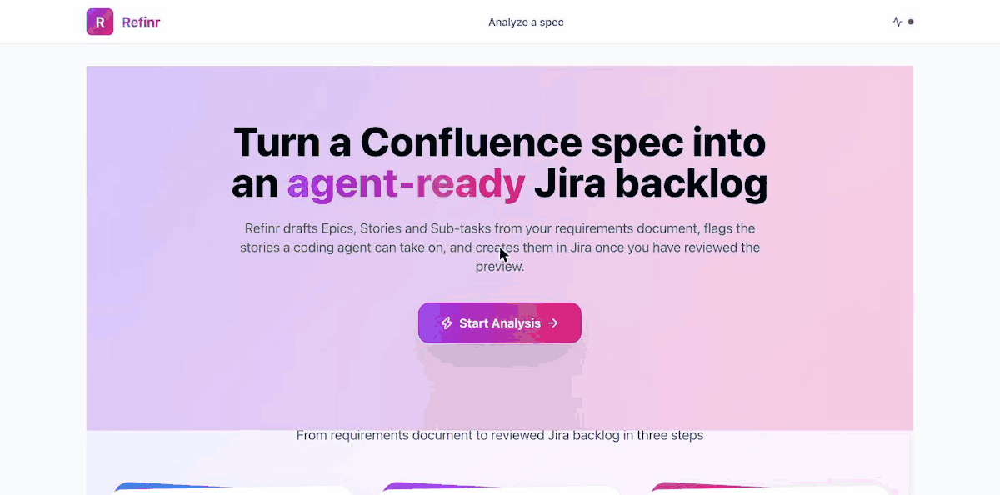
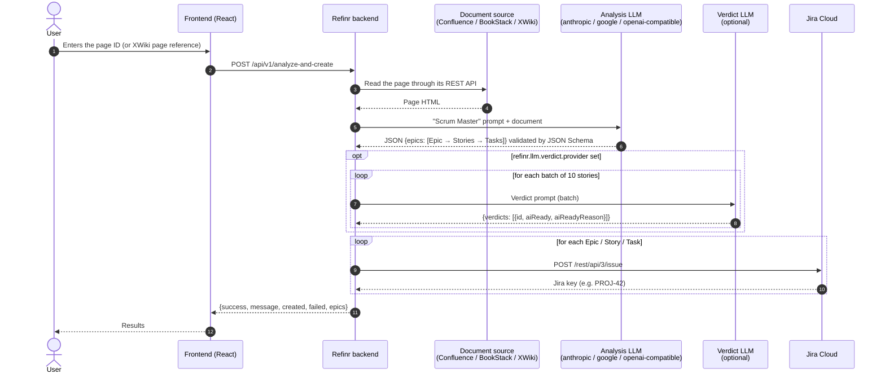
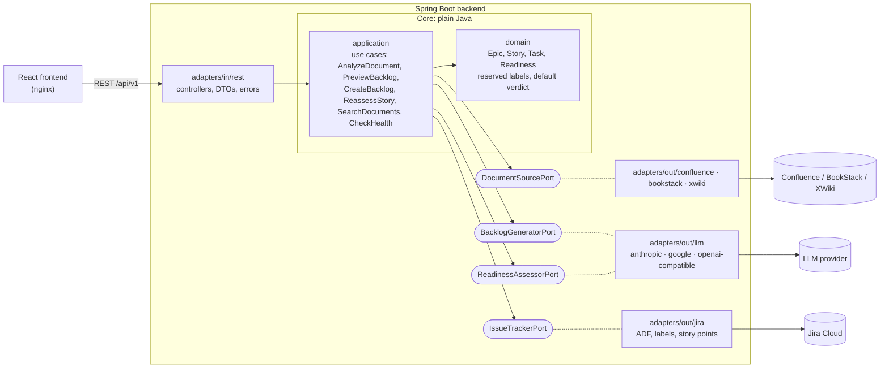

<div align="center">

# 📄 ➜ 🎯 Refinr

**Refinr turns a spec from Confluence, BookStack or XWiki into a Jira or OpenProject backlog (Epic → Story → Sub-task) and tells you, story by story, whether a coding agent can build it without a human decision.**

**English** · [Français](README.fr.md)


[](LICENSE)

</div>

<p align="center">
  
</p>

---

## 🤔 Why

Coding agents can implement a story — when the story is clear. The real bottleneck sits upstream: knowing
**which** stories you can hand over without a round-trip to a human.

Refinr does more than split a spec into tickets. It judges every story and labels it **`ai-ready`** (clear scope,
testable acceptance criteria, no unspecified external dependency) or **`validation-necessaire`** ("needs
validation", with the reason). The verdict is **recomputed on the final content** when issues are created, and any
doubt defaults to `validation-necessaire`. You get a queue your agents can pull with one JQL query —
`labels = "ai-ready"` — and a precise list of questions for your Product Owner about the rest.

## ⚡ Quickstart (Docker)

```bash
git clone https://github.com/chams-bensalem/refinr.git && cd refinr
cp .env.example .env           # fill in your document source, your issue tracker and your LLM provider
docker compose up -d --build   # UI http://localhost:3000 · API http://localhost:8080
```

Using Ollama on your machine? In `.env`, set `LLM_ANALYSIS_BASE_URL=http://host.docker.internal:11434/v1`
(inside a container, `localhost` is the container itself). Check it with `curl localhost:8080/api/v1/health`.
Want a bundled local model? `docker compose --profile ollama up -d --build`
with `LLM_ANALYSIS_BASE_URL=http://ollama:11434/v1`. More in [Docker Compose](#docker-compose).

## 🔌 LLM providers

| Provider | `provider` | Status |
|---|---|---|
| Ollama (local, default `qwen3:8b`) | `openai-compatible` | ✅ tested against the real API |
| Google Gemini (`gemini-3.6-flash`) | `google` | ✅ tested against the real API |
| Anthropic Claude | `anthropic` | ⚠️ not tested against the real API (simulated HTTP server only) |
| OpenAI | `openai-compatible` | ⚠️ not tested against the real API (simulated HTTP server only) |
| DeepSeek, Mistral, Groq, OpenRouter, LiteLLM, vLLM | `openai-compatible` | ⚠️ not tested against the real API (same client as OpenAI / Ollama) |

"Tested against the real API" means analysis and verdict were run end to end against the provider. Every client is
also covered by tests against a simulated HTTP server (success, `401`, `429` + retry, invalid JSON + repair, timeout).
Tried an untested provider? Please report back — see [CONTRIBUTING.md](CONTRIBUTING.md).

---

## 📚 Contents

- [Features](#-features)
- [How it works](#️-how-it-works)
- [Architecture](#-architecture)
- [Requirements](#-requirements)
- [Configuration](#-configuration)
- [Running](#️-running)
- [Usage](#-usage)
- [API reference](#-api-reference)
- [Data model](#️-data-model)
- [Tests](#-tests)
- [Troubleshooting](#-troubleshooting)
- [Limitations & roadmap](#️-limitations--roadmap)
- [Contributing](#-contributing)
- [License](#-license)

---

## 🚀 Features

**Document sources (one per instance)**
- 📚 **Confluence Cloud** (default), **BookStack** and **XWiki** (v1.2) with `source.provider`: the page is read as
  HTML (BookStack includes and XWiki macros such as `{{include}}` / `{{code}}` expanded), with a dedicated read-only
  account (see [Document sources](#document-sources)).
- 🔎 Title search in the whole source or in one space / book (`GET /api/v1/documents/search`), and a link back to the
  analyzed document in the preview.

**AI analysis of the spec**
- 🔌 **Pick your provider**, separately for the analysis and for the verdict: `anthropic`, `google` or
  `openai-compatible` (OpenAI, DeepSeek, Mistral, Groq, OpenRouter, Ollama, LiteLLM, vLLM…).
- 📐 **Output validated by JSON Schema** (using the provider's native JSON mode when it has one). Invalid output ⇒ up
  to 2 repair attempts with the list of errors, then a clean `502`. Output truncated by the token limit ⇒ explicit
  error, no retry.
- 🧠 **Proportionate Scrum breakdown**: one Epic for a short need, one Epic per module for a full spec — never
  inventing features that are not in the document. Empty pages are refused with a `400`, without calling the LLM.
- 📝 **Normalized stories**: *As a / I want / So that*, 2–5 *Given / When / Then* acceptance criteria, Fibonacci story
  points, estimated hours per task, priorities and cleaned technical labels.

**"Ready for a coding agent" verdict**
- 🤖 `aiReady = true` **only** when the scope is clear, criteria are testable and no external dependency is left
  unspecified. Absent, ambiguous or failed verdict ⇒ `validation-necessaire`.
- 🔀 The verdict can use a **different provider** than the analysis (e.g. structure by local Ollama, verdict by
  Gemini, Claude or a LiteLLM proxy), in batches of 10 stories, with a content-addressed cache.
- ♻️ **Recomputed at creation** (`create-jira`): the client's `aiReady` / `aiReadyReason` are ignored, only
  changed stories are re-judged.
- 🔁 **Reassessment**: unblock a `validation-necessaire` story with a clarification; the original Jira description
  (images, tables, links) is kept and extended, the label updated.

**Issue creation (Jira or OpenProject)**
- 🟦 **OpenProject** (v1.1) instead of Jira with `tracker.provider=openproject`: same hierarchy, verdict in a list
  custom field, story points on user stories, reassessment as a comment (see [OpenProject](#openproject)).
- 🏗️ Epic → Story (linked through `parent`) → Sub-task, Markdown descriptions converted to **ADF** (headings, bold,
  italic, lists, inline code and code blocks).
- 🎯 Target project per request (`projectKey`) or a default project; **team-managed** projects supported
  (`jira.priority-enabled=false`); **story points** written to the field set in `jira.story-points-field`.
- 👀 **Preview mode**: generate the structure, edit it, then send it to Jira.
- 🧾 **Partial results instead of duplicates**: issue creation is never retried; a failure is reported in
  `created` / `failed` (`207` or `502`) and the remaining issues are still created.

**Operations**
- 🩺 Health check per outbound port (the active document source, the active tracker, each LLM provider), cached 45 s, never exposing a key or URL.
- 📊 Structured JSON logs with a `correlationId` per request; error responses never echo raw exception messages.
- 🐳 Multi-arch (`amd64` / `arm64`) non-root images, read-only containers, ports bound to `127.0.0.1`, CORS allowlist,
  optional `X-API-Key`, DNS rebinding protection.

---

## ⚙️ How it works



1. **Read** — the backend fetches the page from the active source as HTML: Confluence storage format (Atlassian API
   token), BookStack page HTML (API token) or the HTML rendered by XWiki (technical account).
2. **Analyze** — the content goes into a structured prompt; the LLM answers in JSON, validated by a JSON Schema;
   invalid output is sent back with the list of errors.
3. **Verdict** — either part of the analysis, or computed by a dedicated provider, in batches.
4. **Create** — each Epic, Story then Sub-task is created in Jira with an ADF description and the `ai-ready` or
   `validation-necessaire` label on stories.
5. **Reassess** — `POST /reassess-story` re-reads a `validation-necessaire` story, re-judges it with the clarification
   you give, and updates its description and label.

---

## 🧱 Architecture

Hexagonal (ports & adapters): the domain and the use cases are plain Java, with no Spring, HTTP client or JSON library
(enforced by ArchUnit tests); every external service sits behind a port. `IssueTrackerPort` and `DocumentSourcePort`
stay tool-agnostic, which is what makes the OpenProject adapter of v1.1 and the BookStack and XWiki adapters of v1.2
possible.



| Folder | Role | Stack |
|---|---|---|
| [`backend/`](backend) | REST API | Java 25 · Spring Boot 4.1 · WebClient · Spring resilience (`@Retryable`) |
| [`frontend/`](frontend) | Web UI | React 18 · TypeScript · Vite · Tailwind · TanStack Query |

Package layout under `backend/src/main/java/fr/heliocraft/refinr/`: `domain/` (model, rules), `application/`
(`port/in`, `port/out`, `service`), `adapters/in/rest`, `adapters/out/{confluence,bookstack,xwiki,jira,openproject,llm}`, `config/` (wiring,
LLM providers, retry, HTTP security, `correlationId`). Technical choices are recorded in [DECISIONS.md](DECISIONS.md) (French).

---

## 📋 Requirements

| Tool | Version | Used for |
|---|---|---|
| **Docker** + Compose v2 | recent | The quickstart — no JDK or Node needed |
| **JDK** | 25 | Backend (Maven always compiles and tests on a JDK 25 through toolchains) |
| **Maven** | 3.9+ | Backend build |
| **Node.js** + npm | 22.12+ (reference: `.nvmrc`) | Frontend |
| **Ollama** | recent | Optional local LLM (the default provider) |

- A **document source**: Confluence Cloud with an
  [Atlassian API token](https://id.atlassian.com/manage-profile/security/api-tokens), BookStack (API token of a
  dedicated account) or XWiki (dedicated technical account) — see [Document sources](#document-sources).
- An **issue tracker**: Jira Cloud (issue types **`Epic`**, **`Story`** and **`Subtask`**, issue creation rights) or
  OpenProject (see [OpenProject](#openproject)).
- For `google`: a [Google AI Studio key](https://aistudio.google.com/apikey); for `anthropic` or a hosted
  `openai-compatible` service: that provider's key.
- The default `qwen3:8b` needs about **8 GB of free RAM/VRAM**; on a smaller machine pick a lighter model or a hosted provider.

---

## 🔐 Configuration

Secrets live **only** in the `.env` file at the repository root (git-ignored). A real environment variable takes
precedence over `.env`.

```bash
cp .env.example .env
# Running the backend outside Docker also needs the property template:
cp backend/src/main/resources/application-example.properties backend/src/main/resources/application.properties
```

`application.properties` only holds `${VAR:default}` references and imports `.env`
(`spring.config.import=optional:file:../.env[.properties]`). It is git-ignored: never commit it.

### Per LLM provider

Set these in `.env`. `LLM_ANALYSIS_*` drives the analysis; the same keys with `LLM_VERDICT_*` configure an optional,
separate verdict provider (empty `LLM_VERDICT_PROVIDER` = the analysis call also produces the verdict).

```bash
# Ollama (default; no key). In Docker: http://host.docker.internal:11434/v1, or http://ollama:11434/v1 with --profile ollama
LLM_ANALYSIS_PROVIDER=openai-compatible
LLM_ANALYSIS_BASE_URL=http://localhost:11434/v1
LLM_ANALYSIS_MODEL=qwen3:8b
LLM_ANALYSIS_REASONING_EFFORT=none   # keeps qwen3 from "thinking" past the timeout

# Google Gemini (empty base URL = official endpoint)
LLM_ANALYSIS_PROVIDER=google
LLM_ANALYSIS_BASE_URL=
LLM_ANALYSIS_MODEL=gemini-3.6-flash
LLM_ANALYSIS_API_KEY=your-gemini-api-key

# Anthropic (empty base URL = official endpoint; not tested against the real API yet)
LLM_ANALYSIS_PROVIDER=anthropic
LLM_ANALYSIS_BASE_URL=
LLM_ANALYSIS_MODEL=your-claude-model
LLM_ANALYSIS_API_KEY=your-anthropic-api-key

# Any OpenAI-compatible API: OpenAI, DeepSeek, Mistral, Groq, OpenRouter, LiteLLM, vLLM (base URL required, with /v1)
LLM_ANALYSIS_PROVIDER=openai-compatible
LLM_ANALYSIS_BASE_URL=https://api.openai.com/v1
LLM_ANALYSIS_MODEL=your-model
LLM_ANALYSIS_API_KEY=your-api-key
LLM_ANALYSIS_REASONING_EFFORT=
# OpenAI reasoning models reject temperature and max_tokens:
#   LLM_ANALYSIS_TEMPERATURE=   LLM_ANALYSIS_MAX_TOKENS_PARAM=max_completion_tokens
```

On a slow machine (a few tokens/s), raise `LLM_ANALYSIS_TIMEOUT` (e.g. `30m`). Configuration keys from before v1.0
(`ai.provider`, `GEMINI_API_KEY`, `OLLAMA_*`…) are **refused at startup** with the mapping to apply — see the
[migration table in the French README](README.fr.md#migration-depuis-lancienne-configuration-ia).

### Jira

```bash
JIRA_BASE_URL=https://your-site.atlassian.net
JIRA_USERNAME=you@example.com
JIRA_TOKEN=your-atlassian-api-token
JIRA_PROJECT_KEY=PROJ          # default project when a request sets no projectKey
JIRA_PRIORITY_ENABLED=true     # false for a team-managed project (no priority field)
JIRA_STORY_POINTS_FIELD=       # e.g. customfield_10016; empty = story points not sent
```

- **Team-managed projects** have no *priority* field: set `JIRA_PRIORITY_ENABLED=false`, otherwise Jira rejects the
  Epic with *Field 'priority' cannot be set*.
- **Story points**: the field ID depends on your site. Call `GET /rest/api/3/field` and look for *Story point
  estimate* (team-managed) or *Story Points* (company-managed), often `customfield_10016`. The field must be on the
  Story creation screen.

### Document sources

Refinr reads the spec from **one** document source per instance, selected with `SOURCE_PROVIDER`: `confluence`
(default), `bookstack` or `xwiki` (v1.2). Only the properties of the chosen source are required: an instance on
BookStack or XWiki needs no `CONFLUENCE_*` variable. In every tool, use a **dedicated read-only account**: Refinr
never writes to the source.

#### Confluence

```bash
SOURCE_PROVIDER=confluence          # default
CONFLUENCE_BASE_URL=https://your-site.atlassian.net   # without /wiki
CONFLUENCE_USERNAME=you@example.com
CONFLUENCE_TOKEN=your-atlassian-api-token
```

- **Rights**: read access to the spaces holding your specs.
- **Page ID**: the number in the page URL (`…/wiki/spaces/SPACE/pages/123456789/My+spec`). Search `space` = space key.

#### BookStack

Checked against BookStack v26.09 (REST API with tokens). BookStack publishes **no official Docker image**: the one
used to test Refinr is the **community** image [`linuxserver/bookstack`](https://hub.docker.com/r/linuxserver/bookstack).

```bash
SOURCE_PROVIDER=bookstack
BOOKSTACK_BASE_URL=https://bookstack.example.com   # in Docker, a local instance is http://host.docker.internal:<port>
BOOKSTACK_TOKEN_ID=your-bookstack-token-id
BOOKSTACK_TOKEN_SECRET=your-bookstack-token-secret
BOOKSTACK_WEB_URL=                                 # links in the UI; empty = BOOKSTACK_BASE_URL
```

- **Account**: a dedicated user with a role holding only *Access system API* and *View* on pages (*Page: View All*,
  or *View* on the books to analyze); add *Book: View All* only if you search by book **slug**. API token created on
  the user's profile (*Settings → Users → {user} → API Tokens*).
- **Page ID**: select some text on the page: the bubble shows the permalink `…/link/42`, and **42** is the ID. It
  does not change when the page is renamed.
- **Search in a book**: prefer the **numeric book ID** as `space`. A book slug is resolved first and needs
  *Book: View All*; an unknown or invisible slug gives an empty result (with a warning in the server logs).
- Content read: the page HTML, BookStack includes (`{{@id}}`) expanded. A page the account cannot see answers
  *not found* (`404`): BookStack does not tell the difference.

#### XWiki

Checked against XWiki 18.4 LTS (REST API).

```bash
SOURCE_PROVIDER=xwiki
XWIKI_BASE_URL=https://xwiki.example.com     # HTTPS only: the account uses HTTP Basic
XWIKI_USERNAME=refinr_bot                     # letters, digits and _ only
XWIKI_PASSWORD=your-xwiki-password
XWIKI_WEB_URL=                                # links in the UI; empty = XWIKI_BASE_URL
XWIKI_WIKI=xwiki                              # wiki to read (main wiki by default)
```

> ⚠️ **HTTP Basic only behind HTTPS**: the technical account's password travels with every request.
>
> ⚠️ **Remove the account from `XWiki.XWikiAllGroup`** (or restrict that group): XWiki adds every new user to it,
> and by default it has *edit* — hence *view* — on the **whole wiki**. Then grant the account only the **View** right
> on the spaces to analyze (rights of each space, in its administration).

- **Page ID**: the **page reference** of the *Information* tab at the bottom of the page, e.g.
  `Specs.Inventory.WebHome` (`xwiki:` prefix optional). The page path `/bin/view/Specs/Inventory/` written with dots
  (`Specs.Inventory`) also works: Refinr tries the nested page `Specs.Inventory.WebHome`, then the terminal page.
- **Renamed pages are followed**: the old reference keeps working (XWiki leaves a redirect, which Refinr follows).
- Content read: the HTML **rendered by XWiki**, macros executed with the account's rights (`{{include}}`,
  `{{code}}`…); the error blocks of failed macros (message and Java stack trace) are removed before the analysis.
- **Search**: without a space, a database title search (substring, case-insensitive). With a space (e.g. `Specs` or
  `Specs.Sub`), a Solr search that includes sub-spaces: **accent-sensitive** (`conges` does not find *congés*) and
  **slightly delayed** (a brand-new page can take a few seconds to appear).
- The health check is `UP` only if XWiki recognizes the account: wrong credentials do not fail on XWiki, they fall
  back to guest access silently.


### OpenProject

Refinr creates the backlog in **one** issue tracker per instance: Jira (default) or OpenProject (v1.1, checked
against OpenProject 17.9). Select it with `TRACKER_PROVIDER=openproject`:

```bash
TRACKER_PROVIDER=openproject
OPENPROJECT_BASE_URL=https://openproject.example.com   # in Docker, a local instance is http://host.docker.internal:<port>
OPENPROJECT_API_KEY=your-openproject-api-key
OPENPROJECT_PROJECT=my-project      # default project: identifier (lowercase, digits, - and _) or numeric id
OPENPROJECT_WEB_URL=                # links in the UI; empty = OPENPROJECT_BASE_URL (e.g. http://localhost:8090 in Docker)
# Optional (defaults shown):
# OPENPROJECT_TYPE_EPIC=Epic  OPENPROJECT_TYPE_STORY=User story  OPENPROJECT_TYPE_SUBTASK=Task
# OPENPROJECT_READINESS_FIELD=Agent readiness  OPENPROJECT_STORY_POINTS_ENABLED=true  OPENPROJECT_PRIORITY_ENABLED=true
```

**One-time setup by an OpenProject administrator** (Refinr does not create these):

1. **Types**: enable *Epic* and *User story* in the project (*Project settings → Work packages → Types*; *Task* is
   enabled by default).
2. **Verdict field**: create a **list** custom field named *Agent readiness* with the two options `ai-ready` and
   `validation-necessaire` (*Administration → Custom fields → Work packages*), then
   - enable it **in the project** (*Project settings → Work packages → Custom fields*), **and**
   - add it to the **form of each type** *Epic*, *User story* and *Task* (*Administration → Types → {type} → Form
     configuration*: drag the field into a group).

   Without these three settings the field is missing from the API and Refinr reports it, listing them.
3. **Account**: use a dedicated **non-admin** account (e.g. `refinr-bot`) member of the project with these 5
   permissions: `view_work_packages`, `add_work_packages`, `edit_work_packages`, `add_work_package_comments`,
   `manage_subtasks`. The standard **Member** role contains them all: it is the simplest option.
4. **API key**: *Administration → API and webhooks → API*: keep *Enable API tokens* checked; then, logged in as the
   Refinr account, *My account → Access tokens → API* → generate the key for `OPENPROJECT_API_KEY`.

How the backlog maps to OpenProject:

- Epic → User story → Task through the work package **parent**; Markdown descriptions sent as is.
- **Verdict** in the *Agent readiness* field of each user story (not a label). OpenProject has no labels: the other
  labels are written as a last `**Labels:** …` line of the description.
- **Story points** on user stories only (Backlogs module, enabled by default), like Jira; **priority** matched by name
  (`Medium` → `Normal`).
- **Reassessment** adds the clarification and the new verdict as a **comment** (the description is kept) and updates
  the field.
- Issue keys are work package ids (e.g. `39`); `projectKey` takes an OpenProject identifier or id.

### Property reference

| Property | Default | Description |
|---|---|---|
| `source.provider` | `confluence` | Document source of the instance (one per instance): `confluence`, `bookstack` or `xwiki`. Unknown value or missing property of the chosen source: startup fails with an explicit message |
| `bookstack.base-url` | — | BookStack URL (when `source.provider=bookstack`) |
| `bookstack.token-id` / `bookstack.token-secret` | — | API token of the Refinr account |
| `bookstack.web-url` | *(empty)* | Web address used only for the links to pages; empty = `bookstack.base-url` |
| `xwiki.base-url` | — | XWiki URL (when `source.provider=xwiki`), HTTPS |
| `xwiki.username` / `xwiki.password` | — | Technical account (HTTP Basic) |
| `xwiki.web-url` | *(empty)* | Web address used only for the links to pages; empty = `xwiki.base-url` |
| `xwiki.wiki` | `xwiki` | Wiki to read (main wiki by default) |
| `tracker.provider` | `jira` | Issue tracker of the instance (one per instance): `jira` or `openproject`. Unknown value or missing property of the chosen tracker: startup fails with an explicit message |
| `confluence.base-url` / `jira.base-url` | — | Atlassian Cloud site URL (without `/wiki`); `confluence.*` only when `source.provider=confluence` |
| `confluence.username` / `jira.username` | — | Atlassian account e-mail |
| `confluence.token` / `jira.token` | — | Atlassian API token |
| `jira.project-key` | — | Project used when the request sets no `projectKey` |
| `jira.priority-enabled` | `true` | Sends the `priority` field (disable for team-managed) |
| `jira.story-points-field` | *(empty)* | Story points custom field (e.g. `customfield_10016`); empty = not sent |
| `openproject.base-url` | — | OpenProject URL (when `tracker.provider=openproject`) |
| `openproject.api-key` | — | API key of the Refinr account (*My account → Access tokens → API*) |
| `openproject.web-url` | *(empty)* | Web address used only for the links to the created work packages; empty = `openproject.base-url` |
| `openproject.project` | — | Default project (identifier or numeric id) when the request sets no `projectKey` |
| `openproject.types.epic` / `.story` / `.subtask` | `Epic` / `User story` / `Task` | Work package types used for each level |
| `openproject.readiness-field` | `Agent readiness` | List custom field holding the verdict (options `ai-ready` / `validation-necessaire`) |
| `openproject.story-points-enabled` | `true` | Sends `storyPoints` on user stories only (Backlogs module) |
| `openproject.priority-enabled` | `true` | Sends the priority (matched by name, `Medium` → `Normal`) |
| `refinr.llm.analysis.provider` | `openai-compatible` | Analysis provider: `anthropic`, `google` or `openai-compatible`. Unset: local Ollama, i.e. `openai-compatible` + `http://localhost:11434/v1` + `qwen3:8b` |
| `refinr.llm.analysis.base-url` | *(empty)* | API URL (with `/v1` for `openai-compatible`). Empty = official URL for `anthropic` / `google`; **required** for an explicit `openai-compatible` (startup fails otherwise) |
| `refinr.llm.analysis.model` | *(empty)* | Analysis model (also used by the health check), required as soon as a provider is set |
| `refinr.llm.analysis.api-key` | *(empty)* | API key (required for `anthropic` and `google`) |
| `refinr.llm.analysis.timeout` | `300s` | Maximum duration of an analysis call |
| `refinr.llm.analysis.temperature` | `0.2` | Temperature (verdict: `0.1`). Empty = not sent, provider default (required for OpenAI reasoning models); never sent to `anthropic` |
| `refinr.llm.analysis.max-tokens-param` | `max_tokens` | `openai-compatible`: name of the output limit parameter, `max_tokens`, `max_completion_tokens` (OpenAI reasoning models) or `none` (same for `refinr.llm.verdict.*`) |
| `refinr.llm.analysis.extra-body.*` | *(empty)* | `openai-compatible`: properties added to the request body; `reasoning_effort` comes from `LLM_ANALYSIS_REASONING_EFFORT` (`none` for Ollama) |
| `refinr.llm.analysis.max-output-tokens` | `32768` | Output token limit (truncated output ⇒ explicit error) |
| `refinr.llm.analysis.max-retries` | `2` | Retries on `429`, `5xx` and unreachable provider (same for `refinr.llm.verdict.*`) |
| `refinr.llm.analysis.retry-base-delay` | `2s` | Delay before the first retry |
| `refinr.llm.analysis.retry-multiplier` | `4` | Factor between two delays (defaults: 2 s then 8 s) |
| `refinr.llm.analysis.retry-jitter` | `0.2` | Random share of the delay (± 20 %) |
| `refinr.llm.analysis.retry-max-delay` | `30s` | Cap of a delay, including a provider `Retry-After` (which wins over the backoff) |
| `refinr.llm.max-repair-attempts` | `2` | Repair attempts with the list of errors when the output breaks the JSON Schema, then `502` |
| `refinr.llm.verdict.provider` | *(empty)* | Dedicated `ai-ready` verdict provider; empty = the analysis one |
| `refinr.llm.verdict.timeout` | `90s` | Maximum duration of a verdict call |
| `refinr.llm.verdict.max-output-tokens` | `4096` | Verdict output token limit |
| `refinr.llm.verdict.batch-size` | `10` | Stories judged per verdict call (`1` = one call per story) |
| `refinr.llm.verdict.cache.ttl` | `24h` | Lifetime of cached successful verdicts (`0s` = no cache) |
| `refinr.llm.verdict.cache.max-entries` | `1000` | Maximum size of the verdict cache (LRU) |
| `refinr.health.cache-ttl` | `45s` | Health check cache duration (`0s` = no cache) |
| `refinr.security.allowed-hosts` | `localhost,127.0.0.1,[::1]` | Host names accepted in the `Host` header (DNS rebinding protection), comma-separated, port ignored; otherwise `403`, health checks included; `*` and an empty list are refused at startup (`REFINR_ALLOWED_HOSTS`, shared with the frontend) |
| `refinr.cors.allowed-origins` | `http://localhost:3000` | Browser origins allowed to call the API (CORS), comma-separated; empty = same origin only; `*` refused at startup (`CORS_ALLOWED_ORIGINS`) |
| `refinr.security.api-key` | *(empty)* | Optional API key: when set, every `/api/**` request must send `X-API-Key` (except `/api/v1/health` and `/api/v1/health/live`), otherwise `401`; empty = disabled (`REFINR_API_KEY`) |
| `refinr.http.max-body-bytes` | `5242880` | Maximum request body size in bytes (5 MiB, same as the frontend proxy's `client_max_body_size 5m`), also enforced on chunked bodies; above it `413` (`HTTP_MAX_BODY_BYTES`) |
| `refinr.document.max-content-chars` | `200000` | Maximum size of a document provided as text (`content`), in Unicode characters, title included; above it `413`, before any LLM call (`DOCUMENT_MAX_CONTENT_CHARS`) |

`.env.example` lists every environment variable. The frontend needs none: it reads the API base URL at page load
from `/config.js` (`REFINR_API_BASE_URL` in the Docker image, default `/api/v1`, same origin).

---

## ▶️ Running

### Docker Compose

```bash
cp .env.example .env
docker compose up -d --build                      # backend + frontend
docker compose --profile ollama up -d --build     # + a bundled Ollama, pulls LLM_ANALYSIS_MODEL on first start
curl localhost:8080/api/v1/health
```

| Service | Image | Host port | Notes |
|---|---|---|---|
| `backend` | `refinr-backend` — JRE 25 Alpine, non-root user `10001` | `127.0.0.1:8080` | Configured by environment variables only (`.env`), probe `GET /api/v1/health/live` |
| `frontend` | `refinr-frontend` — non-root nginx, static files | `127.0.0.1:3000` | Proxies `/api` to `REFINR_BACKEND_URL`; adds `X-API-Key` server-side when `REFINR_API_KEY` is set |
| `ollama` *(profile `ollama`)* | `ollama/ollama` | — (internal network) | Reached at `http://ollama:11434/v1` |

Inside a container `localhost` is the container itself: an Ollama running on your machine is at
`http://host.docker.internal:11434/v1`.

#### Security

- **`X-API-Key` protects direct API access** (`:8080`, scripts), **not the web UI**: the frontend proxy adds the key
  to every `/api` call, so anyone who reaches the frontend uses the API with it.
- **Do not expose the frontend to the Internet without authentication in front of it** (SSO / OAuth2 reverse proxy,
  VPN, private network). Ports are published on `127.0.0.1` only by default.
- **Allowed hosts** (`REFINR_ALLOWED_HOSTS`) defeat *DNS rebinding* (a malicious page resolving its own domain to
  `127.0.0.1` to drive your local API with the proxy's key): nginx closes the connection (`444`) and the backend
  answers `403` for any `Host` not listed, always, even without an API key.
- **Network deployment**: add the DNS name or IP used to reach Refinr, e.g.
  `REFINR_ALLOWED_HOSTS=localhost,127.0.0.1,[::1],refinr.intranet.example,10.0.0.12`. Behind a reverse proxy, keep the
  original `Host` (`proxy_set_header Host $host`) or list the name it sends. Exact names only, no wildcard. Calling the
  API from another origin also requires that origin in `CORS_ALLOWED_ORIGINS`.

### Without Docker

```bash
ollama serve && ollama pull qwen3:8b                 # 1. local LLM (default provider)
(cd backend && mvn spring-boot:run)                   # 2. API → http://localhost:8080
(cd frontend && npm install && npm run dev)           # 3. UI  → http://localhost:3000 (Vite proxies /api)
```

Production build: `(cd backend && mvn clean package && java -jar target/refinr-1.2.0.jar)` and
`(cd frontend && npm run build)` (output in `frontend/dist/`).

---

## 🧭 Usage

**Find the page ID**: see [Document sources](#document-sources) for each tool (Confluence: the number in the URL;
BookStack: the number of the permalink; XWiki: the page reference), or search by title, in the whole source or in
one space / book:

```bash
curl -G "http://localhost:8080/api/v1/documents/search" --data-urlencode "title=spec" --data-urlencode "space=SPACE"
# { "success": true, "results": [ { "id": "123456789", "title": "My spec", "url": "https://your-site.atlassian.net/wiki/..." } ] }
```

**Web UI**: open <http://localhost:3000>, check the health indicators in the header are green, open **Analyze a spec**,
choose **Confluence page** (or **BookStack page** / **XWiki page**, after the active source) and paste the page ID, or choose **Pasted text** and paste the spec itself (Markdown or plain
text, optional title; a counter shows the size against the limit), then click **Preview**. Review the Epics > Stories > Sub-tasks and the `ai-ready` /
`validation-necessaire` badge (with its reason) of each story, then click **Create in Jira** (or OpenProject) — nothing is created
before that — and read the summary on **Results**.

**API — preview, edit, then create** (recommended):

```bash
# 1. Preview the structure without creating anything
curl -s -X POST http://localhost:8080/api/v1/analyze-preview \
  -H "Content-Type: application/json" -d '{"documentId": "123456789"}' > preview.json

# 2. (optional) edit the epics in preview.json — the ai-ready verdict is recomputed at creation

# 3. Create them in Jira (projectKey optional)
jq '.epics' preview.json | curl -s -X POST "http://localhost:8080/api/v1/create-jira?projectKey=PROJ" \
  -H "Content-Type: application/json" -d @-
```

Or in one step: `POST /api/v1/analyze-and-create` with `{"documentId": "123456789", "projectKey": "DEMO"}`.

**API — document provided as text** (any configured source; nothing is read from it): send `content` (Markdown or
plain text) and an optional `title` instead of `documentId`, on `analyze-preview` or `analyze-and-create`:

```bash
jq -n --rawfile content spec.md '{title: "Inventory management", content: $content}' |
  curl -s -X POST http://localhost:8080/api/v1/analyze-preview -H "Content-Type: application/json" -d @-
```

**Unblock a `validation-necessaire` story**:

```bash
curl -s -X POST http://localhost:8080/api/v1/reassess-story -H "Content-Type: application/json" \
  -d '{"issueKey": "PROJ-42", "precision": "Login uses GitLab OAuth2; the mock-up is approved."}'
# { "success": true, "issueKey": "PROJ-42", "aiReady": true, "aiReadyReason": "Scope and criteria are now complete." }
```

**Feed your coding agent**: query Jira with `labels = "ai-ready"`; in OpenProject, filter the work packages on
*Agent readiness* = `ai-ready` (and save the query for your agent).

**Tips**: structure the page by module (each becomes an Epic); state user roles, business rules and technical
constraints; name external dependencies (access, API keys, mock-ups) explicitly — otherwise stories end up
`validation-necessaire`; run `analyze-preview` on a new document before any bulk creation.

---

## 📡 API reference

Base URL: `http://localhost:8080/api/v1`

| Method | Endpoint | Body / parameters | Description |
|---|---|---|---|
| `POST` | `/analyze-and-create` | `{ "documentId": "…", "projectKey": "PROJ" }` or `{ "content": "…", "title": "…", "projectKey": "PROJ" }` *(documentId: page ID or XWiki reference of the active source; content: the document itself, Markdown or plain text, title optional; projectKey optional: project of the active tracker — Jira key `^[A-Z][A-Z0-9]{1,9}$`, or OpenProject identifier `^[a-z0-9_-]{1,100}$` / numeric id)* | Reads (or takes the text), analyzes and creates the whole hierarchy in the active tracker |
| `POST` | `/analyze-preview` | `{ "documentId": "…" }` or `{ "content": "…", "title": "…" }` | Analyzes without creating issues; `documentUrl` (link to the page) added when known, never for a text |
| `POST` | `/create-jira` | `Epic[]` (JSON) · `?projectKey=PROJ` *(optional, same format)* | Creates a generated structure; the server recomputes the verdict (client `aiReady` / `aiReadyReason` ignored) |
| `POST` | `/reassess-story` | `{ "issueKey": "PROJ-42", "precision": "…" }` | Reassesses a `validation-necessaire` story (`409` if it is not one) |
| `GET` | `/documents/search` | `?title=…&space=…` *(space optional: Confluence space key, BookStack book ID or slug, XWiki space reference)* | Title search in the active source, 25 results at most: `{ success, results: [{ id, title, url }] }` |
| `GET` | `/source` | — | Active document source and text limit: `{ "name": "Confluence", "maxContentChars": 200000 }` (`"BookStack"` or `"XWiki"`; used by the web UI) |
| `GET` | `/tracker` | — | Active issue tracker: `{ "name": "Jira" }` or `{ "name": "OpenProject" }` (used by the web UI) |
| `GET` | `/health` | — | Detailed health of the active source (`confluence`, `bookstack` or `xwiki`) / the active tracker (`jira` or `openproject`) / LLM (analysis, and verdict when separate), cached 45 s |
| `GET` | `/health/live` | — | Liveness probe `{ "status": "UP" }`, no external call |

- **API key**: when `REFINR_API_KEY` is set, send `X-API-Key: <key>` (`/health` and `/health/live` excepted), otherwise `401`.
- **CORS**: only the origins in `refinr.cors.allowed-origins`. **Host**: a `Host` not in `refinr.security.allowed-hosts` gets `403`.
- **Errors**: `{ "success": false, "error": "<generic message>", "correlationId": "…" }` — never the raw exception;
  the `correlationId` points to the details in the logs.
- **Document errors** (`analyze-*`): `400` missing or malformed `documentId`, or empty document; `404` page not found
  or not visible to the Refinr account; `502` source unavailable (credentials or rights refused, error, timeout) —
  with a safe message naming the page and the HTTP status, never a URL or a raw body.
- **Document provided as text** (`content`, `title` optional): exclusive of `documentId` / `confluencePageId`
  (`content` with a non-blank id → `400`); empty or blank `content` → the `400` empty document; `title` without
  `content` → `400`; text longer than `refinr.document.max-content-chars` (200 000 Unicode characters by default,
  the `# title` line included) → `413` with the limit in the message. The title heads the text sent to the LLM as a
  `# title` line. Logs show the size of the text, never its content.
- **Body size**: a request body over `refinr.http.max-body-bytes` (5 MiB, `Content-Length` or chunked) → `413`.
- **Deprecated aliases** (still accepted): `confluencePageId` instead of `documentId` (both with different values →
  `400`); `GET /confluence/search?spaceKey=…&title=…`, answered with the `Deprecation` and
  `Link: </api/v1/documents/search>; rel="successor-version"` headers.

**Creation responses** (`analyze-and-create`, `create-jira`):

| Status | Case | `success` |
|---|---|---|
| `200` | All issues created | `true` |
| `207` | Partial: some issues created, others not | `false` |
| `400` | Invalid `projectKey`, or empty document / no text to analyze | `false` |
| `413` | Text longer than `refinr.document.max-content-chars`, or body over `refinr.http.max-body-bytes` (nothing created, no LLM call) | `false` |
| `502` | No issue could be created, unusable LLM output (invalid after repairs, or truncated), or LLM provider unavailable | `false` |

```json
{
  "success": false,
  "message": "Partially created: 2 issues created, 2 not created",
  "created": [
    { "type": "epic",  "title": "Epic: Authentication", "key": "PROJ-1" },
    { "type": "story", "title": "OAuth2 login",         "key": "PROJ-2" }
  ],
  "failed": [
    { "type": "story",   "title": "PDF export",   "reason": "Jira rejected the story (HTTP 400): priority: Field 'priority' cannot be set." },
    { "type": "subtask", "title": "Generate PDF", "reason": "Not created: parent story PDF export failed" }
  ],
  "epics": [ { "name": "Epic: Authentication", "jiraKey": "PROJ-1", "stories": [ … ] } ]
}
```

**Retries**: document source reads (Confluence `429`, `500`; BookStack and XWiki `429`, `5xx`: 2 retries, 1 s then 2 s) and LLM calls (`429`, `5xx`, unreachable:
2 retries, `Retry-After` first, capped at 30 s, never after a timeout) are retried. **Jira issue creation is never
retried** — a `POST` is not idempotent and a retry after a server-side success would duplicate the issue; failures
go to `failed` and you re-send only those.

---

## 🗂️ Data model

```jsonc
{
  "name": "Epic: User management",
  "description": "…",
  "priority": "High",                 // High | Medium | Low
  "labels": ["backend", "security"],
  "jiraKey": "PROJ-1",                // set after creation
  "stories": [{
    "title": "OAuth2 login",
    "asA": "User", "iWant": "to sign in with GitLab", "soThat": "I can reach my repositories",
    "description": "…",
    "acceptanceCriteria": ["Given …, When …, Then …"],
    "estimatedStoryPoints": 5,
    "priority": "High",
    "labels": ["backend", "api"],
    "aiReady": false,
    "aiReadyReason": "The OAuth provider and scopes are not specified.",
    "tasks": [ { "title": "Create the OAuth service", "description": "…", "estimatedHours": 4, "labels": ["backend"] } ]
  }]
}
```

| Story label | Meaning |
|---|---|
| `ai-ready` | A coding agent can implement it without a human decision |
| `validation-necessaire` | Missing information: human validation or clarification required |

Both labels are **reserved**: if the LLM puts them anywhere, they are removed — only the explicit verdict sets them.

---

## 🧪 Tests

```bash
cd backend && mvn test                     # unit, integration (MockWebServer), architecture (ArchUnit), contract tests
cd frontend && npm run lint && npm run build
scripts/check-spdx.sh                      # every source file carries the AGPL-3.0-only SPDX header
```

External HTTP calls are simulated with OkHttp MockWebServer: no network access or token needed. CI
(`.github/workflows/ci.yml`) runs on every PR: backend tests on JDK 25, frontend lint + build, SPDX headers, gitleaks
over the full history, multi-arch image builds and a `docker compose up` smoke test. Dependabot proposes Maven, npm,
Docker and GitHub Actions updates weekly.

---

## 🩹 Troubleshooting

| Symptom | Likely cause | Fix |
|---|---|---|
| `ai: DOWN — model qwen3:8b not found` | Model not pulled | `ollama pull qwen3:8b` |
| `ai: DOWN — unreachable` | Ollama stopped, or wrong base URL | `ollama serve`; check `LLM_ANALYSIS_BASE_URL` (with `/v1`) |
| `ai: DOWN — HTTP 401` | Provider key refused | Check `LLM_ANALYSIS_API_KEY` / `LLM_VERDICT_API_KEY` |
| Startup refused: *Obsolete LLM configuration* | Pre-1.0 keys (`ai.provider`, `GEMINI_API_KEY`…) | Rename them as the message says |
| `confluence: DOWN` / `401` | Invalid Atlassian token or e-mail | Regenerate the token, check `*_USERNAME` |
| Startup refused: *Missing configuration for source.provider=…* / *Unknown source.provider* | A property of the chosen source is absent (local `application.properties` older than 1.2), or a typo | Copy the `source.provider` line and the `bookstack.*` / `xwiki.*` block from `application-example.properties` |
| `bookstack: DOWN — HTTP 401` / `HTTP 403` | Wrong token, or the role lacks *Access system API* | Check `BOOKSTACK_TOKEN_ID` / `BOOKSTACK_TOKEN_SECRET` and the role |
| `xwiki: DOWN — credentials refused (guest access)` | Wrong user name or password (XWiki falls back to guest silently) | Check `XWIKI_USERNAME` (case-sensitive) and `XWIKI_PASSWORD` |
| `404` *…not found or not visible to the account* | Wrong page ID / reference, or the account cannot view the page | Check the ID ([Document sources](#document-sources)) and the account's rights on the page |
| `502` *… rejected the credentials* / *… is unreachable* | Source credentials refused, source down or unreachable | See `GET /api/v1/health` |
| BookStack search in a book returns nothing | Book slug unknown or not visible (needs *Book: View All*) | Use the numeric book ID as `space` |
| XWiki search in a space misses a page | Solr is accent-sensitive and indexes a few seconds late | Search with the exact accents, or without `space` (database search) |
| `jira: DOWN` / `404` | Unknown or inaccessible project key | Check the key and the account's permissions |
| `Field 'priority' cannot be set` | Team-managed project | `JIRA_PRIORITY_ENABLED=false` |
| `issuetype … invalid` | `Epic` / `Story` / `Subtask` missing | Check the Jira project's issue types |
| `502` *did not produce a valid result* | Output breaks the schema even after repairs | Use a more capable model |
| `502` *output was truncated* | Token limit reached | Raise `refinr.llm.analysis.max-output-tokens` |
| `502` *The AI provider is unavailable* | Unreachable, key refused, quota or timeout (after retries) | See `GET /api/v1/health` and the logs (`correlationId`) |
| `ai: UP` but every analysis fails with *does not know the model or endpoint (HTTP 404)* | Model retired for generation: the Google health check only reads the model (`GET /v1beta/models/{model}`), which can still answer for a retired model | Switch `LLM_ANALYSIS_MODEL` to a current model (default example: `gemini-3.6-flash`) |
| `ai` busy: *HTTP 503* | Provider overloaded (high demand) | Retry a few minutes later |
| Startup refused: *Missing configuration for tracker.provider=…* | A property of the chosen tracker is absent (local `application.properties` older than 1.1) | Copy the `tracker.provider` and `openproject.*` lines from `application-example.properties` |
| `openproject: DOWN — openproject.project not set` / `HTTP 404` | No or unknown default project | Set `OPENPROJECT_PROJECT` (identifier or id) and check the account is a member |
| Links to created work packages point to `host.docker.internal` | Links use `OPENPROJECT_BASE_URL`, the address Refinr uses to reach OpenProject | Set `OPENPROJECT_WEB_URL` to the address of your browser (e.g. `http://localhost:8090`) |
| `openproject: DOWN — HTTP 400` (*Invalid host_name configuration*) | OpenProject refuses the host name Refinr uses (e.g. `host.docker.internal` for a local instance) | On the OpenProject side, add it: `OPENPROJECT_ADDITIONAL__HOST__NAMES=host.docker.internal:<port>` |
| *field 'Agent readiness' not found* / *has no option* | OpenProject setup incomplete | Apply the 3 settings listed in [OpenProject](#openproject) |
| Reassessment fails, logs: *could not comment work package … (HTTP 404)* | The account lacks `add_work_package_comments` (OpenProject answers 404, not 403) | Give the account the **Member** role, or that permission |
| `400` *The document is empty or contains no text to analyze* | Empty, unpublished or image-only page | Publish the page content and retry |
| Every story is `validation-necessaire` | Verdict provider unreachable | Check `LLM_VERDICT_BASE_URL` / `LLM_VERDICT_API_KEY`, or empty `LLM_VERDICT_PROVIDER` |
| `403` *Host not allowed* / connection closed | Host not in `REFINR_ALLOWED_HOSTS` | Add the name or IP used to reach Refinr |
| `403` in the UI (e.g. *Preview failed — HTTP 403*) after changing the frontend port | The browser's new origin is not in `CORS_ALLOWED_ORIGINS` (default `http://localhost:3000`) | Add the new origin, e.g. `CORS_ALLOWED_ORIGINS=http://localhost:3006`, and restart the backend |

---

## 🗺️ Limitations & roadmap

**Current limitations (v1.2)**

- Creation is not transactional: a failure midway leaves the issues already created (partial response
  `created` / `failed`; re-send only what failed).
- One document source per instance (Confluence Cloud, BookStack or XWiki) and one tracker per instance (Jira Cloud,
  `Epic`, `Story` and `Subtask` issue types required, or OpenProject, setup in [OpenProject](#openproject)); a spec can
  also be pasted as text (no file upload yet).
- The web UI preview is read-only, and reassessment is not in the UI yet (editing the preview and reassessment are available through the API).
- No user authentication: a shared API key added by the proxy (see [Security](#security)).
- Verdict cache in memory, local to each instance.

**Roadmap**

- [x] **v1.0** — Confluence → Jira, `ai-ready` verdict, `anthropic` / `google` / `openai-compatible` providers,
  multi-arch Docker images, CI.
- [x] **v1.1** — **OpenProject** as an issue tracker (`tracker.provider=openproject`, a new `IssueTrackerPort` adapter).
- [x] **v1.2** — **BookStack** and **XWiki** as document sources (`source.provider`, new `DocumentSourcePort`
  adapters), neutral `documentId` and `/documents/search`.
- [ ] **v1.3** — document provided as **text** (`content`, pasted text in the web UI) and an **Obsidian plugin**
  (in progress: pasted text available).
- [ ] File upload (Markdown, Word, PDF).
- [ ] Administration console (sources and trackers configured from the UI, several sources per instance).
- [ ] **Linear** and **GitHub Issues** as issue trackers.
- [ ] **MCP server** to drive Refinr from a coding agent.
- [ ] Hosted demo with BYOK (bring your own LLM key) and real user authentication; editing the preview and
  reassessment in the web UI.

---

## 🤝 Contributing

Contributions are welcome: read [CONTRIBUTING.md](CONTRIBUTING.md) (setup, git hooks, conventions) and the
[Code of Conduct](CODE_OF_CONDUCT.md). A first contribution requires signing the [CLA](CLA.md), in one click on the
pull request. Found a vulnerability? Do not open a public issue — see [SECURITY.md](SECURITY.md).

## 📜 License

Copyright © 2026 Chams Bensalem. Refinr is licensed under the
**[GNU Affero General Public License v3.0 only](LICENSE)** (`AGPL-3.0-only`); every source file carries the
`SPDX-License-Identifier: AGPL-3.0-only` header. If you run a modified version of Refinr for users over a network,
you must offer them its source code (AGPL section 13).
